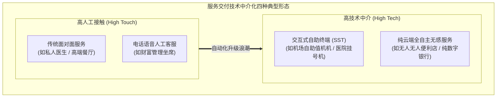

# Lec 15 技术中介服务：自助终端技术、体验边界与自动化摩擦（Technology-Mediated Services: Self-Service Technologies & Friction）

## TL;DR

- 自助服务技术（SST）：ATM 机、无人收银与手机银行重塑服务交付前沿。
- 技术准备度（Technology Readiness Index, TRI）与客户采纳摩擦阻力分析。
- 过度自动化的灾难反噬：当纯技术遭遇极端异常时的“服务冰冷与数字荒漠”。

## 一、自助服务技术（SST）的汹涌浪潮

在过去半个世纪中，技术中介服务（Technology-Mediated Services）彻底颠覆了人与企业的交互方式：
- 20 世纪 70 年代 ATM 自动取款机的问世，被誉为金融服务业最大的运营革命，将柜台现金存取成本直降一个数量级；
- 超市无人自助扫码收银台（Self-Checkout）；
- 航司电子登机牌与人脸识别全流程自助通关；
- 移动端 App 自助挂号、缴费与查询体检报告。

**自助服务技术（Self-Service Technologies, SST）**为企业带来了诱人的财务图景：边际交付成本趋近于零、全天候 24×7 永不停摆、消灭了一线服务员的情绪波动与劳资纠纷。

## 二、技术准备度（TRI）与采纳摩擦（Adoption Friction）

然而，企业管理层最容易犯下的战略错误就是假设“只要我们推出了酷炫的新技术，所有客户都会欢天喜地立刻拥抱”。
帕拉苏拉曼（Parasuraman）提出的**技术准备度指数（Technology Readiness Index, TRI）**表明，人群对新技术的心理态度呈现极其复杂的四维拉扯：
1. **乐观度（Optimism）**：相信技术能带来效率与掌控力；
2. **创新倾向（Innovativeness）**：以抢先尝试最新极客工具为荣；
3. **不适感（Discomfort）**：面对复杂的屏幕交互感到被科技凌辱、害怕弄错；
4. **不安全感（Insecurity）**：极度担忧个人银行卡密码被窃取、隐私面部数据被滥用。

在真实世界中，强推 SST 经常遭遇严重的**自动化摩擦阻力（Automation Friction）**：
- 超市自助收银台因为“商品称重感应器与条码轻微不符”而疯狂报错蜂鸣报警；
- 老年顾客面对复杂的手机 App 菜单束手无策，在冷冰冰的数字界面前产生强烈的社会遗弃感；
- 最终导致自助机前排队的队伍，比原先人工柜台还要漫长数倍！

## 三、过度自动化的反噬：数字荒漠（The Digital Desert）

当企业为了极端削减人力成本，彻底取消人工电话客服、全面由死板弱智的自动语音机器人（IVR）取代理赔或退票入口时，必然引发灾难性的**“数字荒漠危机”**：

::: pitfall [死循环 IVR 迷宫的反噬]
客户遭遇了信用卡被盗刷 10 万元的生死危机，惊恐地拨打银行热线，却被迫在冰冷的语音中按“按 1 普通业务、按 2 贷款咨询……按 0 返回上级”，转了 20 分钟找不到任何人工坐席出口。
这种在危机时刻由冷血算法制造的绝望与暴怒，会瞬间彻底摧毁客户对品牌沉淀十年的全部信任，引发客户在社交媒体发起毁灭性的声讨控诉。
:::

::: theorem [人机协同共生法则（Bionic Service Operations）]
卓越的服务系统必须建立**“技术承载 80% 例行标准化 + 人类专家兜底 20% 极端危机”的无缝混血架构**：
- 打造**“一键呼叫肉身人类（Escape to Human）”逃生通道**：在任何自助机或 App 界面，只要客户连续两次遭遇报错、或检测到语音中出现愤怒恐慌情绪，系统在 3 秒钟内无条件平滑切入高情商真人客服；
- 让算法充当人类专家的超级外骨骼（副驾驶 Copilot），由 AI 在后台毫秒级为一线员工调取解决方案，真正实现“高科技与高温度（High Tech + High Touch）”的完美融合。
:::

## 我的理解

技术从来不应该成为隔绝企业与客户真实呼吸的高墙。盲目沉迷于“消灭所有人类员工、实现 100% 自动化”是技术乌托邦主义的狂妄傲慢。服务最深处的本质，永远是人与人之间基于信任与关怀的连接。最顶级的技术中介服务，是将冷冰冰的代码化作无形的润滑剂，把人类从枯燥机械的重复劳动中解放出来，从而有充沛的精力在最关键的时刻，为同类递上一杯充满温度的热茶。
