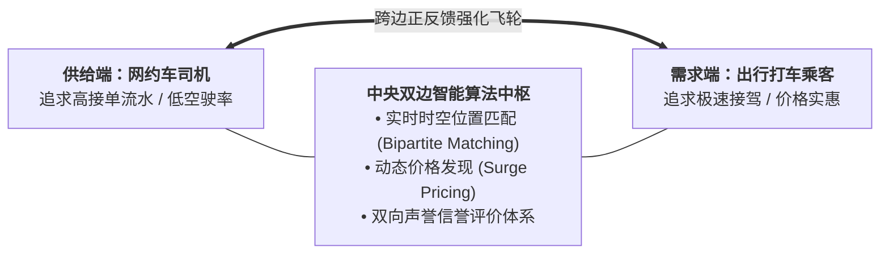

# Lec 16 平台型双边网络服务运营：双边匹配机制与动态溢价（Platform Services Operations: Multi-Sided Matching & Surge Pricing）

## TL;DR

- 双边平台经济学（Two-Sided Platforms）：跨边网络效应（Cross-Side Network Effects）与冷启动困局。
- Uber / 滴滴网约车双边实时匹配算法：空间网格切片（H3/Geohash）与批量清算。
- 动态溢价机制（Surge Pricing）的经济学真相：配额配给还是刺激隐形运力供给？

## 一、双边市场（Two-Sided Markets）的跨边网络效应

以 Uber、滴滴、Airbnb、美团为代表的现代平台型服务企业，其运营模式与传统单向买卖服务企业存在根本性断裂：
- 传统企业拥有自有资产或全职雇员，按线性管道（Pipelines）单向生产服务交付给客户；
- 平台企业本身不拥有一辆出租车、不拥有一间客房，它充当一个**连接独立供给方（司机、房东）与独立需求方（乘客、房客）的双边交互市场中枢**！

双边平台赖以爆发的生命力源泉是**跨边网络外部性（Cross-Side Network Effects）**：
- 平台上的司机数量越多，乘客打车的等待时间越短，吸引越多的乘客涌入平台；
- 乘客越多，司机的接单流水越高、空驶率越低，进一步吸引海量司机加入。
这种正向飞轮效应使得平台一旦跨越临界规模（Critical Mass），将在极短时间内形成“赢家通吃（Winner-Takes-All）”的自然垄断格局。

## 二、网约车毫秒级双边匹配（Matching Algorithm）运筹学

在几万名乘客与几万名司机同时在线的超大型特大城市中，如何完成最优派单？
如果采取早期的“贪心就近派单（Greedy Nearest-Driver）”：
- 只要有乘客下单，立刻指派距离其最近的一辆车；
- 这种短视贪心会导致全网系统陷入灾难性的次优锁死——一辆车为了接 200 米外的短途单，放弃了 400 米外的一张机场跨城高价值大单，最终导致全网总等待时延居高不下。

现代平台普遍采用**高频批量双边匹配（Batch Bipartite Matching）**：

::: theorem [时空网格离散化与二分图最大权匹配]
1. **空间六边形网格切片（Uber H3 / Geohash）**：
   将全城物理空间离散化切分为数万个直径约 500 米的标准正六边形蜂窝单元格；
2. **时间批处理聚合窗口（Batching Window）**：
   将过去 3 到 5 秒内涌入该蜂窝及相邻蜂窝的所有乘客请求集合 $I$ 与可用空闲司机集合 $J$ 进行聚合；
3. **二分图最大权完美匹配（Maximum Weight Bipartite Matching）**：
   构建二分图 $G = (I, J, E)$，弧权重 $w_{ij}$ 综合权衡直线接驾距离、预计到达时间（ETA）、司机星级与平台全局履约率：
   $$\max \sum_{i \in I} \sum_{j \in J} w_{ij} x_{ij} \quad \text{s.t.} \quad \sum_{j} x_{ij} \le 1, \quad \sum_{i} x_{ij} \le 1, \quad x_{ij} \in \{0, 1\}$$
   借助匈牙利算法（Hungarian Algorithm）或 Kuhn-Munkres（KM）网络流快速求解，每 3 秒刷新一次全局最优解，全网接驾效率相比贪心算法直接提升 20% 以上！
:::

## 三、动态溢价（Surge Pricing）的经济学真相

在跨年夜暴雨倾盆的午夜，某热门酒吧街打车需求突发暴涨 10 倍，而街头运力严重不足。
此时系统自动触发**动态溢价（Surge Pricing，加价 1.8 倍至 3.0 倍）**。

很多愤怒的乘客斥责平台是“趁火打劫的无良奸商”。然而，在微观经济学与运筹学视角下，动态溢价的核心功能根本不是“敛财”，而是**最冷酷但最有效的双向资源再平衡中枢**：

1. **抑制需求端非刚需（Demand Rationing）**：
   通过价格杠杆，迫使那些其实可以坐地铁或等半小时再走的价格敏感型乘客放弃打车，将仅存的宝贵即时运力，精准筛选留给那些急需去医院看病或赶飞机的绝对刚需客群；
2. **激励隐性供给端跨区迁徙（Supply Stimulation）**：
   高昂的溢价倍数像一具强烈的经济磁铁，吸引数公里外原本打算收工回家睡觉的司机、或者相邻未溢价区域的空车，飞速向暴雨酒吧街主动迁徙集结！
实证研究表明：一旦取消动态溢价（强行推行平价排队），系统将在 10 分钟内彻底陷入“全城排队数百人、全网零车可用、呼叫接单率暴跌至 5%”的完全系统死锁状态。

## 我的理解

平台型双边网络运营是现代运筹学在数字新经济中的巅峰表演。它向我们展示了一个去中心化生态如何依靠算法实现自组织与自平衡。没有发改委的行政命令，没有传统的自营资产，仅仅依靠二分图网格切片与动态价格弹性这两个杠杆，平台就在混沌的城市时空中建立起高吞吐量的流动秩序。这是数学理性与市场经济看不见的手最优雅的合体。
