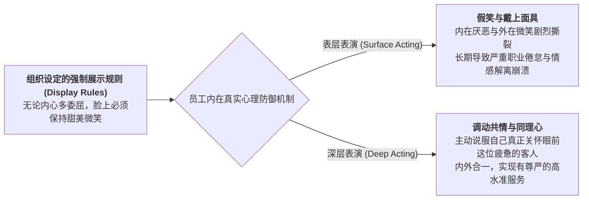

# Lec 17 服务人力资源战略：员工赋权、情感劳动与一线激励机制（Service HR Strategy: Empowerment, Emotional Labor & Incentives）

## TL;DR

- 阿莉·霍克希尔德（Hochschild）情感劳动理论（Emotional Labor）：表层表演与深层表演。
- 员工真诚赋权（True Empowerment）的边界设计：控制型 vs. 承诺型人力资源系统。
- 防范一线职业倦怠（Burnout）与离职率螺旋上升的心理契约治理机制。

## 一、情感劳动（Emotional Labor）的商业资本化

社会学大师阿莉·霍克希尔德在其划时代名著《被统治的心：人类情感的商业化》（The Managed Heart）中，揭示了现代服务业对人类天性最深刻的重塑：
在传统农业时代，农民出卖体力（Physical Labor）；在工业时代，工人出卖机智与操作技术（Technical Labor）；
**而在现代体验经济时代，服务型员工被迫将自己的喜怒哀乐与面部神经全面商品化，出卖自身的情感劳动（Emotional Labor）！**

服务企业通过规章制度，严格向员工规定了**“感受与展示规则（Feeling and Display Rules）”**：
- 空姐被要求“永远保持露出八颗牙齿的空姐式微笑”；
- 银行催收人员被要求“语气必须冷酷威严且不露声色”；
- 迪士尼乐园员工被要求“全天候保持亢奋的快乐”。

## 二、表层表演 vs. 深层表演的组织心理学代价

当企业强制推行死板的微笑标准时，往往引发一线员工的心理崩溃：
1. **表层表演（Surface Acting）**：
   - 员工内心愤怒或极度委屈，但嘴角机械性上扬挤出假笑。心理学证明，长期的表层表演会导致严重的**情绪衰竭（Emotional Exhaustion）、去人性化（Depersonalization）与个人成就感丧失**；员工在下班后产生强烈的虚无感，导致一线年化流失率甚至突破 100%！
2. **深层表演（Deep Acting）**：
   - 员工通过同理心训练，主动将愤怒的顾客想象成“一个在生活中遭遇了巨大不幸、需要被抚慰的脆弱普通人”，从而由内而外地激发出真实的关切之情。深层表演不仅让客户感受到无可挑剔的真诚，更能有效保护员工的心理防线。

## 三、真诚赋权（Empowerment）的系统性边界

许多传统企业采用**“控制型 HR 模式（Control-oriented HR）”**：把员工当贼防，每一个折扣必须找主管审批、每一次打扫必须用打卡机拍照，完全剥夺一线的主体性。
卓越服务组织则推行**“承诺型赋权系统（Commitment-oriented HR）”**：

::: theorem [鲍恩与劳勒（Bowen & Lawler）赋权四大支柱]
赋权绝不是一句口头放权，它必须同时赋予基层四大配套要素：
1. **业务信息（Information）**：让一线员工实时掌握全公司的运营数据、经营成本与客户全景档案；
2. **专业知识（Knowledge）**：提供深度的冲突化解、商务礼仪与突发危机应对培训；
3. **真实权力（Power）**：赋予员工现场调动资金、调整价格、调换房型的法定决策权；
4. **奖酬挂钩（Rewards）**：让员工从每一次主动卓越服务所创造的增量利润中获得公开公正的物质回报。
:::

::: example [西南航空（Southwest Airlines）的文化放飞]
西南航空允许空乘人员在广播安全须知时自由发挥：
空姐可以用说唱 Rap 播报安全指南，机长可以在飞机降落时给全机乘客讲幽默段子。西南航空认为：**与其用死板的 200 条手册把员工驯化成毫无生气的机器人，不如解放他们的个性和幽默感**。这种高度信任与赋权，使得西南航空的一线员工拥有全美民航业最高的敬业度与最低的离职率，进而创造了连续数十年全行业唯一持续盈利的商业神话。
:::

## 我的理解

服务人力资源战略是现代企业最深刻的良心体现。它告诫所有管理者：员工绝不是可以被随意磨损的工业螺丝钉，他们是有血有肉、有尊严有痛苦的独立灵魂。强制假笑换不来长久的客户忠诚，唯有用真诚的制度关怀呵护一线员工的内心世界，赋予他们解决问题的自主武器，员工才能把这份被珍视的温暖，化作对终端客户最发自内心的深情奉献。
