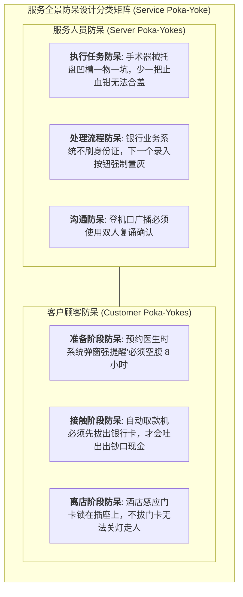

# Lec 18 服务交付质量管控：防呆设计与服务六西格玛（Quality Control in Services: Poka-Yoke & Six Sigma for Services）

## TL;DR

- 从工厂车间向服务业迁移：全面质量管理（TQM）在非标服务中的改造范式。
- 蔡斯与斯图尔特（Chase & Stewart）服务防呆设计（Service Poka-Yoke）全景分类体系。",
- 六西格玛 DMAIC 循环在缩减金融与医疗服务交付流程方差中的实战落地。

## 一、制造业品质工具向服务领域的跃迁困境

六西格玛（Six Sigma）、统计过程控制（SPC）与全面质量管理（TQM）在摩托罗拉和通用电气（GE）的工业流水线上曾缔造了不可思议的零缺陷神话。数十年来，工业工程界通过严格控制原材料公差、机床振动与工装夹具，将产品缺陷率压低至每百万机会仅 3.4 个缺陷（DPMO）的极致境界。

然而，当各大知名跨国咨询公司试图将这套发源于车间机床的工具生搬硬套进银行网点、航空公司、律师事务所和综合医院时，最初普遍遭遇了惨烈的碰壁与抵触。服务业的物理特性决定了其质量控制逻辑与工厂装配存在本质鸿沟：
- **加工对象的本质差异**：工业品是由冰冷、被动的无机材料构成的，工件没有主观意识、没有情绪波动、完全服从力学规律；
- **协同生产的复杂变异**：**服务质量是由“服务人员的操作规范”与“客户的临场配合行为”实时双向碰撞共创而成的！**
- **单边控制的破产**：如果企业单方面死抓“一线服务员零差错”，而对客户自身的粗心大意、随意插队、填错关键凭证、丢失卡片等普遍行为视而不见，整个服务交付系统的端到端品质依然会漏洞百出、投诉不断。

正因如此，现代服务运营工程学必须跳出单纯监控员工的狭隘盲区，开创一套全面覆盖**“服务人员防呆（Server Poka-Yoke）”与“顾客行为防呆（Customer Poka-Yoke）”**的双向容错防御矩阵。这种双向防呆思想的核心哲学，是将“人一定会犯错”作为系统设计的基本前提，在错误即将发生的微观瞬间设置无法逾越的护栏，从而真正达成高可靠性的交付水准：

通过建立这种全景式的防呆防御拓扑，企业能够将质量控制的前沿防线从单纯的事后惩戒与补救，全面前置为流程结构与物理环境的主动引导，从而在根本上杜绝绝大多数人为失误的滋生土壤。

## 二、蔡斯与斯图尔特的服务防呆设计（Poka-Yoke）

丰田新乡重夫开创的“防呆设计（Poka-Yoke）”，由理查德·蔡斯与道格拉斯·斯图尔特系统改造为服务业六大防呆范式：

::: definition [服务防呆六大核心范式]
1. **任务防呆（Task Poka-Yoke）**：
   - 麦当劳炸薯条漏铲：手柄尺寸恰好只能装入规定克重的薯条，杜绝分量偏差；
2. **流程处理防呆（Treatment Poka-Yoke）**：
   - 医生开处方输入药名时，系统基于患者药物过敏史与肝肾功能指标进行毫秒级自动碰撞，一旦发现禁忌配伍，全屏红色死锁报警；
3. **触点沟通防呆（Tangible Poka-Yoke）**：
   - 酒店客房清洁员在收拾完马桶后，在马桶盖上贴上印有“已深度消毒”的纸质封条，向客人提供无可辩驳的物理品质证据；
4. **客户准备防呆（Customer Preparation Poka-Yoke）**：
   - 航空值机邮件明确标注随身行李箱三维尺寸限制并配示意图；
5. **客户接触防呆（Customer Encounter Poka-Yoke）**：
   - **ATM 先拔卡后吐钞**：早期 ATM 吐出现金后，80% 的粗心顾客拿着钱高兴地转身就走，将银行卡忘在卡槽里；现代 ATM 改变物理逻辑：**唯有客人先伸手把银行卡从卡槽拔出，出钞口的铁闸门才允许开启吐出钞票！**
6. **客户离店防呆（Customer Resolution Poka-Yoke）**：
   - 餐厅在顾客买单结账时，顺带附赠一块清口薄荷糖和印有专属 WiFi 密码的下一次优惠券。
:::

## 三、服务六西格玛 DMAIC 循环实战

在复杂金融机构（如信用卡审批、外汇跨境电汇）中，推行 DMAIC 经典五步循环：

| 阶段步骤 | 核心任务 | 金融服务落地实操案例 |
| :--- | :--- | :--- |
| **D (Define)** | 界定关键质量特性（CTQ） | 将客户痛点界定为：“从提交房屋按揭申请到最终放款时延（TAT）” |
| **M (Measure)** | 收集数据与测量系统分析（Gage R&R） | 统计全行 10,000 笔贷款，发现均值 18 天，方差极大（最长甚至长达 45 天） |
| **A (Analyze)** | 识别引发方差波动的根本根因 | 利用鱼骨图与帕累托图，发现 82% 的延误发生在“跨部门人工补充征信材料”环节 |
| **I (Improve)** | 流程重组与数字化消除瓶颈 | 打通公积金与社保大数据接口，实现 90% 资信自动秒级核验 |
| **C (Control)** | 建立控制图（SPC）长效防反弹 | 部署自动化异常预警看板，一旦放款时延超过 3 天自动向上级风控总监告警 |

经过六西格玛重组，全行平均放款时延由 18 天压缩至 2.5 天，流程缺陷率从每百万机会 66,800 个（约 3.0 西格玛）跃升至每百万机会仅 3.4 个（达到令人惊叹的 6.0 西格玛世界水准！）。

## 我的理解

服务质量管控是对“人性脆弱与疏忽”的最温柔庇护。它彻底颠覆了“只要出了事故就开除一线工人”的粗暴懒政思维。真正的质量大师明白：人类一定会犯错、客户一定会粗心分神；卓越的系统设计，绝不是把希望寄托在每个人的全神贯注上，而是用精妙的防呆物理机关与算法闭锁，在错误即将发生的瞬间温柔地将其挡在门外。这是工程理性为凡俗人间构筑的最安全的防线。
