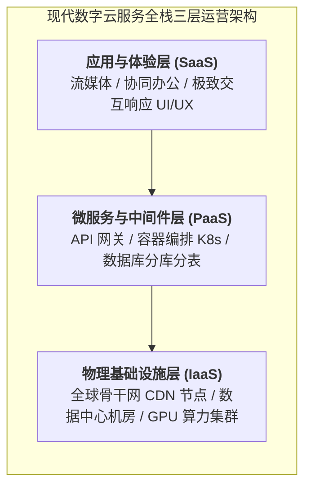
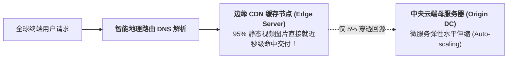

# Lec 19 数字媒体、Web 服务与云计算分布式服务架构运营（Web Services, Cloud Computing & Digital Media Platforms）

## TL;DR

- 现代纯数字服务（Digital Services）运营特征：零物理边际成本与全球瞬间交付。
- 云原生基础设施（AWS / Azure）弹性算力调度与服务等级协议（SLA）九承诺体系。
- 流媒体高并发流转网络（CDN）内容缓存与微服务架构（Microservices）解耦容错。

## 一、纯数字服务（Pure Digital Services）的全新运营维度

当服务交付彻底脱离了物理肉身与砖瓦门店，演变为基于互联网比特流的数字产品（如 Netflix 流媒体、Spotify 音乐、AWS 云计算、SaaS 软件）：
传统运营管理学建立在“物理实体约束”之上的全部假设再次被打破：
- **物理边际生产与分发成本近乎严格为零**：为全世界第 1 个用户提供软件服务需要耗费数千万美元研发成本，而为第 1 亿个用户提供相同服务，边际分发带宽成本仅需几微美分；
- **全球瞬时交付（Instant Global Scale）**：软件可以在几秒钟内通过应用商店推送到全大洲数十亿终端屏幕上；
- **停机的毁灭性代价**：如果亚马逊 AWS 云服务或者全球金融清算网关发生哪怕 10 分钟宕机事故，全网损失的不仅是数千万美元直接交易流水，更是全球现代商业运转的信誉休克！

## 二、高可用性可用性与“几个 9”的 SLA 契约

在云服务与数字外包合同中，最核心的履约衡量标准是**服务可用性（Service Availability）**与**服务等级协议（SLA）**：

::: theorem [高可用性时间停机公式]
系统可用性通常以“9 的数量（Nines of Availability）”进行量化评级：
$$Availability = \frac{MTBF}{MTBF + MTTR} \times 100\%$$
- **99% 可用性（Two Nines）**：全年度允许的最大累计停机时间为 **3.65 天**（粗放不可接受）；
- **99.9% 可用性（Three Nines）**：全年度允许停机时间为 **8.76 小时**（普通企业级基线）；
- **99.99% 可用性（Four Nines）**：全年度允许停机时间骤降为 **52.56 分钟**；
- **99.999% 可用性（Five Nines，电信与金融级终极圣杯）**：**全年度 365 天内，允许的全部故障停机中断总时长不得超过 5.26 分钟！**
:::

为了达成 5 个 9 的严苛指标，现代分布式系统彻底摒弃了“祈祷单台巨型服务器永不坏死”的脆弱幻想，全面转向**“面向失败而设计（Design for Failure）”**的混沌工程架构：
- **无单点故障（No Single Point of Failure, SPOF）**：全链路双活、异地多活灾备；
- **混沌工程主动注入（Chaos Monkey）**：在生产环境随机拔掉服务器网线或关闭数据库集群，强制检验系统的自动故障转移与自愈能力。

## 三、内容分发网络（CDN）与微服务弹性伸缩

面对全球数亿用户同时在线并发请求（如超级碗决赛直播、双十一午夜抢购）：

1. **边缘缓存与反向代理（Edge Caching）**：
   将流媒体音视频和静态资源缓存至全球数千个贴近当地电信运营商的 CDN 边缘机房，用户请求在 10 毫秒内就近完成履约，95% 以上的流量被拦截在边缘，中央母仓完全免遭海啸冲垮；
2. **微服务解耦与熔断限流（Circuit Breaking）**：
   将复杂的单体系统（Monolith）拆解为数十个独立的微服务（如推荐引擎、用户鉴权、支付结算）：
   - 当促销期支付结算服务负载爆满时，系统自动启动**降级熔断机制**（例如暂时关闭非核心的“用户个性化评论推荐”功能，将宝贵算力资源全部锁死留给“支付付款”通道），保障主航道永不瘫痪。

## 我的理解

数字云服务运营是工业工程思想向赛博空间最宏伟的数字映射。在这里，服务器就是机床，带宽就是公路，缓存节点就是前置仓，微服务编排就是柔性装配线。追求“五个 9”的极致可用性，展现了人类工程师在由数亿行代码构成的脆弱虚拟世界中，对抗熵增与混乱的最高秩序意志。它向我们证明：无论商业介质如何从原子跃迁为比特，运营科学追求可靠、高效与韧性的灵魂内核永远坚如磐石。
