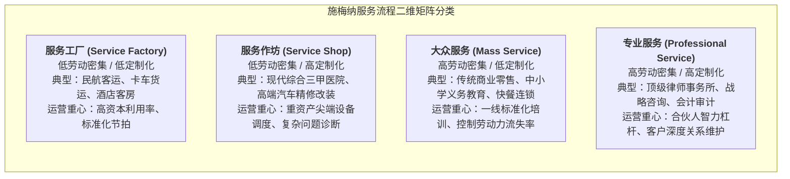
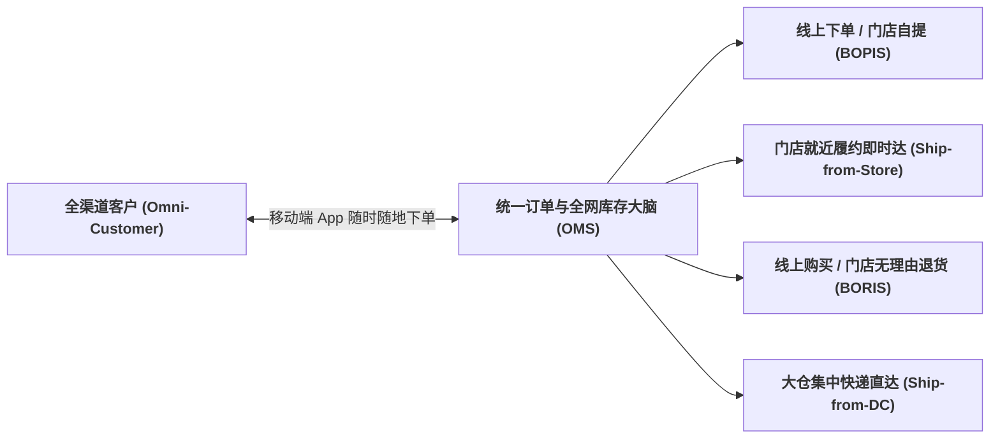

# Lec 2 服务流程设计与全渠道履约机制（Service Process Design & Omnichannel Fulfillment）

## TL;DR

- 施梅纳（Schmenner）服务流程矩阵：劳动力密集度与客户互动定制度的二维分类。
- 从单渠道、多渠道到真正全渠道（Omnichannel）的库存可见度与线上线下履约融合。",
- 实体零售门店转型为微型履约中心（Micro-Fulfillment Centers, MFC）的运营变革。

## 一、施梅纳（Schmenner）服务流程分类矩阵

在面对五花八门的服务业态时，如果缺乏统一的系统分析框架，运营管理者往往容易迷失在具体的业务细节中。罗杰·施梅纳（Roger Schmenner）教授提出的二维分类矩阵，被誉为服务运营管理学中的“元素周期表”。该模型通过两个决定性的经济与流程维度，将错综复杂的服务体系高度凝练为四个截然不同的运营象限：
- **横轴（客户互动与定制化程度，Degree of Interaction & Customization）**：客户在服务交付中介入的深度，以及产品是否因人而异；
- **纵轴（劳动力密集程度，Degree of Labor Intensity）**：企业劳动力成本与固定资产厂房设备投资之间的相对比重。

这套分类模型不仅清晰界定了各类服务的物理属性，更直接指明了企业在流程排程、质量控制、人员激励与数字化技术选型上的根本战略路线：

通过施梅纳矩阵的精准映射，企业能够清醒地审视自身所处的核心运营阵地。在商业实践中，最忌讳的是战略定位与底层流程体系的错配：

企业若试图跨越象限运营（例如试图用“服务工厂”的僵化流程去交付“专业服务”），必然遭遇客户满意度崩溃；而若以“专业服务”的手工作坊模式去交付“大众服务”，则会迅速在失控的人力成本中破产。

## 二、全渠道（Omnichannel）履约革命

随着移动互联网与即时电商的爆发，零售与生活服务经历了三次结构性跃迁：
1. **单渠道（Single-channel）**：传统实体店时代，线下门店与客户物理面对面交易；
2. **多渠道（Multi-channel）**：企业分别设立了实体店和线上电商网站，但两套系统的库存、会员积分和退换货政策完全割裂独立，甚至互相把对方视为抢生意的竞争对手；
3. **全渠道（Omnichannel）**：**彻底打破线上线下的物理壁垒，全网只有一套共享实时库存池！**

## 三、实体门店转型微型履约中心（MFC）

在全渠道战略中，实体门店不再仅仅是供顾客闲逛的“陈列货架”，而是演变为深入城市社区毛细血管的**分布式微型履约中心（Micro-Fulfillment Center, MFC）**：

::: definition [门店发货（Ship-from-Store）的核心运筹权衡]
当一张线上生鲜或快消订单产生时，智能订单管理系统（OMS）动态求解：
究竟是从 50 公里外的郊区中央总仓发顺丰快递，还是直接指派给距离顾客仅 1.5 公里的社区实体门店进行就近外卖众包配送？
- **运费节约**：门店就近配送大幅压缩最后一公里干线运费；
- **库存风险**：门店货架如果被线上拣货员抢空，可能导致进店的线下高价值老顾客遭遇“货架缺货”的恶劣体验；
- **算法防范**：系统设置**动态虚拟安全缓冲（Dynamic Buffer）**——只有当门店可用库存超过线下客流日常消费阈值时，多余库存才向线上算法开放展示。
:::

## 我的理解

服务流程设计的演进，实质上是商业世界在物理空间与数字空间之间的重新缝合。施梅纳矩阵告诫我们认清自己的基因定位，不被盲目的互联网营销冲昏头脑；而全渠道革命则展现了重构存量资产的巨大魅力。一家传统的街头超市，一旦接入全网统一的库存中枢，就瞬间化身为一座高频脉动的微型前置仓。这不仅释放了巨量的周转红利，更为身处存量博弈时代的企业注入了强韧的生命力。
