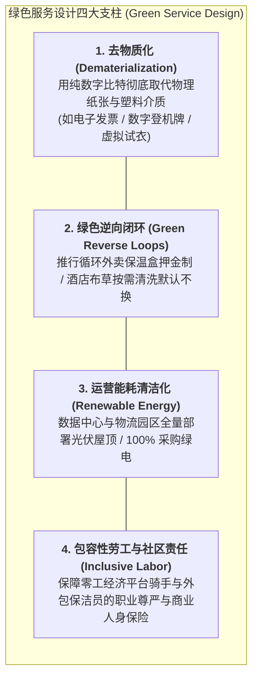
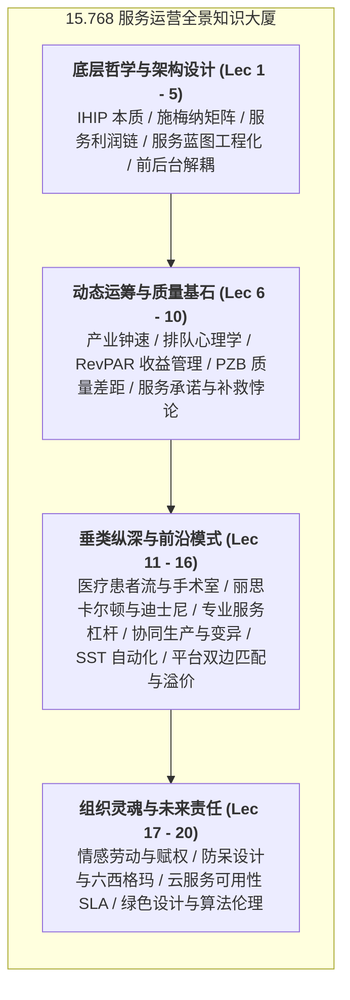

# Lec 20 服务运营的社会责任、绿色服务设计与前沿总结（Sustainable Services, CSR & The Future of Service Operations）

## TL;DR

- 服务经济的双重底线与社会责任（CSR）：从单纯商业盈利向 ESG 治理全面升华。
- 绿色服务设计（Green Service Design）：去物质化（Dematerialization）与碳足迹核算。
- MIT 15.768 全课程终极大盘点：在体验、效率与人性尊严交织的世界中重塑卓越。

## 一、服务业无污染神话的破灭与绿色觉醒

在过去的认知中，人们常常把服务业误以为是“无烟工业、天生天然环保绿色”。
然而，现代可持续运营管理学无情地戳破了这一神话：
- **数据中心碳排放海啸**：全球为运行 AI 大模型、云计算和加密货币挖矿设立的超大型数据中心，其耗电量已经超越了绝大多数中等工业强国的全国用电总量；
- **全渠道物流包装垃圾围城**：每年外卖快餐与即时电商产生的不可降解一次性塑料盒、胶带与气泡膜高达数千万吨；
- **旅游胜地的生态过载与绅士化危机**：过度旅游（Overtourism）彻底破坏了威尼斯、巴厘岛的历史遗迹与珊瑚礁生态。

服务运营必须全面纳入**环境、社会与治理（ESG）三底线框架**，承担起沉甸甸的时代道义。

## 二、平台零工经济（Gig Economy）的社会责任困境

在优步、外卖平台等双边网络中，成百上千万骑手和司机在算法的精密驱使下奔跑在街头巷尾。
然而，传统的管理设计往往将他们定义为“非正式独立承包商”，从而规避为其缴纳法定社会保障与工伤保险。

::: pitfall [算法暴政与社会反弹危机]
算法为了压缩 3 分钟的送餐时延，向骑手下发近乎不可能完成的极限任务，诱使骑手违章闯红灯逆行；一旦发生车祸，算法直接判定扣分扣款。
这种将技术异化为冷血压榨工具的短视运营，已经引发全社会的剧烈道德谴责与各国政府极其严苛的反垄断反算法暴政立法整肃！
:::

卓越的企业正在引领**负责任的算法设计（Ethical Algorithm Design）**：
- 在派单模型中强制嵌入“安全与疲劳阻尼约束”；
- 平台联合政府与保险机构设立“灵活就业人员职业伤害互助共济基金”；
- 赋予一线骑手对不合理扣罚申诉的独立仲裁通道。

## 三、MIT 15.768 全景征程终极大盘点

回顾麻省理工学院 15.768 服务运营管理（Management of Services）的全部宏伟历程，我们系统穿越了现代服务经济最核心的架构图景与前沿探索。从无形性与体验经济的底层哲学出发，我们一步步推演了服务蓝图的工程化图解、前后台解耦的组织分工，深入剖析了排队心理学与收益管理中的数学运筹，并探讨了医疗、酒旅、金融等关键垂直领域的运营智慧。

这门课程向我们清晰地揭示出：卓越的服务运营绝不是空洞的情感口号，而是一套严密自洽、环环相扣的现代管理工程大厦：

这四个层级的知识结构构成了一套完整的服务卓越运营认知闭环。它要求未来的高级管理者既要精通前台体验设计与后台规模化工程，又要在瞬息万变的技术突变中始终坚守对人性和社会伦理的深切关怀。

::: insight
服务运营是一门将科学的严谨与人文的光芒融为一体的崇高学科。它教会我们：**卓越的运营绝不仅是报表上那串冰冷的数字，而是每一个被尊严对待的员工发自内心的微笑，是每一位客户在绝望危机中得到的真诚救助，是整个商业生态在高效运转中散发出的人性温暖**。
:::

## 我的理解

15.768 的课程落幕了，但服务运营的智慧将永远引领我们在商业与人性的交汇处航行。这门课让我们明白：最高级的效率从来不是把人变成冷酷的齿轮，而是建立一套赋能于人的精巧系统，让每一个平凡的个体都能在岗位上绽放出尊严与创造力的光芒。在这个被 AI 与算法狂潮席卷的世界里，唯有对温度的坚守、对伦理的敬畏、对生命的关怀，才是任何技术都永远无法颠覆的终极壁垒。
