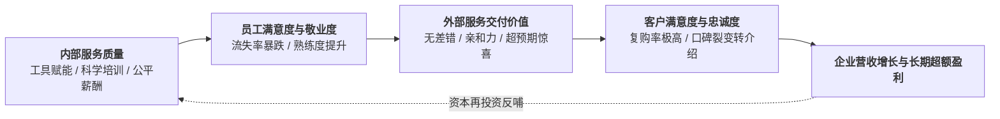

# Lec 3 服务利润链：员工敬业度、客户忠诚与企业盈利逻辑（The Service-Profit Chain: Linking Employee Satisfaction to Profit）

## TL;DR

- 赫斯克特（Heskett）服务利润链（Service-Profit Chain）五大联动因果闭环。
- 内部服务质量（Internal Service Quality）如何驱动一线员工满意度与生产率。
- 从单纯客户满意（Satisfaction）跃迁至真正带来超额盈利的客户忠诚与客户终身价值（LTV）。

## 一、哈佛商学院服务利润链（Service-Profit Chain）模型

哈佛商学院詹姆斯·赫斯克特（James Heskett）、厄尔·萨瑟（Earl Sasser）与伦纳德·施莱辛格（Leonard Schlesinger）于 1994 年提出了著名的**服务利润链（Service-Profit Chain）**。
该理论彻底推翻了传统企业“财务导向、将一线员工视为成本包袱”的陈腐观念，建立了严密的五级因果多米诺骨牌：

::: theorem [服务利润链五大因果联动铁律]
1. **盈利与增长** 主要由 **客户忠诚度（Customer Loyalty）** 直接驱动；
2. **客户忠诚度** 产生于 **客户满意度（Customer Satisfaction）** 的质变；
3. **客户满意度** 决定于 客户接收到的 **服务交付感知价值（Perceived Service Value）**；
4. **服务价值** 完全由 满怀激情且高生产率的 **一线服务员工（Satisfied & Productive Employees）** 所创造；
5. **员工满意度** 最终溯源于 组织给予一线的 **内部服务质量（Internal Service Quality）**（即企业是否把一线员工当成最尊贵的内部客户来精心服务与赋能！）。
:::

## 二、内部服务质量（Internal Service Quality）的制度保障

很多企业天天向一线服务员高喊“客户是上帝”、“微笑服务”，但一线员工却每天忍受着坏掉的 POS 扫码枪、残破的员工休息室、繁琐苛刻的罚款制度和毫无希望的薪资待遇。
这种自相矛盾的虚伪管理必然导致：一线员工带着怨气和委屈上岗，不可避免地将戾气宣泄在终端客户身上！

卓越的服务企业（如西南航空 Southwest Airlines、海底捞、丽思卡尔顿）将 80% 的管理精力放在夯实**内部服务质量**上：
- **工具与权限赋能（Empowerment）**：丽思卡尔顿赋予每一位基层普通服务员每天最高 2000 美元的自主免审批授权，只要能让不满意的客人露出笑容，服务员可以自主决定免单或赠送房晚；
- **完善的后勤保障**：员工食堂伙食标准高于普通餐厅、提供配备空调的专业休息胶囊舱；
- **清晰的晋升通道**：管理层 100% 优先从一线服务员中提拔，坚决不外聘空降不懂业务的傲慢官僚。

## 三、客户满意度与忠诚度的非线性鸿沟

在客户满意度评分中（1 分非常不满，5 分非常满意），传统管理者以为“4 分满意”和“5 分非常满意”差不多。
但萨瑟教授的实证统计数据揭示了一个震撼的残酷事实：
- 打 4 分（基本满意）的客户中，**高达 60% 至 80% 会在竞品降价或促销时毫不犹豫地背叛转投竞品**！
- 唯有打出 5 分（极度满意 / 惊艳赞叹）的客户，其复购率和终身价值（LTV）会呈现出**指数级的爆发性忠诚**！

::: definition [客户终身价值（Customer Lifetime Value, CLV）]
设一个忠诚客户每年为企业贡献的净利润毛利为 $M$，年贴现率为 $r$，年客户留存率（Retention Rate）为 $R$：
$$CLV = \sum_{t=0}^\infty M \cdot \left( \frac{R}{1 + r} \right)^t = M \cdot \frac{1 + r}{1 + r - R}$$
:::

::: example [留存率提升 5% 的倍增奇迹]
若贴现率 $r = 10\%$：
- 当客户年留存率 $R = 80\%$ 时：乘数因子为 $\frac{1.1}{1.1 - 0.8} = \frac{1.1}{0.3} \approx 3.67$；
- 若通过改善一线关怀将留存率仅仅提升 5 个百分点至 $R = 85\%$ 时：乘数因子跃升为 $\frac{1.1}{1.1 - 0.85} = \frac{1.1}{0.25} = 4.40$（CLV 瞬间暴涨 **20%**！）；
- 若留存率达到 $R = 95\%$，乘数因子直接狂飙至 **7.33 倍**（客户终身总利润翻倍！）！
这就是为什么贝恩咨询公司总结的黄金法则：“将客户流失率降低 5%，企业终身利润将激增 25% 至 95%”。
:::

## 我的理解

服务利润链是管理思想史上对“泰勒制冷血工具人假定”的最有力救赎。它以无懈可击的商业财务闭环证明了一个朴素的人道主义真理：**你如何对待你的员工，你的员工就会如何对待你的客户**。企业绝不可能通过压榨一线员工在资本市场上获得真正的基业长青。那些将尊严、信任与工具赋予前沿基层的伟大企业，不仅赢得了员工的终身敬业与客户的至死忠诚，更在商业利润的数字报表上收获了时代最丰厚的奖赏。
