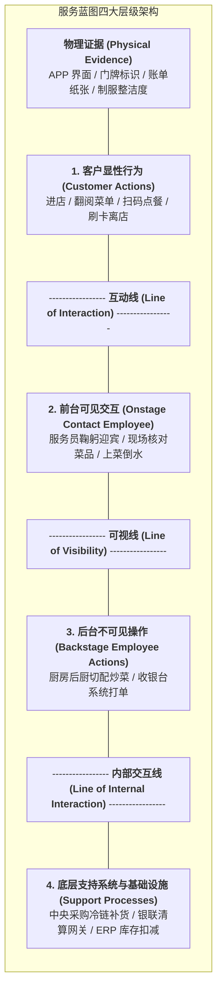

# Lec 4 服务交付系统架构设计与服务蓝图描绘（Service Delivery System Architecture & Service Blueprinting）

## TL;DR

- 将无形服务工程化：林·肖斯塔克（Lynn Shostack）服务蓝图（Service Blueprinting）架构。
- 四大核心分界线：互动线、可视线、内部交互线与支持流程实施线。
- 失败关键点（Fail Points）识别、客户等待时延标注与全流程防呆容错设计。

## 一、服务工程化的终极工具：服务蓝图

对于机械工程师或建筑设计师而言，构建复杂的物理系统必须依赖精确到毫米级甚至微米级的工程总装图纸（CAD/BIM），每一个零部件的公差、接口与装配次序都有严格的标准规范。然而在传统服务运营领域，很多管理者却长期依赖抽象模糊的感性口号——例如“让顾客感受到宾至如归”、“提供极致惊喜体验”等。这种缺乏工程化定义的虚浮表达，往往导致前线服务人员在执行中无所适从、服务品质随员工情绪剧烈波动。

为了彻底终结这种手工作坊式的混沌状态，林·肖斯塔克（G. Lynn Shostack）于 1982 年在《哈佛商业评论》上开创性地提出了**服务蓝图（Service Blueprinting）**方法论。该技术将原本无形、主观且稍纵即逝的端到端服务体验，像工业装配线一样解构为严密的二维结构图谱。

通过将客户的显性行为、前台员工的直接交互、后台支持人员的隐性协同以及底层的 IT 基础设施在统一的时间轴上进行对齐，服务蓝图为企业提供了一套能够被全体员工共同理解、精准执行并持续迭代的工程化作业底座：

服务蓝图的建立打破了企业各职能部门之间的厚重深井。无论是负责前台迎宾的接待员，还是负责后台服务器运维的软件工程师，都能在同一张图纸上清晰定位自己所承担的质量职责与交付节拍。

## 二、服务蓝图的四大水平基准线

一张严谨的服务蓝图通过四条横向分界线，将整个组织的跨职能协作清晰切割：

::: definition [服务蓝图四大核心分割线定义]
1. **互动线（Line of Interaction）**：
   区分“客户自身的独立行为”与“服务企业人员的直接接触点”。只要跨越这条线，即发生一次直接的服务接触（Service Encounter / Moment of Truth）；
2. **可视线（Line of Visibility）**：
   **整个服务蓝图最关键的核心分水岭**！区分客户“肉眼能够看到的所有动作”与“在幕后悄悄进行的操作”。可视线以上是舞台表演，可视线以下是工业化流水线；
3. **内部交互线（Line of Internal Interaction）**：
   区分“直接负责接待客户的业务部门”与“企业内部其他非前线职能部门（如采购、财务、IT 支持）”；
4. **实施支持线（Line of Implementation）**：
   界定纯粹的数字化底层基础设施与硬件支持流程。
:::

## 三、失败关键点（Fail Points）与客户瓶颈诊断

绘制完服务蓝图后，运营专家的核心任务是使用放大镜对整张图谱进行压力审查：

1. **标注失败关键点（Fail Points, 记为 $F$）**：
   识别流程中最容易发生人为疏漏、信息丢失或质量崩塌的脆弱环节（例如：前台点餐员记错忌口需求、线上预约系统没有及时同步后厨库存）；
   - 在每一个 $F$ 点强制引入**防呆设计（Poka-Yoke）**（如点单平板系统在勾选“过敏花生”时弹出全屏警示确认框）；
2. **标注客户等待时延（Bottleneck Delays, 记为 $W$）**：
   客户在哪些环节会被迫坐在位置上空等？若等待时间超过 5 分钟，必须在此处设计转移注意力的心理缓冲（如海底捞等待区的免费美甲和妙脆角）；
3. **优化物理证据（Physical Evidence）**：
   审查每一个可视节点，向客户展示最具信服力的高品质信号（如诊所大厅悬挂的国际认证医师执照、高星级酒店整洁如雪的纯棉浴巾）。

## 我的理解

服务蓝图是服务运营管理者的战略作战地图。它将飘渺虚无的“服务态度”，转化为可以用秒表度量、用看板控制、用流程锁死的硬核工业体系。可视线的划分尤其展现了深邃的管理智慧——把需要情感共鸣与个性化尊重的舞台留给前台，把追求极致规模经济与标准化的脏活累活藏在后台。通过一张蓝图，全公司从保洁阿姨到服务器运维工程师，都能清晰看懂自己的每一个动作如何汇入最终让客户赞叹的璀璨河流。
