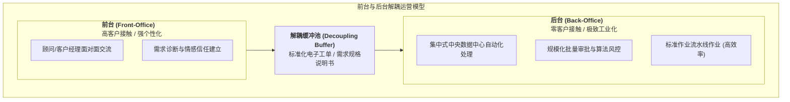

# Lec 5 前台与后台解耦运营与标准化缓冲（Front-Office vs. Back-Office Decoupling & Buffering）

## TL;DR

- 理查德·蔡斯（Richard Chase）客户接触度理论（Customer Contact Model）：接触度越高效率越低。",
- 前台（Front-Office）与后台（Back-Office）物理与逻辑解耦的组织与运筹设计。
- 后台规模经济流水线化与前台个性化定制的最佳解耦缓冲配置。

## 一、客户接触度假说（Customer Contact Hypothesis）

运营管理学大师理查德·蔡斯（Richard Chase）于 1978 年提出了著名的客户接触度理论：
**一个服务运营系统的潜在技术生产率（Potential Operating Efficiency），与客户在服务创建过程中的接触程度成严格反比！**

$$E = 1 - \frac{\text{客户实际卷入系统的时间}}{\text{服务总处理时间}}$$

为什么客户接触会导致效率暴跌？
因为**客户是整个运营系统中最不可控、最充满变异性与噪音的随机干扰源**：
- 客户在银行柜台前磨磨蹭蹭掏不出身份证；
- 客户临时提出稀奇古怪、完全非标的个性化要求；
- 客户情绪激动导致现场服务人员不得不花费半小时进行心理安抚。

如果让高接触度贯穿整个业务全流程，整个企业将永远处于手工作坊式的低效混乱中。

## 二、前后台解耦的战略实施路径

为了兼顾“高品质个性化客户体验”与“低成本规模化工业效率”，现代企业必须坚决推行**前后台彻底解耦（Decoupling Strategy）**：

| 对比维度 | 前台核心特征（Front-Office） | 后台核心特征（Back-Office） |
| :--- | :--- | :--- |
| **客户可见度** | **100% 暴露在客户眼前（舞台）** | **绝对隔离，严禁客户进入（黑盒工厂）** |
| **员工技能模型** | 善于倾听、高情商、同理心、抗压沟通能力 | 专注严谨、打字与计算神速、熟练执行标准化作业 |
| **地理选址策略** | 必须位于租金昂贵的大都市核心商圈、交通枢纽 | **设在租金低廉、电力充沛、人力成本低的远郊或二三线城市** |
| **布局设计逻辑** | 豪华装修、舒适沙发、灯光柔和、注重隐私 | 类似现代无菌工厂或呼叫中心工位，追求空间极致利用率 |
| **管理考核核心** | 客户净推荐值（NPS）、客户满意度、客单价 | **单票处理工时（AHT）、单件处理成本、差错率 PPM** |

::: example [零售银行前后台解耦的经典演进]
在过去，客户去银行网点申请房屋抵押贷款：支行柜员一边和客户聊天，一边当场翻看厚厚的文件、手动计算房产评估值并逐级找支行行长签字，一笔贷款耗时两周且极易出错。
现代解耦改革：
- **前台**：客户经理仅负责端茶倒水、用高拍仪扫描客户材料，利用情感交流建立信任；
- **后台**：所有数字化图像瞬间打散上传至几千公里外的成都或合肥“远程作业共享服务中心（SSC）”；后台数据录入员在无干扰的流水线上以秒为单位快速核对数据，算法自动跑风控模型，**最快在 15 分钟内自动完成贷款授信批复**！
:::

## 三、解耦缓冲池的设计与信息衰减防范

在前后台切开后，两者之间的衔接枢纽是**解耦缓冲（Decoupling Buffer）**：
- **物料缓冲**：如高级餐厅前台服务员从后厨取餐保温传菜台；
- **数字信息缓冲**：如 CRM 系统流转的标准结构化电子工单。

::: pitfall [信息断层与责任推诿陷阱]
解耦带来的最大组织风险是“传声筒效应（Broken Telephone）”：
前台为了讨好客户随意做出过度口头承诺，填写的工单含糊不清；后台按照死板规则拒绝办理，两头互相甩锅。
防范机制：建立严格的**内部服务等级协议（Internal SLA）**，将工单退回率（Kickback Rate）直接计入前台客户经理的考核 KPI，杜绝半成品垃圾信息流入后台流水线。
:::

## 我的理解

前后台解耦是服务运营管理最具实用主义力量的解剖刀。它打破了“要么全手工、要么全机械化”的教条主义死结。优秀的商业模式，绝不是让工程师去直面客户的挑剔，也不是让善解人意的一线客服去从事繁琐复杂的后台计算。把柔情和温度留给前台，把冷酷的算法与规模效率留给后台，用精密的数字管道穿透其间，这是现代商业社会最优雅的分工结晶。
