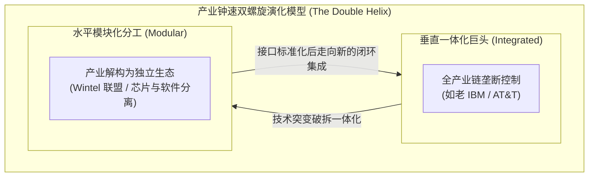
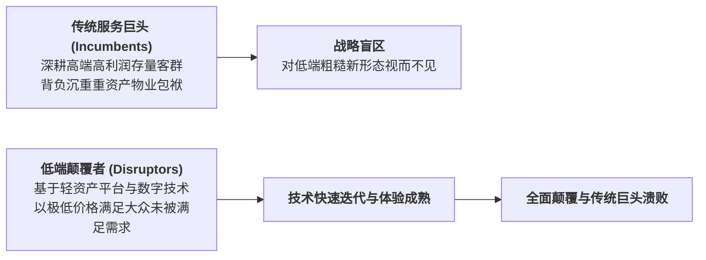

# Lec 6 行业钟速理论、技术突变与服务模式重塑（Strategic Clockspeed and Operational Disruptions）

## TL;DR

- 查尔斯·芬奇（Charles Fine）产业钟速理论（Clockspeed）：产品、流程与组织的三重脉动。
- 破坏性创新（Disruptive Innovation）对传统重资产服务业的颠覆路径分析。
- 技术突变情境下传统服务企业的双元能力（Ambidexterity）与敏捷转型。

## 一、查尔斯·芬奇的产业钟速（Clockspeed）理论

麻省理工学院斯隆管理学院教授查尔斯·芬奇在其开创性著作《钟速》（Clockspeed）中提出：
**不同的产业如同不同的生物物种，其进化、繁衍与灭亡的生命周期节奏（时钟频率）存在数量级的巨大差异！**

- **慢钟速产业（Slow Clockspeed）**：
  典型代表如民航客机制造（波音 737 平台服役超过 50 年）、远洋造船、石化冶炼。其产品生命周期长达数十年，投资回收期极其漫长，组织结构高度稳定保守；
- **中钟速产业（Medium Clockspeed）**：
  汽车制造（传统燃油车每 5 年一次大改款）、传统商业银行；
- **快钟速产业（Fast Clockspeed）**：
  智能手机（每年换代）、短视频社交平台、高频快时尚，其竞争优势的半衰期以月甚至以周计算！

芬奇教授证明：**任何行业都不会永远停留在某一状态，而是在“垂直一体化”与“水平模块化”之间沿着双螺旋轨道不断循环往复交替震荡**。

## 二、破坏性创新对传统服务巨头的屠戮

克莱顿·克里斯坦森（Clayton Christensen）的破坏性创新理论在服务行业反复上演：
- 传统五星级豪华酒店巨头（万豪、希尔顿）多年来沉迷于“延续性创新（Sustaining Innovation）”：采购更奢华的埃及长绒棉床单、聘请米其林名厨入驻，将房价推向普通家庭无法承受的高峰；
- **Airbnb 从低端边缘市场悄然崛起**：起初由于房源参差不齐、没有统一客房清洁标准，被传统酒店高管讥讽为“穷学生的廉价沙发露营”；
- 然而，依托轻资产平台网络效应和去中心化房源供给，Airbnb 在短短数年内房源数量超越全球前十大酒店集团的总和，完成了对传统酒旅服务业的终极颠覆！

## 三、服务企业的双元组织能力（Ambidextrous Organization）

面对快钟速与技术突变的生死存亡威胁，传统服务型企业如何避免成为下一个柯达或百视达？
组织运筹学提出了**双元能力架构（Ambidexterity）**：

::: definition [探索性业务 vs. 利用性业务的双元平衡]
企业必须在同一屋檐下同时运行两套截然相反的运营管理操作系统：
1. **左手深耕“利用性业务（Exploitation Engine）”**：
   负责主营传统基本盘业务（如银行传统线下网点放贷），追求严密的合规、六西格玛精益控制、极低差错率与现金流榨取；
2. **右手孵化“探索性业务（Exploration Engine）”**：
   设立物理与财务完全隔离的独立数字创新子公司或孵化沙盒，采用硅谷敏捷开发、快速试错、容忍 80% 的失败率，全力向云原生、AI 智能体新业务发起自杀式冲锋！
:::

唯有打破单一组织惯性，敢于用自己的右手主动革掉自己左手的命，服务巨头才能在产业钟速的狂飙风暴中获得长青。

## 我的理解

钟速理论是给所有沉醉于过去辉煌的服务企业的一记警钟。商业世界从来没有永恒的避风港。当外部环境的时钟频率从年加速为天时，过去引以为傲的庞大重资产门店，在一夜之间就会变成溺水者的铅块。真正的战略洞察，是能够敏锐感知时代脉动的频率跃迁，敢于在暴风雨来临前主动砸碎舒适圈，用双元组织的韧性在变革的风口上重塑自我。
