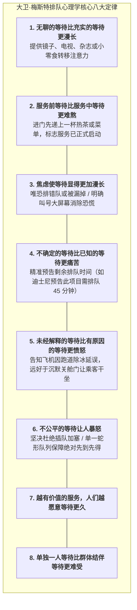
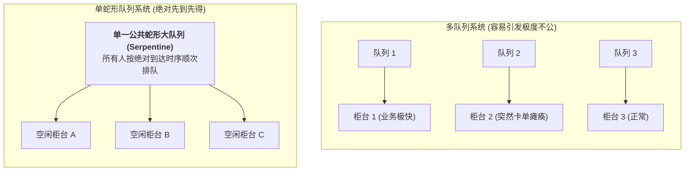

# Lec 7 服务产能规划与排队动力学：等待体验心理学（Service Capacity Planning & Queueing Dynamics: Psychology of Waiting）

## TL;DR

- 大卫·梅斯特（David Maister）排队心理学八大定律：感知时间远比物理时间更重要。
- 排队系统几何拓扑选择：多蛇形单队列（Serpentine Queue）vs. 多服务台分散队列。
- 服务产能错峰调节战术：价格歧视、需求转移与仪式感等待体验设计。

## 一、排队等待体验的心理学本质

在传统运筹学中，工程师痴迷于计算客观物理指标：平均等待时间 $W_q$、队长 $L_q$。
然而，哈佛商学院前教授大卫·梅斯特在其经典论文《等待的心理学》（The Psychology of Waiting Lines）中深刻指出：
**客户对服务满意度的评价，并不取决于秒表上的客观物理时间，而是完全取决于客户在等待过程中的主观心理感知（Perception vs. Expectation）！**

$$\text{心理满意度 (Satisfaction)} = \text{实际感知体验 (Perception)} - \text{心理预期 (Expectation)}$$

如果一个客人以为要等 30 分钟，结果只等了 15 分钟，他会感到由衷的高兴；
如果一个客人被告知“马上就好”，结果等了 10 分钟，他就会怒火中烧、大发雷霆！

深刻掌握这八大心理学定律，能够使运营管理者摆脱单纯依靠盲目扩建硬件设施（增加服务台和雇员）的重资产陷阱，转而通过细腻的认知设计与感官引导，在物理等待时间完全不变甚至略有增加的情况下，大幅提升客户的综合愉悦度与口碑净推荐值。

## 二、排队几何拓扑的运筹学对决：单队列 vs. 多队列

在银行网点、超市收银台或机场安检中，管理层面临核心布局选择：
- **方案 A：多队列多服务台（Multiple Queues）**：每个服务台前面各排一条独立队伍，顾客进门自由选一条排队；
- **方案 B：单蛇形队列多服务台（Single Serpentine Queue）**：所有人排在一条由警戒带隔开的蜿蜒蛇形大队伍中，排在队首的人谁先空出来就去哪个柜台。

### 为什么温迪汉堡（Wendy's）和各家银行全面拥抱单蛇形队列？
1. **彻底消除“倒霉挫败感”**：在多队列中，顾客只要不幸排在了一个“正在办理复杂业务的老人”身后，眼睁睁看着旁边队伍比自己晚来的人一个个全部办完离开，会产生剧烈的不公感；单蛇形队列在数学上严格保证了绝对的先进先出（FIFO）；
2. **消灭多服务台空转**：在多队列中，当某柜台刚巧没人时容易发生短暂空转；单队列保证任何柜台一有空闲瞬间被队首补上；
3. **视觉持续前进感**：蛇形队列由于服务台数量多，队伍每隔几秒钟就会向前迈动几步，给顾客带来“一直在快速前进”的积极心理暗示。

## 三、服务产能的峰谷动态调节战术

由于服务产能不可储存，面对潮汐般的日内与季节性需求波峰波谷，企业必须打出“需求引导与弹性供给”组合拳：

1. **错峰价格歧视（Off-Peak Pricing）**：
   - 电影院周二半价、KTV 下午场白菜价、餐厅夜宵时段满减优惠，将价格敏感型客户有效分流至低谷时段；
2. **虚拟排队与预约制（Virtual Queueing）**：
   - 迪士尼的 FastPass / Disney Genie+：让游客用手机 App 线上领号，在等待的两小时内自由去逛纪念品商店或享用餐饮消费，将原本痛苦死板的站立排队转化为二次商业变现的黄金时间；
3. **跨职能多能工波峰支援（Part-time & Cross-trained Floating Staff）**：
   - 午餐高峰期时，所有经理和后勤主管一秒换上工作服冲向点餐台充当打包员，波峰过后回归办公室。

## 我的理解

排队心理学是人文温度对机械运筹学最生动的纠偏。它证明了：优秀的管理绝不是冷冰冰地追求均值最优化，而是对人类脆弱心理的深刻体察与呵护。一块精准预告时延的电子屏幕、一条杜绝插队的蛇形警戒带、一杯递到等待客户手中的温水，看似微不足道，却能让原本充满焦虑愤怒的漫长等待，化解为充满期待与尊严的美好旅程。
