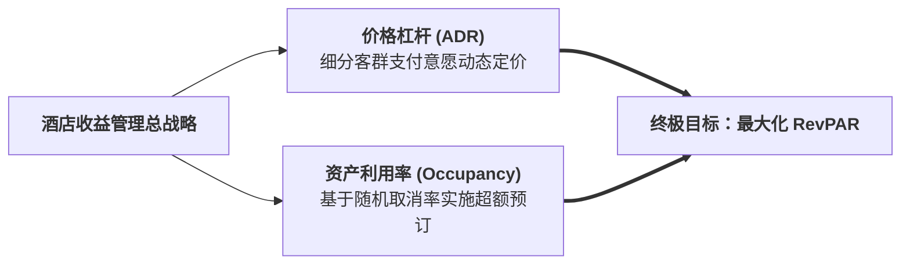

# Lec 8 易腐服务能力的收益管理与动态定价（Yield & Revenue Management in Perishable Services）

## TL;DR

- 酒店客房与演艺票务的核心商业特征：固定物理资产与高固定成本属性。
- 每间可售房收入（RevPAR）与平均每日房价（ADR）财务平衡指标拆解。
- 基于历史入住率曲线与取消率随机动态规划的多天连续连住控制（LOS）。

## 一、酒店酒旅运营的核心财务标尺

在酒店、邮轮、主题乐园与租车服务行业，运营总监每天最重要的晨会就是复盘前一天的收益管理（Revenue Management）指标。
传统的出租率（Occupancy Rate, OCC）和平均房价（Average Daily Rate, ADR）单看任何一个都会产生巨大误导：
- 如果酒店为了追求 100% 满房率，把客房统统按 1 折甩卖，出租率虽然亮眼，但总收入低得可怜，甚至无法覆盖清洁能耗；
- 如果酒店为了维持五星级尊贵形象，死守每晚 2000 元高价绝不打折，结果入住率仅有 20%，80% 的客房空置放凉，同样惨遭巨额亏损。

行业最高权威综合指标是**每间可售房收益（Revenue Per Available Room, RevPAR）**：

::: definition [RevPAR 计算方程与分解]
设酒店总客房数为 $N$，当晚实际售出客房数为 $n$，当晚总客房销售收入为 $TotalRev$：
$$RevPAR = \frac{TotalRev}{N} = \frac{TotalRev}{n} \times \frac{n}{N} = ADR \times Occupancy$$
RevPAR 巧妙地将“价格杠杆（ADR）”与“资产利用率杠杆（Occupancy）”相乘融为一体，成为评估易腐资产变现效率的唯一终极试金石。
:::

## 二、连住限制控制（Length of Stay Controls, LOS）

在单日定价中，由于周末（周五、周六）往往需求极度火爆，而周四和周日相对平淡。
如果酒店采取孤立单日定价：
- 很多只住周五一晚的散客迅速把周五的房间抢购一空；
- 随后，一位打算连续入住四晚（周四至周日）的高价值商务客申请预订时，系统因为周五已无房只能被迫拒单！
- 最终导致周四和周日大量空置，酒店总收益严重受损。

为了解决多天联合预约冲突，收益管理系统必须部署**连住限制控制（LOS Controls）**：

::: theorem [三大经典 LOS 控制策略]
1. **最低连住天数限制（Minimum Length of Stay, MLOS）**：
   在热门假日前夕（如国庆黄金周第一天），强制设定“仅接受连住 3 晚及以上”的预订请求，坚决拒绝单日游离订单；
2. **到达封闭控制（Closed to Arrival, CTA）**：
   在峰值当天设定“禁止作为入住第一天”，迫使希望在该天入住的客人必须从前一天提前入住；
3. **贯通房控动态规划（Full Pattern Allocation）**：
   将整个一周的 7 天时间切片建立动态规划网络，计算每一条连续逗留路径的影子竞价门槛值，确保只有多日总收益超过各单日影子价格总和的长单才能被确认通过。
:::

## 三、在线旅行平台（OTA）博弈与渠道佣金管理

现代酒店服务运营必须在自有渠道（官方微信小程序、官网会员直销）与在线旅行代理商（OTA，如携程、Booking.com、Expedia）之间进行惊心动魄的渠道博弈：
- **OTA 渠道的优劣**：拥有极其庞大的全球流量曝光，能快速帮酒店填补淡季空房；但代价极其昂贵（每笔订单扣取高达 **15% 至 25% 的高昂渠道佣金抽成**！）；
- **自有直销渠道的优劣**：零佣金、且能直接沉淀忠诚会员数据进行二次私域营销；但获客成本高。

::: insight
卓越的收益管理经理人绝不机械地依赖单一渠道，而是动态执行**“渠道围栏限价策略（Channel Fencing）”**：
在淡季空房率高时，果断向 OTA 开放大折扣配额快速回笼现金流；而在旺季预订进度（Pace）显示房源紧张时，立即关闭 OTA 外门配额，将仅剩的宝贵房源全部收拢至自有会员渠道全价直销，彻底摆脱平台中介的盘剥。
:::

## 我的理解

易腐服务资产的收益管理，是运营运筹与微观市场营销结合的最纯粹杰作。它向我们证明：价格从来不应该是一个死板印在墙上的静态标签，而是一条随时间流逝、供需博弈而动态跳动的呼吸曲线。每一间空置的客房都是逝去的财富，而每一个过早低价售出的床位都是对潜在价值的贱卖。懂得在这两者之间驾驭概率的平衡，是在体验经济浪潮中立于不败之地的核心底牌。
