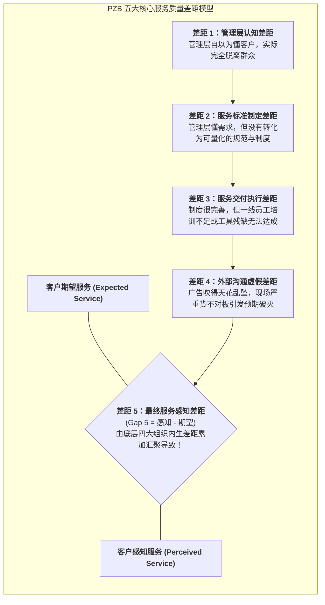

# Lec 9 服务运营分析框架 II：SERVQUAL 质量差距模型（Service Operations Frameworks II: SERVQUAL Quality Gap Model）

## TL;DR

- 帕拉苏拉曼（Parasuraman）、泽丝曼尔（Zeithaml）与贝利（Berry）PZB 质量差距体系。
- SERVQUAL 评估五大维度：有形性、可靠性、响应性、保证性与同理心（RATER）。
- 诊断并闭环修复从管理认知差距（Gap 1）到交付感知差距（Gap 5）的组织机制。

## 一、服务质量的本质是“期望与感知的差距”

在传统的机械制造与离散工业中，产品质量的判定标准是高度客观且外在的：钢板的厚度公差是否在微米级别以内、芯片的坏点率是否符合出厂规格。只要符合既定的工程图纸，产品质量即被视为合格。

然而在高度依赖人际交互与主观体验的服务运营领域，质量从来不是一个孤立存在的物理属性，而是**客户心中的“期望服务水平（Expected Service）”与其在实际接触中所体会到的“感知服务水平（Perceived Service）”之间的相对心理落差函数**。即使一家餐厅的菜品与环境完全符合卫生标准，但如果顾客事前预期这是一家米其林三星水准的殿堂级餐厅，其最终感知依然会是一场惨痛的质量滑铁卢。

由 A. Parasuraman, Valarie Zeithaml 和 Leonard Berry 三位管理学教授于 1985 年开创的 **PZB 服务质量差距模型（5-Gaps Model）**，首次在学术与工业界建立了一套系统化的病理学诊断框架。该模型深入企业组织肌体内部，精准剖析了导致最终客户满意度赤字（差距 5）的四大底层组织断层：

这套差距分析体系彻底改变了企业诊断服务缺陷的思维逻辑。它清晰地表明：外部可见的客户差评和流失，从来不是单一环节的突发偶然事故，而是企业内部从战略定位、标准制定到一线执行全流程系统性失调的必然表征。在现代服务运营审计中，该模型要求管理层不仅要向外看，更要向内看。许多企业在遭遇客户大量流失时，第一反应往往是斥责一线员工态度恶劣；但经过差距模型的深度解构后，人们往往惊讶地发现，真正的病灶几乎总是潜伏在高层认知盲区和前后端协同机制的断裂之中。通过逐一排查各个子差距，企业才能实现从根因层面杜绝服务质量的滑坡。

## 二、底层四大组织差距（Gaps 1-4）的根因与手术刀

最终让客户愤怒投诉的**差距 5（服务质量感知赤字）**，从来不是偶然发生的，它必然是企业内部四处溃烂的必然产物：

1. **差距 1：管理层认知差距（Management Perception Gap）**：
   - **症状**：高管天天坐在顶层大理石办公室里看报表，自以为客户最看重的是“豪华大堂”，而客户真正痛苦的是“开发票需要排队半小时”；
   - **解药**：推行高管一线轮岗（走动式管理），建立制度化的客户深入田野访谈与吐槽吐槽热线直通车；
2. **差距 2：标准制定差距（Service Standards Gap）**：
   - **症状**：公司虽然知道了客户想快，却含糊地写出“请大家动作麻利点”这种毫无操作性的废话；
   - **解药**：将客户期望转化为硬核量化的**服务水平协议（SLA）**（如“呼叫中心响铃不得超过 3 声”、“急诊患者从进门到完成心电图不得超过 8 分钟”）；
3. **差距 3：服务交付差距（Service Delivery Gap）**：
   - **症状**：标准定得非常清晰，但一线员工因为疲劳过度、缺乏系统权限、工具落后频频卡单，导致实际操作无法达标；
   - **解药**：落实前后台解耦、提供趁手的现代工具，优化员工排班降低职业倦怠；
4. **差距 4：外部沟通差距（Communication Gap）**：
   - **症状**：市场营销部门为了冲业绩，在广告中吹嘘“随叫随到、宾至如归”；客户满怀超高期望进店，发现服务其实中规中矩，但因落差巨大愤而给出差评；
   - **解药**：市场宣传必须恪守**“保守承诺、超额交付（Under-promise, Over-deliver）”**的底线纪律！

## 三、SERVQUAL 五大度量维度（RATER 量表）

为了量化测评服务质量，PZB 设计了著名的 **RATER 22 项量表矩阵**：

| 维度代码 | 核心考察维度 | 客户内心深处的拷问标准 |
| :--- | :--- | :--- |
| **R (Reliability)** | **可靠性（最核心维度！）** | 企业是否言而有信、准时履约、账单分毫不差？ |
| **A (Assurance)** | **保证性 / 专业度** | 一线员工是否具备深厚专业知识、举止是否让人感到安全信赖？ |
| **T (Tangibles)** | **有形性物理证据** | 设施设备是否现代高端、员工制服是否整洁、宣传材料是否精致？ |
| **E (Empathy)** | **同理心 / 关怀感** | 员工是否真诚理解我的特殊困难、是否提供一对一的个性化关怀？ |
| **R (Responsiveness)** | **响应性 / 敏捷度** | 遇到突发问题时，员工是否热情主动、迅速行动而非踢皮球？ |

统计研究表明：在所有维度中，**可靠性（Reliability）永远以超过 40% 的权重绝对压倒其他所有维度**。如果企业连最基础的准时和不出差错都做不到，再光鲜的有形装修和满脸堆笑都只是毫无意义的伪装。

## 我的理解

SERVQUAL 模型是现代服务运营管理中最清醒的一面照妖镜。它彻底打破了传统官僚体系中“把服务质量不好归咎于一线员工笨”的甩锅恶习。它无情地揭示出：客户的每一次差评，本质上都是由于管理层脱离实际、标准缺乏量化、虚假宣传过度营销等组织系统性腐化所造成的必然代价。修补服务质量，必须从管理层的自我审判开始，这是一场全链路的组织灵魂重塑。
