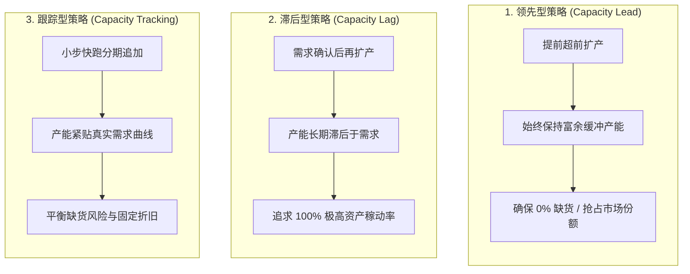

# Lec 10 产能战略与扩张时机决策（Capacity Strategy & Expansion Timing）

## TL;DR

- 产能扩张战略存在领先型（Capacity Lead）、滞后型（Capacity Lag）与跟踪型（Capacity Tracking）三大经典时序路径。
- 规模经济与规模不经济的交点确立了最优工厂规模（MES），大额资本开支的块状投入（Chunkiness）引发利用率震荡。
- 在双寡头或寡头博弈中，先发抢占式产能扩张（Preemption）具备战略威慑力，但也承担着极高的沉没退出壁垒。

## 一、产能扩张的三大经典时序战略

在资产密集型行业（如半导体制造、动力电池、民用航空与重化工），产能投资是影响企业生死存亡的关键战略决策。企业的产能供给与不可预测的市场需求之间，必然存在动态的时间差与规模差。

根据新增产能释放时点与市场需求增长曲线的相对位置，存在三种经典的扩张时序战略：

### 1. 领先型策略（Capacity Lead Strategy）
- **核心逻辑**：在市场需求释放之前，提前建设超额产能，始终保持正向产能缓冲（Capacity Cushion）。
- **优势**：保证 100% 现货供应，在需求爆发时迅速挤占竞对份额；为生产线提供充分的计划柔性与预防性维护窗口。
- **风险**：若市场需求未如预期爆发，庞大的固定资产折旧将严重拖垮净资产收益率（ROE）。

### 2. 滞后型策略（Capacity Lag Strategy）
- **核心逻辑**：等待实际需求已被市场销售数据完全证实后，才追加投资扩建。在扩建完成前，企业依靠加班、委外代工或积压订单（Backorders）应对。
- **优势**：资本投资确定性极高，工厂设备稼动率（Utilization）常年维持在 95% 以上，财务下行风险极小。
- **风险**：长期缺货将迫使不耐烦的客户转向竞争对手，导致永久性市场份额丢失。

### 3. 跟踪型策略（Capacity Tracking Strategy）
- **核心逻辑**：采用模块化、轻量化的方式小幅、高频追加产能，使产能阶梯状增长尽量紧贴需求斜率。
- **优势**：在缺货损失与闲置成本之间寻找动态折中。

::: definition [产能缓冲度（Capacity Cushion）]
产能缓冲度定义为理论设计产能相对于预期平均需求的富余比例：
$$\text{Capacity Cushion} = \frac{\text{有效设计产能} - \text{预期平均需求}}{\text{有效设计产能}} \times 100\%$$
在高定制、快速时钟与高溢价行业，产能缓冲度通常维持在 15%-25%；在大宗低毛利行业，该指标往往压缩至 5% 以下。
:::

## 二、规模经济、规模不经济与最小有效规模（MES）

在单厂规模决策中，管理层必须平衡规模经济与规模不经济的非线性博弈：

- **规模经济（Economies of Scale）的驱动力**：固定建设成本的分摊（如化工厂储罐体积按立方增加，而钢板表面积按平方增加的“0.6 次方法则”）、专用高效超大装备的引入、大宗采购议价权。
- **规模不经济（Diseconomies of Scale）的惩罚**：厂区内部物流搬运距离指数级拉长、车间层级官僚化导致的沟通扭曲、工人归属感丧失引发的怠工、局部环境污染治理成本飙升。

两者的叠加使得长期平均成本曲线（LRAC）呈现经典的 U 型结构。曲线最低点对应的产量即为**最小有效规模（Minimum Efficient Scale, MES）**。企业新建工厂规模若显著低于 MES，将面临结构性的成本劣势；若盲目超越 MES，则会跌入内部管理失控的泥潭。

## 三、资本投入的块状性（Chunkiness）与抢先博弈（Preemption）

在现实物理世界中，产能投资具有不可分割的“块状性（Chunkiness）”。半导体前道晶圆厂无法以 5% 的增量平滑建设，一座先进晶圆厂的准入门槛往往是 100 亿至 200 亿美元。

在寡头垄断行业中，产能扩张往往转化为一场惊心动魄的非完全信息动态博弈（Dixit 抢先扩产博弈模型）：
- **战略威慑（Credible Threat）**：率先公开宣布并动工不可逆的巨额产能，能够向行业释放强烈的降价威慑信号，迫使处于摇摆状态的追随者放弃扩产计划。
- **公地悲剧与踩踏式过剩**：若博弈各方均试图通过抢建产能吓退对手，且谁也不愿率先刹车，行业将瞬间陷入全行业大萧条与毁灭性价格战（如液晶面板与存储芯片的超级周期波谷）。

::: pitfall [100% 稼动率迷思（The 100% Utilization Fallacy）]
财务分析师往往本能地偏爱 100% 的设备利用率。然而，根据排队论（Queueing Theory）的基本定律，当生产系统的利用率逼近 100% 时，由于到达与加工过程的随机波动，工件的等待时间将趋于无穷大！追求账面的全满负荷，其代价是交付周期的无限延长与客户满意度的崩塌。
:::

## 我的理解

产能决策是企业最昂贵的战略承诺之一，需要建立严密的实物期权与系统动力学思维。

1. **将产能视为实物期权（Real Options）**：在重资产投资时，应当采取“分阶段下注（Phased Staging）”策略。例如先期买下整块地皮并完成地基和动力机房等基础设施施工（持有看涨期权），内部产线根据市场实际吸收能力以每季度一个独立模块逐步装配点亮。
2. **算力基础设施中的容量规划映射**：现代企业在采购 GPU 训练集群时面临完全相同的容量权衡。盲目一次性采购万卡集群可能遭遇下一代架构能效倍增的贬值风险（硬件折旧断崖）；而单纯依赖公有云按需计费在长期高并发下又极其昂贵。构建“核心基础负载自建 + 峰值突发负载混合云外溢”的架构，正是产能战略的经典映射。
3. **产能退出的治理智慧**：优秀的运营领导者不仅知道何时高歌猛进扩产，更知道在行业进入存量博弈时如何体面收缩。通过与资产管理机构合作推行售后回租（Sale-and-Leaseback）或提前签订柔性转产协议，能为企业在寒冬来临时保留宝贵的现金流生命线。
