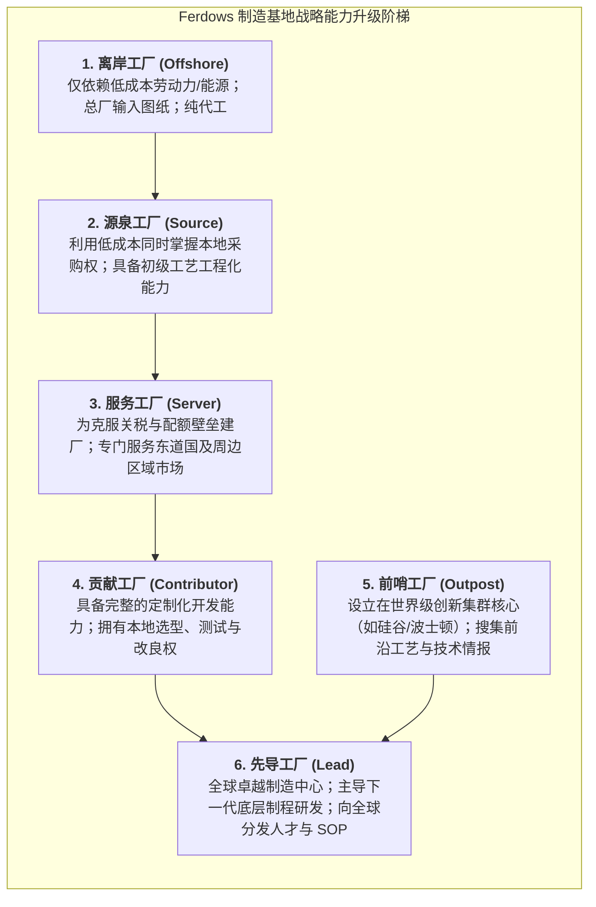

# Lec 11 设施选址战略与全球生产率对标（Facilities Strategies & Global Plant Productivity）

## TL;DR

- 跨国制造选址决策必须从单纯的表面名义人工成本，转向综合考量关税、物流与全生命周期拥有总成本（TCO）。
- 费多斯海外工厂战略角色六阶段演进模型（离岸、源泉、服务、贡献、前哨、先导）揭示了海外制造基地的职能升级。
- 全要素生产率（TFP）对标要求剔除资本密集度与汇率扰动，深入解构生产技术效率与纯管理效率的底层差异。

## 一、全球制造选址：超越表面劳动力成本的 TCO 框架

跨国公司在进行全球工厂选址与供应链布局时，历史上最常犯的战略幼稚病是“逐水草而居”——哪里的法定每小时人工工资低，就盲目将工厂迁移至何处。

波士顿咨询集团（BCG）与哈佛商学院的研究表明，表面人工成本往往仅占复杂工业品总制造成本的 10%-20%。一个连贯的设施选址评估必须建立在**全生命周期拥有总成本（Total Cost of Ownership, TCO）**模型之上：

$$C_{\text{TCO}} = C_{\text{直接制造成本}} + C_{\text{物流运费与港杂}} + C_{\text{关税与合规税赋}} + C_{\text{在途库存资金占用}} + C_{\text{沟通摩擦与质量纠偏}} + C_{\text{地缘政治与断链风险溢价}}$$

::: definition [总拥有成本（Total Cost of Ownership, TCO）]
指跨国采购或海外建厂全生命周期中所产生的显性支出（物料、直接工时、货运、关税）与隐性摩擦损耗（质量返修、汇率波动、知识产权诉讼、供应链安全冗余库存）的总和。
:::

### 选址评估的四大关键维度
1. **要素成本与供应链聚集度（Factor & Ecosystem）**：不仅考察劳动力工资，更关键的是二级/三级零部件配套半径。如果核心元器件需要跨洋运输，远距离物流费用与在途在制品（WIP）将彻底抹平本地劳动力差价。
2. **基础设施与物流可靠性（Infrastructure）**：电网稳定性、港口通关吞吐能力、深水码头吃水深度与高速公路骨干网络。
3. **法律、合规与知识产权保护（Institutions & IP）**：政策稳定度、资本自由进出境审查、司法仲裁独立性。
4. **地缘政治与宏观经济对冲（Geopolitical & Macro）**：东道国双边贸易协定、外汇汇率波动风险、关税原产地规则（Rules of Origin）。

## 二、费多斯（Ferdows）海外工厂六大战略角色演进模型

麻省理工学院客座教授卡斯拉·费多斯（Kasra Ferdows）提出了享誉管理学界的海外工厂角色演化模型。他指出，跨国巨头切忌将海外工厂永远固化为低端的“血汗工厂”，而应根据**工厂战略理由（获取低成本要素、接近市场、获取本地专有技术）**与**工厂现场技术管理能力范围（制造执行、流程工程化、产品研发主导）**，推动工厂向高价值阶梯演化：

::: example [中国代工基地向贡献工厂与先导工厂的华丽蜕变]
苹果供应链企业（如立讯精密、蓝思科技）早期的工厂属于典型的“离岸工厂”，按照富士康与苹果加州总部的图纸严格作业。随着二十年来的深度工程研发投入，这些工厂已全面跃升为“先导工厂”。当苹果研发 Apple Vision Pro 等高复杂度产品时，苹果设计团队必须常驻这些工厂的车间现场，共同攻克微米级贴合与高精度曲面成型工艺。
:::

## 三、工厂全要素生产率（TFP）的严谨对标

跨国高管在评估全球各工厂绩效时，常常被“名义人均产值”所误导。发达国家工厂由于自动化程度高，人均产出必然大幅高于发展中国家人工工厂，但并不意味着其运营更为卓越。

为了实现跨国界、跨工艺的客观对标，必须采用经济学中的**全要素生产率（Total Factor Productivity, TFP）**与**数据包络分析（Data Envelopment Analysis, DEA）**：
- **生产率前沿面（Production Frontier）**：构建综合投入向量（劳动力工时、固定资本存量、能源消耗、物料消耗）与产出向量（合格品件数、附加值金额）。
- **效率解构**：将生产率差异精确拆解为**技术进步变化（Technological Change，技术前沿的外移）**与**技术效率变化（Technical Efficiency，追赶前沿面的管理能力）**。

::: pitfall [单一产出指标导致的工厂管理扭曲]
若总部仅以“单位产品制造成本”单一指标考核海外厂长，厂长为了降低账面分摊成本，必然会倾向于隐瞒设备隐患、削减预防性维护保养预算，并大量排产过量非急需库存。这种短视行为在 1-2 年内能交出漂亮的报表，但随后会导致工厂设备性能断崖式坍塌。
:::

## 我的理解

全球设施选址是一盘复杂的空间经济学棋局，考量的是管理层的全局系统观。

1. **产业生态集群的重力场效应**：永远不要低估供应链物理邻近性的力量。在珠三角或长三角，一个智能硬件团队可以在两小时车程内找到数十家精密模具、SMT 贴片、五金冲压与包装印刷供应商，两周内完成十轮硬件迭代。脱离了这一密集重力场的荒野选址，即便名义地皮与工人工资再便宜，其漫长沟通所丧失的市场先机也是不可挽回的。
2. **前哨工厂的信息雷达价值**：即使某地的制造成本极其高昂，建立一座规模适度的小型“前哨工厂”依然极具战略价值。它能让你的工程团队直接浸泡在世界顶级学术界、先锋创业团队与尖端仪器展会的生态圈中，第一时间嗅探到范式转移的微风。
3. **逆全球化背景下的分布式韧性网络**：过去三十年追求的全球单一超大工厂模式已成为历史。未来的设施战略必然走向“中国+1”或“分布式多中心”拓扑。构建能够快速跨厂转移治具、软件配方与测试脚本的模块化网络，是抵御地缘风险的唯一破局之道。
