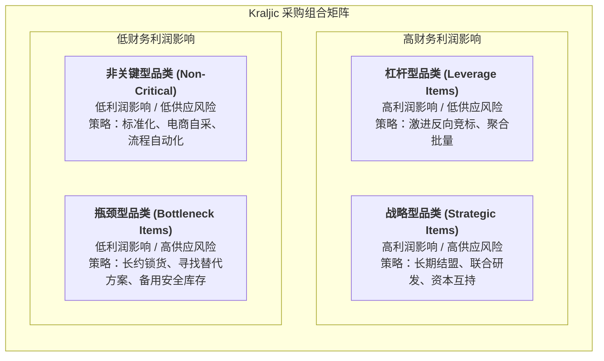

# Lec 13 战略寻源与供应商关系管理（Strategic Sourcing & Supplier Management）

## TL;DR

- 卡拉杰克采购组合矩阵（Kraljic Matrix）依据财务影响与供应风险，将采购品类科学划分为四大战略象限。
- 不同象限适用截然不同的寻源打法：从非关键品的极致自动化，到战略物料的长期联合研发与资本绑定。
- 供应商早期介入（ESI）打破了传统串行图纸招标的壁垒，通过并行工程大幅压缩产品开发周期与全生命周期采购成本。

## 一、卡拉杰克采购组合矩阵（Kraljic Portfolio Matrix）

采购在历史上常被狭隘地定义为“砍价的事务性行政岗位”。1983 年彼得·卡拉杰克（Peter Kraljic）在《哈佛商业评论》上发表了划时代的文章《采购必须成为供应链管理》，确立了现代战略寻源（Strategic Sourcing）的分析范式。

卡拉杰克将企业采购的所有物料与服务，按照两个核心维度进行象限归类：**对财务利润的影响度（Profit Impact）**与**市场供应风险度（Supply Risk）**：

### 1. 非关键型品类（Non-Critical Items）
- **特征**：标准办公用品、通用消耗品（MRO）。单件金额极低，供应商极多。
- **战略重心**：**降低交易行政流程成本**。推行电子采购系统（e-Procurement）、企业内购商城与供应商集成结算，严禁采购员将宝贵时间浪费在琐碎比价上。

### 2. 杠杆型品类（Leverage Items）
- **特征**：大宗原材料、标准紧固件、通用商品芯片。消耗金额巨大，但市场上存在多家资质合格的完全竞争替代供应商。
- **战略重心**：**极致压榨价格，最大化成本节约**。采用全球聚合采购（Volume Pooling）、反向动态拍卖（Reverse Auctions）与短周期滚动招标。

### 3. 瓶颈型品类（Bottleneck Items）
- **特征**：特种备品备件、专有涂层材料。采购总金额不大，但技术规格单一或受专利垄断，市场上仅有 1-2 家供应商供货。一旦断货，将导致全厂停机。
- **战略重心**：**保障供给安全**。签订高溢价长期照付不议（Take-or-pay）保障合同，保有超额安全库存，组织工程团队全力攻关替代材料方案。

### 4. 战略型品类（Strategic Items）
- **特征**：智能手机核心 SoC、纯电动力总成、飞机发动机叶片。占产品总 BOM 成本极高，且技术门槛极高，与单一核心供应商休戚与共。
- **战略重心**：**构建高信任共赢伙伴关系**。跨越简单的买卖合约，推行高管定期互访、技术共研与联合风险分担机制。

## 二、供应商早期介入（ESI）与并行价值工程

传统的工业研发流程往往是僵化串行的“隔墙投掷”（Over-the-wall approach）：产品设计师关起门来画完详细图纸，然后将公差极严、结构怪异的图纸扔给采购部去市场寻价。供应商拿到图纸后，发现许多设计脱离了实际模具制造的物理可行性，导致废品率极高、采购报价居高不下。

**供应商早期介入（Early Supplier Involvement, ESI）**将核心供应商的资深工艺工程师直接拉入新产品开发（NPI）概念设计团队：

- **白盒开发（White-box Sourcing）**：采购方与供应商工程团队并肩工作，共同敲定产品架构与制造工艺，共享完全透明的 BOM 成本结构（Open-book Costing）。
- **黑盒开发（Black-box Sourcing）**：采购方仅定义产品的外部机械/电气接口与性能技术指标，内部详细实现方案完全授权供应商发挥其专业所长。
- **面向制造与装配的设计（DfMA）优化**：供应商在草图阶段即指出何处可以通过减少零件数量、优化拔模斜度来大幅缩减冲压与注塑成本。

::: example [丰田目标成本法（Genka Kikaku）与供应商协同降本]
丰田在开发新车型时，绝不会向电装（Denso）或爱信（Aisin）单向施压强令“降价 20%”。丰田的做法是：首先确立市场可接受的整车零售价，扣除预留目标净利润后，分解出各子系统的“允许目标成本”（Allowable Cost）。
随后，丰田派出自身经验最丰富的精益制造专家入驻供应商车间现场，共同分析加工工序、排查搬运与停机浪费。通过联合价值工程（Value Engineering）帮供应商把真实制造成本降下来，确保供应商在压低售价的同时依然保有健康的利润率。
:::

## 三、全面采购成本（Total Cost of Acquisition）与绩效综合审计

优秀的战略寻源体系绝不看供应商的初次单价（Unit Price），而是综合衡量**全面获取成本（Total Cost of Acquisition, TCA）**：

- **前期资质审核与协同成本**：现场验厂审核开支、联合调试试模成本、试产报废补偿。
- **运行履约成本**：来料批次合格率（PPM 缺陷率）、准时交货率（OTD）、EDI 接口对接维护费。
- **售后与失效成本**：因外购件缺陷引发的客户终端质量索赔与召回连带责任。

::: pitfall [对战略供应商推行无底线零和博弈砍价]
一些采购主管为了完成当季度的个人 KPI，对深度绑定的战略级独家供应商采取野蛮压价甚至恶意拖欠货款。这种零和博弈必然引发恶性反噬：供应商被迫在隐蔽工序偷工减料、降低巡检标准，或将最优秀的工程骨干抽调给更具诚意的其他客户，最终导致企业在关键时刻遭遇断供与严重质量危机。
:::

## 我的理解

战略寻源与采购管理体现了商业组织在边界内外的协同艺术。

1. **采购即组织的外延工程能力**：现代科技企业的研发人员数量往往远少于上游供应链工程师的总和。把供应商视为外部雇佣的技术大军，通过清晰的接口规范与公允的激励机制撬动全球最聪明的头脑为你的产品创新服务，是轻资产高杠杆运作的精髓。
2. **Kraljic 矩阵的动态迁移防守**：永远不要让自身的关键零部件长期停留在“瓶颈象限”。如果某种原材料被单一巨头垄断，研发部门的首要攻关任务就是修改设计标准或推动第二供应商合规认证，果断将其拉回“杠杆象限”，重新夺回商业议价主动权。
3. **数据透明建立真实信任**：真正的供应链协同必须建立在实时数据共享的底座上。将企业自身的 MES 产线排产看板与供应商的 ERP 系统 API 打通，实现库存消耗毫秒级反向触发补货，才能彻底终结相互猜忌的牛鞭效应。
