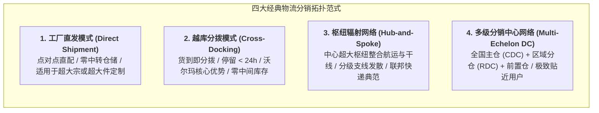

# Lec 15 物流系统与全渠道履约网络（Logistics Systems & Fulfillment Supply Chain）

## TL;DR

- 仓储是静止的库存，物流是运动的库存；配送网络拓扑构成了履约速度与单位运输成本的核心权衡。
- 全渠道零售颠覆了传统单一分销链条，微型前置仓、门店履约与智能暗仓重构了最后一公里的单位经济模型。
- 延迟制造策略（Postponement）通过在物流枢纽完成最终定制与打包，从数学上大幅平抑需求方差风险。

## 一、物流网络拓扑结构的经典范式权衡

物流与分销系统是连接生产工厂与终端消费者的物理动脉。在物流系统的网络拓扑规划中，架构师必须在**库存持有成本（Inventory Holding Cost）**、**干线运输成本（Inbound Freight）**、**终端配送成本（Last-mile Delivery）**与**订单交付时效（Order Lead Time）**之间进行全局权衡：

### 1. 越库作业（Cross-Docking）的运营魔力
作为沃尔玛击败传统零售巨头的核心武器，越库技术颠覆了传统仓库“入库-上架-存储-拣选-出库”的漫长繁琐流程：
- 供应商的整车货车运抵越库中心进货月台；
- 货物经过托盘扫描后直接送入自动化分拣输送线，在传送带上按目的地门店进行动态十字分拨；
- 货物在 12-24 小时内直接装入开往各零售门店的出货货车。仓库退化为纯粹的“快速换乘车站”，实现了近乎零仓储折旧与超高资本周转率。

### 2. 仓储节点数量与安全库存平方根法则（Square Root Law）
随着企业设立的分离分销中心（DC）数量 $N$ 的增加，虽然交付时效因更接近终端客户而大幅提升，但系统的总安全库存需求并不是线性增加，而是遵循**平方根法则（Square Root Law of Inventory）**：

$$SS_{\text{Total}} \propto \sqrt{N} \cdot z \cdot \sigma$$

若将全网库存从 1 个中心总仓分散到 16 个区域分仓，系统的总安全库存理论上将膨胀为原先的 $\sqrt{16} = 4$ 倍！这就是分散式本地履约必然伴随的库存持有成本惩罚。

## 二、全渠道履约（Omnichannel Fulfillment）与最后一公里经济学

电子商务与实体零售的深度融合催生了全渠道履约的复杂性。现代消费者期望实现“在线购买、到店自提（BOPIS）”、“在店购买、送货到家（BORIS）”以及“任意网点无缝退换货”。

全渠道履约中最残酷的成本战役发生在**最后一公里（The Last Mile）**：
- **最后一公里的成本黑洞**：在端到端电商物流总费用中，最后一公里配送往往吞噬了超过 50% 的成本。其根源在于极高的停靠频次、城市拥堵、住宅区路边停车难以及上门妥投失败的二次配送损耗。
- **履约节点的微粒化演进**：
  - **前置仓与微型履约中心（MFC）**：在核心市区布局几百平米的暗仓，常备数百种高频生鲜日用品，以电动车实现 30 分钟极速达。其生死线取决于**日均订单密度**能否覆盖高昂的市区租金与拣货工时。
  - **实体门店兼职履约中心（Ship-from-Store）**：将传统商超货架直接作为拣货仓，由导购员利用推车拣选线上订单并打包外送。这种模式最大化盘活了既有门店资产，但需要精密的实时跨渠道库存同步系统支撑。

::: example [亚马逊全智能机器人履行中心（Fulfillment Center）的内部革命]
在亚马逊先进的履约中心内部，成千上万台 Kiva 机器人顶着沉重的货架在地面上按照蜂群算法穿梭。传统的“人找货”（走动步数占据工人 60% 工时）被彻底重构为“货到人（Goods-to-Person）”。结合机器视觉复核与自动化纸箱动态裁剪包装机，亚马逊将单个包裹的库内拣选打包周期从数小时压缩至 15 分钟以内，确立了无与伦比的规模交付壁垒。
:::

## 三、延迟制造（Postponement / Delayed Differentiation）

在面对全球多元化市场与多语言、多电源制式规格时，供应链管理者面临严峻挑战：如果在工厂端就将所有零部件组装为带插头、印有特定语言包装的成品，任何单一市场的预测失误都将导致大量死库（Dead Stock）。

**延迟制造策略（Postponement）**通过巧妙的系统解耦化解了这一矛盾：

- **形式延迟（Form Postponement）**：在上游工厂仅生产通用的半成品或核心模块（如未上色的毛衣、无电源插头与语言外壳的打印机底机）。半成品以通用 SKU 形式运抵靠近各消费国区域物流中心；在收到终端实际订单后，在物流仓库现场完成最终喷漆、本地化组装与打包。
- **时间延迟（Time Postponement）**：将高价值零部件集中存放在全球单一枢纽仓库，收到真实订单后采用特快专递航空直配，避免在各海外分仓铺设过多沉淀库存。

::: definition [Benetton 毛线成衣染色延迟传奇]
意大利时装品牌贝纳通（Benetton）颠覆了传统“先将毛线染成各种颜色，再编织为毛衣”的制造顺序。由于时尚流行色彩极其不可预测，贝纳通研发了专有的后整染技术：在工厂内先用原色毛线编织出纯白色的中性毛衣成品；待当季销售数据出炉、确认哪种颜色暴火后，在数天之内将库存白色毛衣进行批量浸染出货。这一形式延迟创新使贝纳通在近乎零库存积压的前提下，牢牢抓住了瞬息万变的市场爆款。
:::

## 我的理解

物流与履约系统是决定商业体验能否落地的最终物理抓手。

1. **退货逆向物流（Reverse Logistics）是生命线**：在服装电商与高价值数码零售中，退货率往往高达 20%-40%。许多企业仅建立了顺畅的顺向发货管线，却对退货包裹的处理毫无章法，导致退货在库房堆积数周、贬值报废。构建高效的逆向分拣、质检翻新与二次上架管线，能直接为企业贡献宝贵的净利润。
2. **包裹级追踪的数据价值外溢**：在数字化物流中，物理货物的流动必须伴随着数字信息流的实时孪生。当货物在途状态对客户完全透明时，客户因焦虑拨打客服热线的诉求量将下降 80%。高确定性的物流体验本身就是最强大的品牌复购引擎。
3. **警惕前置仓的虚荣繁荣**：前置仓模式在资本充裕时期极易陷入盲目跑马圈地的误区。脱离了实际订单密度与客单价支撑的高密度设仓，本质上是用高昂的固定租金替代了合理的物流运费，最终必然在资金链断裂时迅速坍塌。做物流系统必须时刻死磕每一单的毛利贡献（Contribution Margin）。
