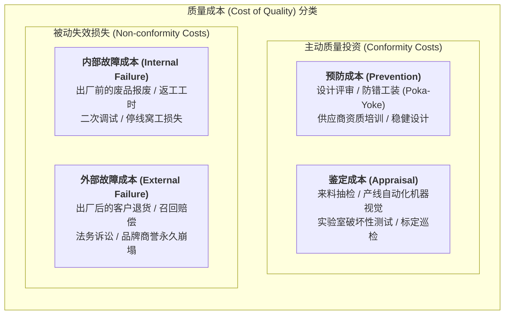

# Lec 16 基于质量的竞争优势：质量维度与测度体系（Competing on Quality: Dimensions & Measurement）

## TL;DR

- 大卫·加尔文（David Garvin）归纳的产品质量八大维度，破除了“质量等于单一无缺陷”的工程狭隘视角。
- 质量成本模型（PAF）将预防、鉴定成本与内部、外部故障损失量化对标，确立了“预防胜于纠错”的 1-10-100 黄金法则。
- 六西格玛（Six Sigma）体系通过过程能力指数（$C_p, C_{pk}$）与 DMAIC 闭环，将质量控制从靠运气的工匠经验升华为严谨的统计工程学。

## 一、大卫·加尔文（David Garvin）产品质量八大维度

在制造业的发展史上，工程师与市场营销人员对“什么是高质量”往往存在鸡同鸭讲的争论。工程师眼中的质量通常狭隘地等同于“图纸公差符合度”，而营销人员眼中的质量则是“品牌光环与客户主观奢华感”。

哈佛商学院大卫·加尔文（David Garvin）在其经典论文中系统提出了产品质量的八大战略维度，为企业制定差异化质量竞争战略提供了全景框架：

1. **性能（Performance）**：产品的主要操作特征（如汽车的百公里加速时间、制动距离）。
2. **附加功能（Features）**：对基本功能起到补充作用的次级特征（如车载无线充电、电动座椅记忆）。
3. **可靠性（Reliability）**：在规定的时间与工况下无故障完成规定功能的概率（平均无故障工作时间 MTBF）。
4. **符合性（Conformance）**：制造与装配过程对预先设定的工程公差与技术规范的精确咬合程度。
5. **耐用性（Durability）**：产品在发生物理磨损无法使用之前的全生命周期使用寿命（经济寿命与技术寿命）。
6. **可维修性（Serviceability）**：发生故障时接受维修的便捷度、售后服务网点响应时效与维修费用。
7. **美学感官（Aesthetics）**：产品对人类视觉、听觉、触觉甚至气味感官的直接物理唤醒体验。
8. **感知质量（Perceived Quality）**：客户受品牌声誉、制造原产地标签与历史口碑影响的主观主观认知。

::: definition [质量战略定位矩阵]
没有任何企业能够在八个维度上同时成为全球第一。保时捷（Porsche）聚焦于极限性能、感官美学与品牌感知质量；而丰田卡罗拉（Corolla）则以绝对的可靠性、严苛的工程符合度与终身极佳的可维修性赢得全球销量桂冠。清晰的质量战略在于明确选定主攻的 1-2 个差异化维度。
:::

## 二、质量成本（Cost of Quality, CoQ）PAF 框架与 1-10-100 法则

质量管理先驱阿曼德·费根堡姆（Armand Feigenbaum）与约瑟夫·朱兰（Joseph Juran）提出了著名的质量成本（PAF）模型，将原本抽象的质量概念转化为首席财务官（CFO）看得懂的财务语言：

### 1-10-100 质量杠杆黄金法则
质量缺陷在产品全生命周期中的蔓延呈现出指数级破坏力：
- **在概念设计与预防阶段（Prevention）**：修改图纸公差或增加一个防呆卡扣，成本仅需 **$1**；
- **在工厂制造与检验阶段（Appraisal & Internal Failure）**：发现次品拦截并进行拆机返工，平均直接损失为 **$10**；
- **当缺陷逃逸流向客户终端（External Failure）**：引发严重安全事故或全球召回，单件综合损失将飙升至 **$100 甚至上万美元**（如三星 Note 7 电池起火召回导致数十亿美元市值蒸发）。

明智的运营战略必须全力推动资金投入向**预防成本**倾斜，从而将破坏力巨大的外部故障成本彻底压制归零。

## 三、六西格玛（Six Sigma）与过程能力指数（$C_p, C_{pk}$）

摩托罗拉（Motorola）与通用电气（GE）推动的六西格玛体系，将统计学严密引入日常质量控制。在正态分布假设下，六西格玛意味着过程变异极小，即便发生 $\pm 1.5\sigma$ 的均值漂移，缺陷率依然低于 **3.4 DPMO（每百万机会缺陷数）**。

### 过程能力指数的数学定义
评估机床工序能否稳定产出合格品的两大约束指标：

1. **潜在过程能力指数 $C_p$（仅衡量离散度）**：
$$C_p = \frac{\text{USL} - \text{LSL}}{6\sigma}$$
其中 $\text{USL}$ 为规格上限，$\text{LSL}$ 为规格下限，$\sigma$ 为过程标准差。

2. **实际过程能力指数 $C_{pk}$（同时衡量均值漂移与离散度）**：
$$C_{pk} = \min \left( \frac{\text{USL} - \mu}{3\sigma}, \frac{\mu - \text{LSL}}{3\sigma} \right) = (1 - k) C_p$$
其中 $\mu$ 为实测均值，$k = \frac{|\text{Target} - \mu|}{(\text{USL} - \text{LSL})/2}$ 为均值偏离中心度。

- 若 $C_{pk} < 1.0$：工序能力严重不足，产线必然在持续产出超差次品，必须立即停机整改。
- 若 $1.33 \le C_{pk} < 1.67$：工序能力处于优良状态，符合主流工业量产准入门槛。
- 若 $C_{pk} \ge 1.67$：达到世界级六西格玛卓越制造水平。

::: pitfall [脱离制程能力盲目收紧图纸公差]
年轻的设计工程师为了追求“完美”，往往在 CAD 图纸上随手标注极小的形位公差（如 $\pm 0.001\text{mm}$）。如果车间现有加工中心的固有变异 $\sigma$ 根本无法支撑这一规格（导致 $C_{pk} < 0.67$），工人只能靠大量挑拣废品供货。这种“设计与工艺脱节”是造成制造企业隐形成本失控的最典型元凶。
:::

## 我的理解

质量不是质检员靠卡尺量出来的，而是从产品设计与产线节拍中内生孕育出来的。

1. **软件工程中的六西格玛映射**：在分布式系统与大规模后端服务中，我们追求的“4 个 9”或“5 个 9”（99.999% SLA）本质上就是数字世界的六西格玛。单元测试、静态代码扫描（Linting）与 CI 门禁对应“预防成本”；灰度告警与压测对应“鉴定成本”；而线上严重故障导致用户数据丢失与服务瘫痪则是最致命的“外部故障成本”。
2. **防呆设计（Poka-Yoke）的人性关怀**：优秀的制造工程师绝不相信“只要人足够专心就不会犯错”的谎言。工人在高强度轮班下疲劳是不可避免的生理规律。将数据插头设计为防反插异形结构、将工装夹具设计为反向放不进去的物理限位，用结构确定性替代人的道德自觉，才是最慈悲的科学管理。
3. **消除隐瞒缺陷的恐惧文化**：在丰田工厂，任何一线工人拉动安灯（Andon）拉绳导致整条流水线停摆，班组长赶到现场的第一句话绝不是责备，而是鞠躬说：“谢谢你帮我们拦截了一个潜在缺陷。”如果企业考核惩罚发现问题的人，员工就会本能地把次品掩盖藏匿，直至灾难在客户端爆发。建立对缺陷坦诚开放的心理安全感，是所有质量工具发挥效能的底层土壤。
