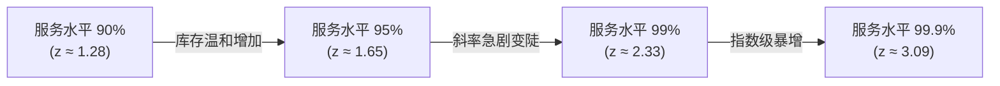

# Lec 17 成本竞争与高可得性竞争权衡（Competing on Cost vs. Competing on Availability）

## TL;DR

- 成本与可得性前沿面展现了非线性陡增特征：当周期服务水平（CSL）超越 95% 时，安全库存呈指数级爆炸。
- 报童模型（Newsvendor Model）通过临界分位数（Critical Fractile）精准量化缺货损失与滞销折价的边际平衡。
- Zara 敏捷快反供应链依托欧洲近岸高柔性产能与小批量高频上新，打破了传统服装靠低价大批押注的巨额折价魔咒。

## 一、成本-可得性前沿面与安全库存的指数级爆炸

在全渠道零售与工业品分销中，客户可得性（Product Availability / Service Level）是赢得订单的关键维度。如果客户在货架上或电商页面上遭遇缺货（Stockout），不仅当期交易流失，往往还会永久性倒流给竞争对手。

然而，追求极致的现货可得性存在残酷的物理与数学边界。在随机需求分布假设下，系统的安全库存（Safety Stock）需求公式为：

$$SS = z_{\alpha} \cdot \sigma_L = z_{\alpha} \cdot \sqrt{L \cdot \sigma_D^2 + D^2 \cdot \sigma_L^2}$$

其中：
- $z_{\alpha}$ 为对应周期服务水平 $\alpha$（Cycle Service Level, CSL）的标准正态分布分位数。
- $L$ 为补货提前期（Lead Time），$D$ 为平均需求率，$\sigma_D$ 与 $\sigma_L$ 分别为其标准差。

当服务水平从 90% 提升至 95% 时，安全库存增加约 29%；而当试图从 95% 冲刺至 99.9% 时，所需安全库存将近乎翻倍！企业必须深刻理解：**为最后 1% 的极端尾部需求保供，往往需要消耗占据总库存量 30% 以上的营运资金**。

## 二、报童模型（Newsvendor Model）与临界分位数决策

对于生命周期极短的易腐商品、时尚服装或季节性电子产品，企业在销售季节到来前仅有一次单向订货机会。经典运筹学中的报童模型（Newsvendor Model）为这一权衡提供了严密的数学解。

### 边际经济学平衡条件
设：
- $C_u = P - C$ 为**低估成本（Underage Cost）**，即多卖出一件商品可赚取的边际毛利（因缺货错失的利润）。
- $C_o = C - S$ 为**过估成本（Overage Cost）**，即未售出存货被迫在季末清仓甩卖的单位损失（采购成本扣除残值）。

在连续需求累积分布函数 $F(Q)$ 下，最优订货量 $Q^*$ 满足**临界分位数（Critical Fractile）**条件：

$$F(Q^*) = \frac{C_u}{C_u + C_o}$$

::: example [高毛利 vs. 低毛利产品的订货倾斜策略]
- **高毛利奢侈品或创新电子配件**：售价 $\$100$，成本 $\$20$，残值 $\$10$。此时 $C_u = 80$，$C_o = 10$，临界分位数高达 $80 / (80 + 10) \approx 0.889$。理性决策应当大幅超额备货，宁可承受极小概率的尾货滞销，也绝不容忍缺货！
- **平价微利大宗快消品**：售价 $\$10$，成本 $\$9$，残值 $\$2$。此时 $C_u = 1$，$C_o = 7$，临界分位数仅为 $1 / (1 + 7) = 0.125$。理性决策应当严格保守订货，宁可让货架售罄，也绝不能让沉重滞销货砸在手里。
:::

## 三、快时尚运营范式对决：Zara vs. 传统服装品牌

传统服装品牌（如 Gap、H&M）长期奉行低成本离岸外包范式：在下一季销售开始前 6-9 个月，即向远在亚洲的低成本工厂下达数十万件的大额采购订单。这种模式将直接生产成本降到了最低，但面对瞬息万变的流行审美，其预测误差高达 40% 以上。最终导致季末超过 30%-50% 的存货必须打折骨折清仓，严重侵蚀品牌价值与整体净利率。

西班牙 Inditex 集团（Zara）颠覆了这一传统范式，构建了举世闻名的敏捷运营飞轮：

1. **近岸高柔性制造集群**：Zara 并不追求全盘低成本离岸外包，而是将 50% 以上的产品保留在西班牙本土、葡萄牙和摩洛哥等近岸工场加工。虽然近岸工厂的单件人工成本高于东南亚，但交期被极致压缩至 2-3 周。
2. **极小批量试水与动态追单**：首批仅生产几百件投放欧洲核心旗舰店，通过店长手持终端实时追踪试穿率与销售转化率。一旦某款成为爆款，近岸产线在 48 小时内启动追单，两周内补货至全球货架。
3. **稀缺感营销与全额正价销售**：Zara 门店内商品周转极快，“看中必须立即买，下周必定断货”的紧迫感使用户养成高频进店习惯。其正价销售比例高达 85% 以上，彻底免去了传统品牌为清库存支付的巨额折价惩罚。

::: pitfall [盲目复制快反流程的“空转”陷阱]
许多传统企业试图照搬 Zara 的敏捷订货机制，但其内部依然维持着复杂的七层审批与漫长的面料检测流程。如果组织流程的审批时间（Lead Time）比衣服制作缝纫时间还要长，盲目缩减车间工时除了增加工厂急件换线损耗外，根本无法实现敏捷交付。
:::

## 我的理解

成本与可得性的权衡直击商业运营的深层人性——对缺货的恐惧与对沉没资产的贪恋。

1. **可得性必须实行分级对待（ABC 分类）**：企业不应试图对所有 SKU 维持 99% 的绝对现货率。对于占销售额 80% 的核心头部 A 类产品，必须以超额安全库存誓死保供；而对于长尾零星的 C 类冷门配件，应当果断采用“按单采购（MTO）”或与客户约定长交期，绝不让营运资金死锁在低频长尾中。
2. **打通动态逆向调拨的数字动脉**：在多区域多门店网络中，高可得性往往可以通过“跨网点虚拟库存聚合”来实现。当某特定规格在 A 店缺货而在 5 公里外的 B 店滞销时，系统自动派单由闪送跑腿完成同城调拨，以极小的局部物流费用化解全局库存积压。
3. **用信息替代物理安全库存**：在数字孪生与物联网时代，降低安全库存的唯一根本路径是缩短补货前置期 $L$。通过前置共享预测信号、简化报关流程与优化干线装卸，每将提前期缩短一半，系统所需的安全库存就能下降约 30%，释放出巨额宝贵的经营现金流。
