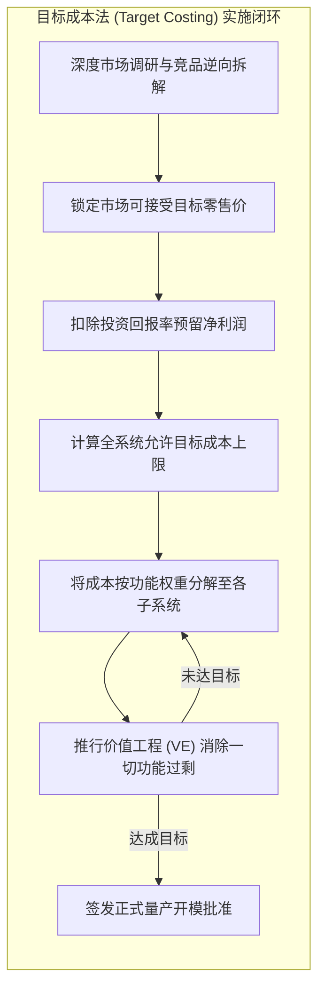

# Lec 18 成本竞争与功能创新性权衡（Competing on Cost vs. Features & Innovativeness）

## TL;DR

- 目标成本法（Target Costing）推行从市场倒推工程成本的严格闭环，以价值工程（VE）消除非客户偏好的性能过剩。
- 狩野模型（Kano Model）将功能精准归类为必备、一维与魅力属性，指明在必备属性上过度投入无法带来溢价。
- 产品平台化与模块化总线架构，能够以极低内部零部件复杂度支撑外部海量产品变体，破解 SKU 爆炸恶性肿瘤。

## 一、目标成本法（Target Costing）与价值工程（VE）

在传统西方制造企业的成本管理模式中，产品开发普遍遵循“成本加成定价法”（Cost-Plus Pricing）：

$$\text{产品售价} = \text{工程估算实际成本} + \text{期望利润率}$$

这种从供给端出发的线性思维在现代竞争激烈的完全竞争市场中屡屡碰壁。企业往往在投入数年研发后，制造出一款功能极其强大、但价格高出市场可承受范围数倍的“工程艺术品”，最终以悲剧收场。

源自日本制造业的目标成本法（Target Costing）彻底颠覆了公式的因果链条：

$$\text{允许目标成本 (Allowable Cost)} = \text{市场竞争驱动目标售价} - \text{战略必须预留净利润}$$

### 价值工程（Value Engineering, VE）的定量判据
价值工程由通用电气劳伦斯·迈尔斯（Lawrence Miles）开创，其核心逻辑在于最大化“价值系数”：

$$V (\text{价值}) = \frac{F (\text{功能与性能效用})}{C (\text{全生命周期达成成本})}$$

对于产品中的任意零部件，如果其成本占比显著高于其为客户带来的感知功能权重（即价值系数 $V < 1$），则该零部件必然存在严重的**设计过剩（Over-engineering）**，必须果断简化或降级替代。

## 二、狩野模型（Kano Model）与功能剪裁法则

东京理科大学狩野纪昭（Noriaki Kano）提出的用户满意度认知模型，为识别哪些功能值得投入成本、哪些应当坚决剪裁提供了心理学量尺：

1. **必备属性（Must-be / Basic Quality）**：客户默认理所当然应当具备的底层底线（如手机通话不掉线、汽车踩刹车能停住）。此类功能若缺失，客户极度愤怒；但即使做得再超标，满意度也不会上升。**策略：严格控制成本，达到合格门槛即可，绝不过度投入！**
2. **一维属性（One-dimensional / Performance Quality）**：客户满意度与功能表现呈严格线性正相关（如笔记本续航时间、电动车百公里电耗）。**策略：对标行业前列，作为主力配置持续优化。**
3. **魅力属性（Attractive / Excitement Quality）**：超越客户预期的颠覆性惊喜体验（如第一代 iPhone 的多点触控电容屏与惯性滑动）。在未提供时客户不会抱怨，一旦提供则引发狂热追捧。**策略：集中核心研发预算全力打造，形成差异化溢价锚点！**

::: pitfall [死磕必备属性的过度工程陷阱]
许多老牌硬件工程师习惯性地在产品的内部机械紧固件防腐性能上投入巨额成本，追求“可在水下浸泡 50 年不生锈”，而该产品的实际消费使用寿命仅为 2 年。这种脱离客户真实使用场景的“工匠精神”，本质上是对企业财务资源的严重浪费。
:::

## 三、模块化平台架构与 SKU 复杂度控制

随着市场竞争白热化，营销部门往往倾向于推出尽可能多的产品变体（SKU Proliferation），以迎合不同小众细分市场的偏好。然而，运营部门为此承担了灾难性的隐性复杂度成本：零件号剧增、模具重复采购、产线换模停机频发、仓库长尾呆滞料激增。

**平台化设计（Platform Architecture）**是化解“外部多品种多样性”与“内部少零件低成本”矛盾的终极解药：

- **核心平台共享（Common Core Platform）**：将高研发门槛、高资本投入的基础底座完全标准化（如汽车底盘驱动架构、通用电池模组、基础软件固件）。
- **模块化即插即用（Modular Add-ons）**：仅在终端面向消费者的外壳颜色、装饰面板、特定传感器配置上保留模块化接口。
- **帕累托 80/20 复杂度瘦身**：定期对全线产品进行盈利贡献度归因分析。对于仅贡献全公司 5% 销量却占据 40% 专属零件号的亏损长尾 SKU，必须执行无情的停产下线治理。

::: example [索尼 Walkman 随身听的多平台衍生奇迹]
在磁带随身听盛行的年代，索尼工程团队基于 4 个高度成熟的标准化机芯通用平台，巧妙组合不同的机身外壳材质、按键布局与耳机配色，在十年内演变出多达数百款面向年轻学生、商务白领与户外运动爱好者的差异化产品。索尼在内部保持了极高的机芯规模量产效率，同时在外部创造了琳琅满目的创新时尚品牌形象。
:::

## 我的理解

创新与成本绝非不可调和的水火关系，而是需要严密的系统工程去巧妙对冲。

1. **少即是多（Less is More）的战略克制**：乔布斯重返苹果时所做的最伟大的运营战略举措，不是发布新产品，而是大刀阔斧地砍掉了包括 Newton 掌上电脑、多型号打印机在内的 70% 产品线，仅保留面向消费级/专业级、台式/便携的四个网格象限。真正的战略不是决定要做什么，而是坚决砍掉那些消耗运营资源却无利可图的平庸功能。
2. **架构师必须懂财务损益表**：一名优秀的系统架构师在画出一条内部数据总线或设计一套压铸模具时，脑海中浮现的不应只有技术参数，更应清晰估算出这一架构决策在未来三年量产中对应的分摊折旧额与 BOM 成本。缺乏财务敏感度的技术专家极易造出企业负担不起的象牙塔玩具。
3. **推行设计面向装配（DfMA）的原子级简化**：在硬件设计评审时，必须推行严苛的零件计数规则：如果两个零件之间没有相对运动、无需因不同材料特性隔离、无需考虑拆卸维修，就必须强行合并为一个整体冲压或注塑件。零件数量减少 50%，意味着采购订单、质检批次、装配工时与潜在失效概率呈指数级下降。
