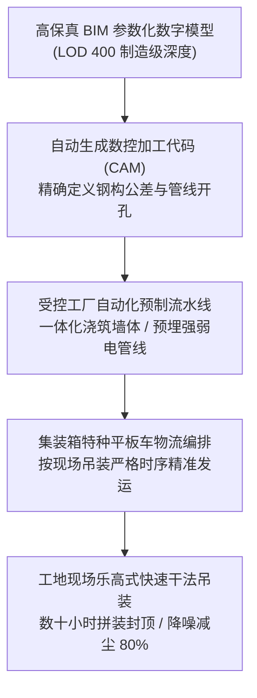

# Lec 19 建筑与复杂系统的工业化运营实践（Industrialized Housing & Modular Construction）

## TL;DR

- 传统土木建筑行业因现场作业离散、气候扰动与分包割裂，半个世纪以来全要素生产率长期陷入停滞。
- 工业化装配式建造将现场湿法施工转移至室内受控工厂流水线，依托建筑信息模型（BIM）推行异地制造与预制装配。
- 硅谷独角兽 Katerra 破产案提供了惨痛镜鉴：重资产厂房巨额固定折旧与现场各州离散法规摩擦，导致脆弱资本链断裂。

## 一、传统建筑产业的生产率泥潭与制造化浪潮

当全球汽车、消费电子与航空航天制造业在过去的半个世纪中，依托精益生产、数控自动化与全球供应链实现了生产率数十倍的飞跃时，传统土木工程与住宅建筑行业却沦为了现代经济中的“生产率洼地”。

麦肯锡全球研究院（MGI）的统计数据显示，自 1960 年代以来，全球制造业生产率累计提升了超过 200%，而建筑业的实际生产率增长几乎平躺为零甚至略有下降。其深层运营结构痛点在于：

- **现场离散式手工作业（Craft Production）**：极度依赖工人在脚手架风吹雨淋下的手工抹灰、绑扎钢筋，作业环境恶劣导致质量波动剧烈。
- **跨专业分包层层割裂**：总包、土建、暖通（HVAC）、强弱电与内外装修分属不同分包商，现场工序冲突严重，窝工返工司空见惯。
- **设计与施工严重断层**：建筑师追求造型美学，施工图纸在现场难以落地，预算超支与工期延误成为行业顽疾。

::: definition [装配式建筑 / 离岸预制制造（Offsite Prefabrication & DfMA）]
将原本在施工工地现场浇筑的墙体、楼板、楼梯、整体卫浴乃至整个三维立体房间模块（Volumetric Modular），转移至受控的室内工业化车间中，运用自动化模台流水线预先精密预制，随后运输至现场通过机械吊装螺栓拼接完成的现代工程模式。
:::

## 二、建筑信息模型（BIM）驱动的端到端数据流水线

工业化建造的核心技术底座是**建筑信息模型（Building Information Modeling, BIM）**与数字孪生平台的深度咬合。在成熟的装配式体系中，BIM 不再只是一张三维效果图，而是直接驱动制造执行系统（MES）与数控机床的工业代码：

### 离线工厂化预制的四大核心优势
1. **工期极端压缩 50%**：传统的地下基础施工与地上结构浇筑必须严格串行；装配式模式下，地基开挖与上部模块的工厂预制完全并行推进，现场吊装仅需数天。
2. **极致质量与毫米级公差**：在恒温车间内由精密钢模与数控养护窑制作，杜绝了现场浇筑出现的蜂窝麻面与开裂渗水隐患。
3. **绿色低碳与零建筑垃圾**：工厂化集中下料使钢筋与混凝土损耗率从现场的 10% 降至 1% 以下，现场扬尘与建筑垃圾减少 80%。
4. **劳动力本质安全**：工人从高空悬吊危险作业转变为车间地面室内操作，工伤事故发生率下降一个数量级。

## 三、Katerra 破产启示录：风投资本在建筑制造业的触礁教训

在工业化建筑领域，最为震撼的商业案例莫过于硅谷独角兽 Katerra 的兴衰。Katerra 曾获得软银愿景基金等数十亿美元巨额投资，其核心愿景是“用制造电子消费品的模式彻底重塑万亿建筑产业”：自建超大型交叉层压木材（CLT）超级工厂、重金自研端到端设计软件、实行从设计到施工的全面垂直一体化。

然而，Katerra 最终在 2021 年轰然破产清算。其背后的深层运营战略失误值得全行业深思：

1. **超额固定资本折旧与产能稼动率断崖**：Katerra 投入数亿美元建设高度自动化的巨型模块化预制厂，这一结构性决策的前提是工厂常年维持 80% 以上的利用率。然而建筑市场受宏观加息周期影响极大，一旦前端总包订单获取不足，庞大的厂房折旧与高薪软件工程师薪水迅速将其现金流吞噬殆尽。
2. **低估现场土木工程的复杂地理摩擦**：不同城市、不同州的建筑防火规范、工会协议与抗震设防烈度各不相同。Katerra 试图用单一的“产品化公模设计”通吃所有市场，导致在地方规划审查与施工许可证（Permits）审批中遭遇无休止的官僚拖延。
3. **跨度过宽的垂直一体化死锁**：Katerra 试图同时成为建筑设计院、物料制造商、软件开发商与施工总包商。四个完全不同基因的业务领域在企业内部爆发激烈的管理协调摩擦，最终导致工程预算超支失控。

::: pitfall [轻视物理世界定制摩擦的“软件盲目自大”]
纯软件行业推崇的“快速试错、敏捷发布、线上热修复”法则，在重资产土木工程中具有致命破坏力。混凝土一旦浇筑完成无法热重载（Hot-reload），数十吨重的预制构件运抵现场如果发现管线偏差 2 公分无法对接，其修复成本是灾难性的。实体产业必须尊重传统建造逻辑对安全冗余的敬畏。
:::

## 我的理解

建筑工业化揭示了先进制造思想在改造传统深水区行业时的机遇与荆棘。

1. **稳健推进混合预制模式**：颠覆传统产业切忌追求“大跃进式”的全盘激进一体化。最务实的路径是推行“核心构件工厂标准化预制（如整体浴室底盘、标准预制楼梯）+ 复杂异形空间现场浇筑”的渐进式混合方案，在灵活性与规模效应之间取得务实平衡。
2. **轻资产制造联盟优于巨型自建重资产**：面对具有强周期性波动的行业，初创企业不应盲目借债自建庞大的重型工厂。应当致力于掌控 BIM 软件平台、核心结构连接件专利与调度算法，将构件浇筑外包给区域内过剩的优质水泥构件厂，推行轻资产代工（Fabless Construction）。
3. **重视最后一公里的吊装微动线**：工业化建造最容易被忽视的瓶颈往往在狭窄的城市现场街道。超宽、超高的运输车辆进城通行证、大型塔吊的吊装作业半径与吊重吨位，直接决定了工厂预制模块的几何尺寸极限。任何优秀的建筑工业化战略，必须从现场吊装工况反向推导工厂切分规格。
