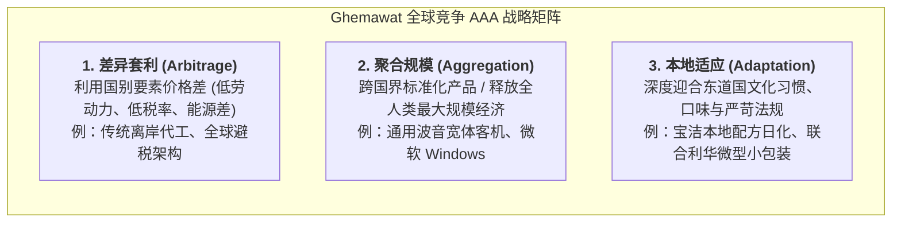
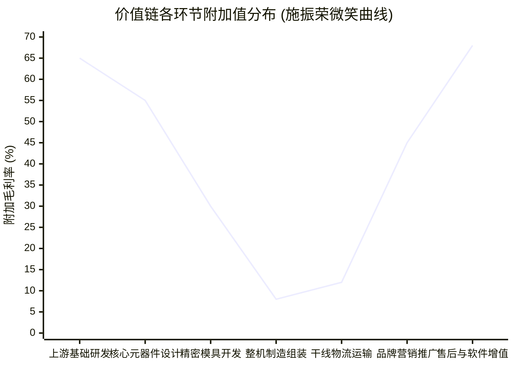

# Lec 20 全球竞争优势模型与价值链精准定位（Gaining Global Advantage & Value Chain Positioning）

## TL;DR

- 潘卡吉·格玛沃特（Pankaj Ghemawat）的 AAA 全球战略框架（套利、整合、适应），明确了跨国竞争的底层战略取舍。
- 施振荣经典“微笑曲线”揭示了在全球价值链中，制造组装环节利润被严重挤压，核心价值向研发专利与品牌服务两端漂移。
- 避开组装红海的战略路径在于深耕隐形冠军生态位，在关键高精专零部件与专有装备环节构建不可逾越的独占话语权。

## 一、格玛沃特（Pankaj Ghemawat）AAA 全球战略框架

企业在走向全球化运营时，面临的核心挑战在于跨国界距离（CAGE 框架：文化 Cultural、行政 Administrative、地理 Geographic、经济 Economic）带来的巨大摩擦。纽约大学斯特恩商学院教授潘卡吉·格玛沃特（Pankaj Ghemawat）指出，企业在全球化竞争中必须明确选择并深度协同三种基础战略（AAA 框架）：

企业极难在同一个运营系统内同时极致兼顾三者：
- 追求**聚合规模（Aggregation）**要求产品尽量全球高度标准化，这必然会牺牲对东道国特殊偏好的**本地适应（Adaptation）**。
- 追求**差异套利（Arbitrage）**要求供应链拉长跨越多个大洲，这必然会增加系统管理复杂度与协调损耗。

成功的跨国运营战略必须根据自身核心能力，明智选定其中 1-2 项作为核心抓手，并构建支持该定位的专属运营基础设施。

## 二、施振荣微笑曲线（Smile Curve）与利润池的代际漂移

宏碁集团（Acer）创始人施振荣在 1992 年提出的“微笑曲线”（Smile Curve）理论，对全球产业分工格局产生了深远影响。该曲线生动刻画了在一个完整工业品产业链的各个环节上，附加值（附加毛利率）的非均衡分布特征：

### 微笑曲线各环节的经济学特性
1. **左侧上游（研发、专利、芯片与基础材料）**：技术壁垒极高，依赖长期的科研探索与巨额沉没资本，享有全球专利保护与绝对垄断定价权，毛利率常年维持在 50%-70% 以上。
2. **中间弧底（纯代工与整机装配制造）**：准入门槛低，各发展中国家依靠低价劳动力、土地税收优惠展开激烈的同质化竞标。组装厂缺乏客户粘性与议价权，沦为赚取微薄加工费的“代工苦力”，毛利率往往被压榨至 3%-8% 的生死线。
3. **右侧下游（品牌运营、全球分销渠道与云端软件服务）**：直接掌控终端客户的信任心智与全生命周期数据，具备极强的网络效应与持续订阅现金流，毛利率高达 40%-60% 以上。

::: definition [微笑曲线的弧底深渊效应]
如果企业长期停留在微笑曲线的最底部（纯组装代工），一旦外部劳动力成本上升或汇率升值，而企业未能在上游关键零部件或下游品牌端建立护城河，利润池将迅速被两头吞噬殆尽，最终面临关厂倒闭的命运。
:::

## 三、逃离组装陷阱：隐形冠军（Hidden Champions）的卡位战

面对微笑曲线的残酷现实，并非所有企业都有能力打通全链路建立像苹果一样的全能帝国。德国管理学者赫尔曼·西蒙（Hermann Simon）指明了另一条极富生命力的战略路径——成为**全球隐形冠军（Hidden Champions）**：

- **聚焦极窄细分赛道**：不在整机大众消费品红海中与巨头正面对决，而是选择某一处于产业链关键喉咙位置的极端复杂元器件、特种装备或核心材料（如精密光刻机光学镜头、高端自行车变速箱、晶圆切片超精密金刚线）。
- **极度深耕构建技术垄断**：在选定的小领域投入远超行业平均的研发预算，数十年如一日积累深厚的工艺壁垒与专有专利丛林，全球市场占有率高达 70%-90%。
- **不可替代的战略控制点**：虽然终端消费者从不直接购买其产品，但全球所有整机巨头若想出货，必须向其跪求配额。这种“小巨人”企业在价值链中拥有极高的话语权与稳固超额利润。

::: example [荷兰 ASML 与日本 Shimano（禧玛诺）的生态位垄断]
- **ASML**：全球唯一能够商业化制造极紫外光刻机（EUV）的企业。整机制造虽然在台积电、三星与英特尔展开，但没有 ASML 每台售价数亿美元的光刻机，全球先进制程芯片工业瞬间停摆。
- **Shimano**：全球中高端自行车传动与刹车组件的绝对霸主。无论是高端赛事公路车还是知名整车品牌，其车架上都必须以印有 Shimano 变速套件为荣。Shimano 凭借精密的金属冷锻工艺与专利变速齿轮轮廓，牢牢统治了全球核心利润池。
:::

## 我的理解

在全球产业重塑的今天，明智的战略家必须具备清醒的价值链穿透力。

1. **认清自身的真实生态位**：企业管理者最忌讳的是产生虚幻的幻觉，明明做着微笑曲线弧底利润最微薄的组装代工，却误以为自己是拥有庞大帝国的行业领袖。必须以冷酷的财务数字审视自身在上下游谈判桌上的真实可替代性。
2. **向下扎根才是硬科技创业的唯一正道**：在互联网红利见顶之后，简单拼装开源代码与外部公模硬件的“皮包式创新”已彻底失去生存空间。真正的商业护城河永远属于那些敢于在物理材料、专有传感器、底层精密工艺与专有算法中深挖十年的隐形冠军。
3. **全球化不是盲目出海扩张，而是能力的精准投影**：企业在出海前，必须在 Ghemawat 的 AAA 框架中想明白自身的核心武器究竟是什么。如果你依赖的是国内高效的供应链套利（Arbitrage），出海后如果无法复刻这种生态红利，盲目的跨国设厂只会演变为失控的财务灾难。
