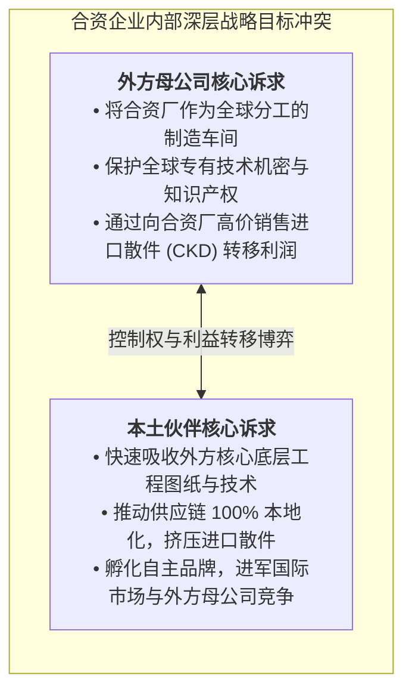

# Lec 21 全球化、合资伙伴与离岸外包的宏观影响（Globalization, Joint Ventures & Offshoring Macro Impacts）

## TL;DR

- 跨国合资企业（IJV）是兼具战略互补与内在控制权冲突的动态博弈契约，具有天然的生命周期不稳定性。
- 技术强制转让与非自愿知识溢出（Spillover），使得跨国巨头在享受新兴市场红利的同时培育了未来的潜在死敌。
- 皮萨诺与西哈的“产业公地”（Industrial Commons）理论指出：大规模制造外包将从宏观上永久摧毁本土工程研发土壤。

## 一、跨国合资企业（IJV）的动态博弈与控制权张力

跨国公司在进入具备庞大市场潜力但存在严苛法规壁垒的发展中国家时，国际合资企业（International Joint Venture, IJV）往往是被东道国政府强制规定的准入模式。

合资企业在理论上具有完美的双赢假设：
- **外方跨国巨头**：提供先进的产品设计图纸、全球品牌授权、质量管理规范与专有生产技术。
- **本土合资伙伴**：提供本地土地厂房资源、政府公关资质、廉价劳动力招募渠道与成熟的本土销售分销网络。

然而，耶鲁大学与麻省理工学院的研究表明，超过 60% 的跨国合资企业最终在 5-10 年内以一方强行收购、拆伙或对簿公堂宣告破裂。其深层原因在于合资各方**核心战略目标的不对称性与动态漂移**：

::: definition [合资企业的“暗中学习竞赛”（Learning Race）]
哈默（Gary Hamel）指出，合资企业本质上是一场没有硝烟的学习竞赛。谁能以最快的速度将对方的核心隐性能力吸收消化并融入自身母体，谁就将彻底打破原有的权力平衡，迫使合作走向终局。
:::

## 二、非自愿知识溢出与“以市场换技术”的宿命

新兴市场国家推行的“以市场换技术”产业政策，在世界制造业版图中塑造了波澜壮阔的赶超史诗：

1. **早期合资代工期**：跨国企业派遣大批外籍专家手把手辅导本土工程师建立车间质量规范、统计过程控制与工装校准。
2. **供应链全面本地化期**：为了压低成本并满足政府对“本地化率（Local Content Requirement）”的强制规定，外方不得不扶持大量本土二级、三级零部件供应商，向其公开测试标准与技术参数。
3. **技术骨干与高管外溢期**：在合资企业内部历练数十年、完全掌握整车集成与研发逻辑的本土高级工程师，随着期权激励兑现或受自主创业愿景驱动，大批流向本土自主品牌。
4. **自主反超与全球出海期**：本土自主企业在经历数十年的技术反向工程与底层消化后，凭借对本土客户需求的敏锐洞察与激进的研发迭代速度，在新赛道（如电动智能化转型）全面击溃昔日的跨国合资外方。

::: example [中国高速铁路与新能源汽车的技术跃迁之路]
- **高铁奇迹**：中国通过统一对外采购谈判窗口，引进庞巴迪、川崎重工、阿尔斯通与西门子的核心动车组技术平台，实行“消化、吸收、再创新”。最终自主研制出具有完全自主知识产权且性能反超外方的“复兴号”标准动车组，并反向向全球输出成套基建工程。
- **新能源汽车颠覆**：传统燃油车合资时代，外方牢牢锁死发动机与变速箱的核心控制软件；而当三电技术崛起时，深耕电池、电机与智能电控的本土自主品牌迅速占据绝对统治地位，迫使大众、Stellantis 等跨国传统巨头反向注资收购中国造车新势力的平台与软件技术。
:::

## 三、皮萨诺-西哈“产业公地”（Industrial Commons）枯竭危机

哈佛商学院加里·皮萨诺（Gary Pisano）与麻省理工学院前任斯隆管理学院副院长西哈（Willy Shih）在经典著作《制造繁荣》（Producing Prosperity）中，向发达国家发出了极其深刻的宏观警示：**过度离岸外包正在系统性破坏支撑国家经济命脉的“产业公地”**。

::: definition [产业公地（Industrial Commons）]
指特定地理区域内支撑跨行业创新与制造的集体研发能力、工程基础设施、熟练技工人才储备、精密工装夹具生态以及供应商协作网络的总和。产业公地具有极强的公共品与正外部性属性。
:::

当企业出于个体理性的短期财务报表优化，将电池制造、印制电路板（PCB）生产、精密注塑全盘外包出境时，会引发不可逆的生态灾难连锁反应：

- **大学与职校工程专业萎缩**：因为本土没有优质的制造就业岗位，最聪明的年轻人不再报考材料科学、机械工程与过程冶金，转而涌向华尔街投行与纯软件代码编写。
- **基础工业装备制造商消亡**：因为本土缺乏制造采购订单，数控机床、工业机器人与特种测试仪器的本土厂商纷纷破产或被外资收购。
- **下一代突破性技术丧失策源能力**：当下一代技术（如柔性屏折叠材料、固态电池制造工艺）需要实验室研发与车间试验无缝衔接时，由于本土缺乏任何可用的试制产线与熟练模具工人，发达国家的初创企业发现自己根本无法在本土将其产品原型商业化量产，不得不全盘投奔海外成熟制造集群。

::: pitfall [宏观公地悲剧：个体微观最优导致的集体长期毁灭]
每一家将工厂迁往海外的跨国公司 CFO，在其个人任期内都达成了漂亮的“降低直接人工成本、美化资产负债表”目标，获得了丰厚奖金。然而，当所有企业都做出这一看似理性的抉择时，国家的产业公地彻底荒漠化。三十年后，国家突然发现自己连一枚小小的抗生素胶囊或最基础的火炮炮弹都无法在本土自给自足。
:::

## 我的理解

产业公地理论与全球化合资博弈深刻揭示了制造业在国家战略纵深中的真正底色。

1. **工程直觉无法通过教科书远距离遗传**：制造是一门极其硬核的实践经验科学。冲压模具在不同温湿度环境下的微米级回弹补偿、复杂药剂在千升发酵罐中的流场动力学，这些隐性知识（Tacit Knowledge）只存在于车间一线工人的手上和机床老师傅的眼睛里。一旦生产线撤走十年，这批人才彻底断代，其隐性知识将永远失传。
2. **合资合作必须保持清醒的技术防火墙**：在任何对外技术合作中，必须明确区分“可分发的边缘模块”与“绝不可外泄的母体内核”。如果为了短期的合资分红将自身立命之本的底层源代码与材料机理倾囊相授，就等于亲手为自己签署了慢性死亡判决书。
3. **主权级供应链安全的回归**：21 世纪的全球竞争已彻底告别纯粹的自由市场乌托邦。未来的跨国运营战略必须将国家安全、出口管制原产地与供应链去单一化纳入核心风险模型。构建在关键时刻“拔掉网线依然能自主开工”的底线工程自持力，是企业与国家基业长青的终极试金石。
