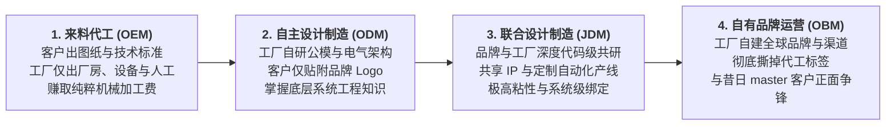

# Lec 22 供应商话语权演变与代工升级机制（Supplier Power & Moving Up the Value Chain）

## TL;DR

- 代工产业演化阶梯刻画了代工厂从来料代工（OEM）、自主设计（ODM）直至自有品牌（OBM）的进阶路径。
- 电子制造服务（EMS）巨头（如富士康）依托超大规模资本开支与供应链压榨，在微薄毛利率下创造了惊人的净资产现金流。
- 采购方的终极困境（Buyer's Dilemma）：当代工厂的工程研发实力全面超越品牌方时，品牌将沦为随时可被架空的薄弱外壳。

## 一、代工模式阶梯演化：从 OEM、ODM 到 OBM

在制造业的全球分工体系中，外部供应商并非永远甘心充当被动受压榨的低端角色。伴随着技术资本的积累，代工企业展现出强烈的向上游与下游攀升的内在驱动力。

代工企业的商业进化历程清晰地映射在四大阶梯之上：

### 1. OEM（Original Equipment Manufacturer，原始设备制造商）
- **商业特征**：代工厂完全没有产品设计权，严格按照客户 engineering department 签发的详细 CAD 图纸、BOM 表与工艺公差进行机械装配（Build-to-print）。
- **竞争弱点**：可替代性极强，客户可以在季末比价后随时将模具搬迁至更廉价的竞对工厂。

### 2. ODM（Original Design Manufacturer，原始设计制造商）
- **商业特征**：代工厂具备强大的独立研发与工业设计团队。代工厂自主定义并研发出若干款完整的成熟原型（如多款笔记本电脑、白牌扫地机），品牌方只需挑选心仪的外壳配色、丝印上自己的品牌商标即可推向市场。
- **竞争优势**：品牌方得以削减内部研发团队，大幅缩短产品上市周期；ODM 厂商通过为多家互为竞争对手的品牌供货，实现了单平台部件采购的超级规模经济。

### 3. OBM（Original Brand Manufacturer，原始品牌制造商）
- **商业特征**：代工厂痛感代工利润微薄，利用沉淀多年的顶尖制造工艺与供应链整合力，推出面向终端消费者的自主品牌。

## 二、EMS 超级航母的规模经济与微利造血机器

在以富士康（Foxconn / 鸿海）、捷普（Jabil）、天弘（Celestica）、立讯精密为代表的电子制造服务（Electronic Manufacturing Services, EMS）帝国中，商业模式展现出惊人的规模工程美学：

- **微薄毛利率下的极致规模（The Penny Business）**：EMS 巨头的综合毛利率通常仅有 4%-7%，净利率更是常年徘徊在 2%-3% 的极薄区间。外界往往轻蔑地将其视为“无技术含量的血汗装配”。
- **庞大资本杠杆与超高营运资金周转**：然而，当富士康年营业收入突破两千亿美元时，即使 2% 的净利率也意味着数十亿美元的纯现金净利润。更为致命的是其**现金循环周期（Cash Conversion Cycle, CCC）常年为负**——依靠对上游数万家零部件供应商长达 90-120 天的应付账款账期，EMS 巨头无偿占用了海量上游无息流动资金，用于投资全球最先进的自动化设备与模具中心。
- **模具制造与工艺垂直整合深度**：富士康真正的核心资产不是百万装配线工人，而是其内部庞大无比的超精密模具加工中心（自研高速 CNC 切削机床、纳米级冲压磨床）与垂直整合的连接器、线缆、机壳制造能力。这种深厚的精密工艺底座，使得任何新晋玩家在短期内均无法承接数千万台级的高精度复杂机电出货。

## 三、采购方困境（The Buyer's Dilemma）与品牌反噬

当代工企业向 ODM 与 OBM 阶梯加速跃升时，将品牌委托方推入了经典的**采购方困境（Buyer's Dilemma）**：

- **工程控制权的悄然流失**：品牌方为了财报好看，裁撤了底层的硬件测试与结构工程师，只保留高薪的市场营销人员与工业设计师。随着每一代产品的迭代，详细技术图纸与底层固件优化越来越完全依赖代工厂的研发团队。
- **供应商话语权的逆转**：当代工厂掌握了该品类从芯片调优、热设计到精密外壳成型的全套专有知识后，品牌方彻底丧失了转单的物理可能。代工厂一旦要求上调加工费，品牌方只能全盘妥协。
- **旧主孵化自己的掘墓人**：代工厂在为知名品牌代工的过程中，不仅摸清了该产品的全部制造成本底牌，还熟悉了全球最严苛的品控体系。当下游时机成熟，代工厂孵化出价格仅为知名品牌一半、但做工和性能完全一致的自有品牌时，昔日的委托客户将遭遇灾难性绞杀。

::: example [宏碁、华硕与宏达电（HTC）的代工蜕变传奇]
- **宏碁（Acer）与明基（BenQ）**：宏碁早年通过为西方巨头代工 PC 积累资本，最终成功孵化出全球知名 PC 品牌宏碁，并分拆出明基。
- **华硕（ASUS）与和硕（Pegatron）**：华硕早年同样是强大的主板与整机代工企业，后全面发力自主品牌 ASUS。为了消除代工客户（如苹果、惠普）对商业机密外泄与品牌利益冲突的疑虑，华硕最终痛下决心将代工业务彻底剥离，独立设立和硕联合科技。
- **宏达电（HTC）**：HTC 最早是微软 Windows CE 掌上电脑与早期智能手机的全球顶级代工厂。HTC 凭借敏锐的战略眼光，率先联手 Google 推出全球首款 Android 智能手机（HTC Dream / G1），从幕后代工一跃成为全球智能手机霸主。
:::

## 我的理解

代工与品牌的互动史是一部关于控制权、信任与价值掠夺的博弈史。

1. **守住自己的技术命门，切忌彻底当甩手掌柜**：如果你的产品核心价值在于硬件体验，就绝不能完全依赖纯 ODM 方案。即使委托代工，核心算法的源代码、底层芯片的寄存器配置权限以及核心模具的所有权，必须牢牢登记在自己的资产负债表与法务专利库中。
2. **警惕代工转品牌的渠道死锁**：许多优秀的代工厂老板雄心勃勃试图打造自主品牌（OBM），最终往往败得极其惨烈。究其原因，制造卓越与品牌运营是两套截然相反的基因。代工讲求确定性、严谨、成本控制与服从客户；品牌讲求讲故事、情绪价值唤醒、渠道博弈与极高的市场试错容忍度。没有脱胎换骨的组织重构，代工厂的品牌梦多半沦为昂贵的交学费。
3. **构建无法被代工侵蚀的情感与生态护城河**：硬件参数与机械公差终究是可以被优秀代工厂逆向测绘并平价复刻的。真正能让品牌穿越代工反噬周期的，是深植于客户心智的文化图腾、不可迁移的跨设备云端生态体验，以及极致的社群归属感。当产品超越了纯粹的物理功能，代工厂就永远只能是为你打造王座的忠诚工匠。
