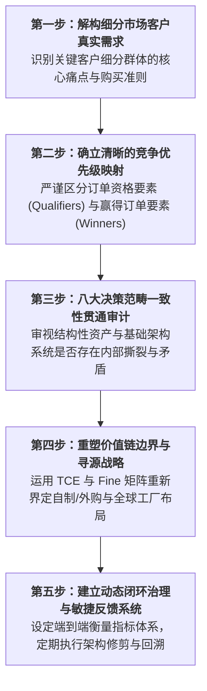

# Lec 23 全球运营战略综合案例推演（Global Operations Strategy Case Synthesis）

## TL;DR

- 战略一致性（Strategic Coherence）是卓越运营系统的终极灵魂：所有局部的资产决策必须毫无保留地服务于顶层定位。
- 苹果（极致代工管控与定制芯片架构）与特斯拉（激进垂直整合与一体化压铸）展现了通向巅峰的截然不同运营范式。
- 五步系统化运营审计法（需求界定、优先级映射、架构匹配、资源定界、动态反馈）为企业战略诊断提供了严谨实战工具箱。

## 一、两大科技巅峰运营范式对比：苹果 vs. 特斯拉

在当代全球高科技制造领域，苹果公司（Apple）与特斯拉（Tesla）代表了两种截然不同、却各自将运营战略推向极致的典范体系。深入剖析两者的运营架构，能够为我们理解前述 22 讲的所有理论提供最宏大的实战全景：

| 运营决策范畴 | 苹果公司（Apple Inc.）范式 | 特斯拉（Tesla Inc.）范式 |
| :--- | :--- | :--- |
| **垂直一体化边界** | **无晶圆/轻资产制造 + 极端专有资产自控** 自研 A/M 芯片架构与 OS；制造组装 100% 委外 | **极致重资产垂直整合 (Extreme Integration)** 自建超级工厂 (Gigafactory)；自研电池、电机、软硬件与直营服务 |
| **工艺技术与装备控制** | **出资定制，买断所有权** 买断数万台超高精度 CNC 机床置于富士康车间；包圆台积电先进制程首发产能 | **突破物理极限的工艺重构** 发明一体化大型压铸技术（Gigacasting）；彻底革新车身结构制造底层节拍 |
| **供应链协作模式** | **双源/多源动态平衡，严密管控** 对二级、三级甚至四级物料推行穿透式管控；掌握物料成本极致细节 | **软硬件协同自研，打破 Tier 1 黑盒** 自研中央集中式中央计算架构；直接对接原材料矿山；将传统供应商压缩为代工零件商 |
| **核心竞争优先级** | **极致的美学感官、完美品质一致性与全球惊人爆发交付** | **极致的结构降本、颠覆性产品性能与软件算法周度 OTA 迭代** |

::: example [两种范式的殊途同归：对底层核心控制点的极致偏执]
表面上看，苹果将工厂全部外包，特斯拉疯狂自建超级工厂，两者截然相反。然而在本质上，两者的底层逻辑高度统一：**它们对承载自身核心价值与客户体验控制点的环节，展现出近乎偏执的绝对掌控力**！
苹果虽然不拧螺丝，但螺丝的合金材料配方、阳极氧化表面处理工艺参数、乃至流水线测试夹具的固件代码，全部由加州库比蒂诺的工程团队编写下发；特斯拉痛感传统整车厂被 Tier 1 供应商绑架导致的系统臃肿，果断打破内燃机百年装配逻辑，用软件架构思维重新设计一辆由少数超大压铸件与中央芯片组成的移动电脑。
:::

## 二、企业运营战略五步系统化审计与诊断方法论

基于斯隆管理学院经典理论，任何面临战略迷茫、增长乏力或质量成本危机的企业，均可按照以下严密的五步闭环开展系统化运营审计（Operations Audit）：

### 关键审计自查清单（Diagnostic Checklist）
1. **是否存在战略错位？**：销售部门是否在市场上以“48 小时快速定制”为卖点大肆揽单，而制造部门却依然按照“大批量刚性流水线”考核单件制造成本？
2. **是否存在虚假精益？**：车间现场是否为了盲目追求表面好看的低在制品（WIP），导致下游装配工序因频繁缺料而陷入大面积停工待料？
3. **是否存在关键能力空心化？**：过去五年内，企业内部的技术研发人员对核心零部件底层制造工艺的了解程度是在加深还是在退化？

## 三、应对黑天鹅冲击的抗脆弱（Anti-fragile）运营网络设计

在世纪变局中，优秀的运营战略必须从追求纯粹的静态效率（Efficiency），全面转向追求系统的**抗脆弱性（Anti-fragility）**与**适应性（Adaptability）**：

- **从“单点最优化”走向“网络级容错”**：坚决消除供应链中的单一故障点（Single Point of Failure, SPOF）。对于不可替代的核心元件，强制推行跨地域双源（Dual-sourcing）配置。
- **构建可互换的模块化生产单元**：设计标准化的集装箱式柔性制造单元，当某一区域遭遇极端天灾或地缘封锁时，能够在数周内将整套测试治具与数字化工艺代码打包空运至备用基地快速投产。
- **数字化可见性与情景演练**：定期在全集团范围内开展“断链红蓝对抗演练”：假设核心港口瘫痪或主要代工基地停电 30 天，系统需要多长时间激活备用路由？真实成本冲击几何？

::: pitfall [战略执行中的“局部优化陷阱”]
最致命的运营败局往往不是因为某一个部门犯了明显低级的错误，而是因为每一个部门都在极其负责地追求自身部门局部的 KPI 最优，最终拼装出一个整体效率低下、毫无生机的怪胎。战略高管的首要职责是打破部门壁垒，让所有人对系统级全局最优化负责。
:::

## 我的理解

运营战略的最高境界，是让物理世界复杂的资产、设备与数万员工，如同交响乐团般精准协同演奏。

1. **战略的核心是学会说“不”（Strategy is Trade-off）**：平庸的企业试图讨好所有人，在宣传册上宣称自己“成本最低、质量最好、交期最快、定制最强”，最终沦为各维度均无特色的平庸牺牲品。卓越的企业敢于向客户公开声明：“我们为了追求极致的性能与定制化，交期就是需要等待两周，价格就是昂贵。”敢于明确放弃什么，才是战略自信的源泉。
2. **制度设计比道德说教强大一万倍**：如果你希望员工注重长期质量，就绝不能在月底按照工人的装配件数计件发放奖金；如果你希望跨部门敏捷协同，就绝不能让各部门总监的年终考评仅仅取决于各自部门的预算结余率。利益指挥棒指向哪里，运营系统的重心就会本能地流向哪里。
3. **回到现场，用眼睛看，用手去摸（Genchi Genbutsu）**：无论你的顶层战略规划多么优美、咨询顾问制作的 PPT 多么精美，永远不要脱离车间现场、代码仓库与客户交货月台。物理现实永远是所有理论的唯一审判官。
