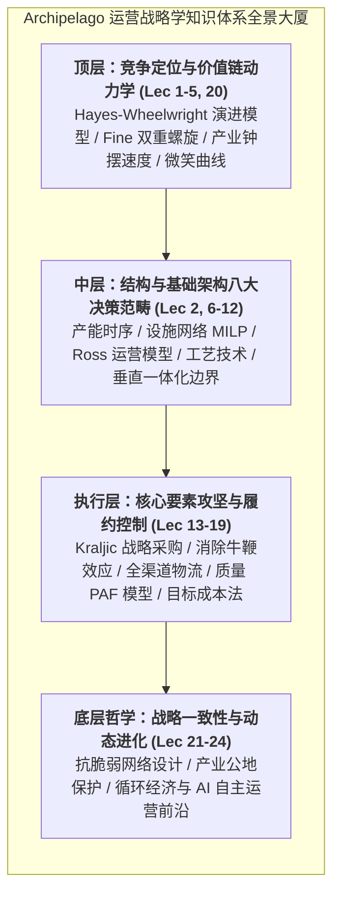

# Lec 24 21世纪运营战略前沿与全课总结（21st Century Operations Strategy Frontiers & Course Wrap-up）

## TL;DR

- 本课程 24 讲全景体系系统整合了斯金纳决策范畴法、法恩双重螺旋与企业架构协同模型，确立了运营战略大一统视角。
- 地缘政治脱钩下的分布式供应链韧性、人工智能与自主 Agent 驱动的智能调度，构成了 21 世纪运营管理的最前沿浪潮。
- 闭环循环经济（Circular Economy）与 ESG 碳足迹审计，正将运营系统的传统边界从出厂交付拓展至全生命周期绿色再生。

## 一、15.769 运营战略思想全景大统一视界

贯穿麻省理工学院 15.769 运营战略学全课程的 24 次深入研讨，我们构建了一个立体的认知框架。现代运营战略绝非孤立的工具箱组合，而是一座逻辑严密、层层咬合的战略思想大厦：

### 运营战略的四大核心不可动摇原则
1. **单一真实事实来源（Single Source of Truth）**：运营系统的每一处物理动作必须由真实、无失真的市场与需求信号驱动，坚决消除多层预测扭曲导致的系统性牛鞭震荡。
2. **权衡不可避免（No Free Lunch）**：任何试图超越物理客观规律、声称全维度同时登顶的方案都是谎言。真正的战略是在深刻理解物理边界的前提下，通过巧妙的系统解耦与架构创新，推动效率前沿面的整体向外位移。
3. **软硬件协同进化（Conway's Law Extended）**：物理工厂的工艺布局、上游供应链的网络拓扑与企业内部的 IT/软件数据管道必须保持同构咬合。脱离软件支撑的重资产是僵化的恐龙，脱离硬件支撑的纯算法是空中楼阁。
4. **知行合一的现场精神（Gemba Spirit）**：一切管理智慧最终都要接受车间公差与客户交付时效的无情检验。

## 二、21 世纪三大前沿颠覆浪潮与未来进化方向

站在当前历史节点展望未来，新一代运营战略管理者必须时刻直面正在深刻重构全球商业底层逻辑的三大前沿颠覆浪潮：

### 1. 地缘政治重组与主权级分布式供应链
全球自由贸易的黄昏与地缘政治竞争的加剧，彻底终结了“全球单一超大工厂”时代。未来的企业运营必须具备在“多极世界”中自如切换的分布式能力：
- 供应链多重冗余与合规穿透审计成为常态；
- 模块化“工厂即代码（Factory as Code）”理念兴起，通过云端分发数字孪生脚本，实现数周内在友岸国家快速点亮平行备份工厂。

### 2. 人工智能与自主 Agent 编排的运营闭环
大语言模型（LLM）与具身智能（Embodied AI）正在从根本上改写运营管理的游戏规则：
- **从启发式规则到端到端自主决策**：传统的 MRP/ERP 排程依赖人工经验调参；未来由多智能体协同网络（Multi-Agent System）自主监控天气、航运、海关报关与车间设备振动数据，微秒级动态重写全球运力路由与工单序列。
- **具身智能人形机器人的劳动力革命**：在未来 10-20 年内，通用人形机器人将逐步进驻传统被视为柔性难点的非标装配车间，彻底重构制造业的劳动力要素成本模型。

### 3. 闭环循环经济（Circular Economy）与全生命周期碳中和
资源环境承载力的逼近与全球碳关税（CBAM）法规的推行，迫使运营系统的传统边界发生革命性外延：
- **从线性经济走向闭环再生（Cradle-to-Cradle）**：产品不再是“开采-制造-使用-丢弃”的单向死胡同。企业必须在设计之初即规划产品报废后的自动化无损拆解、关键稀贵金属化学回收与高价值零部件再制造（Remanufacturing）。
- **供应链范围三（Scope 3）碳足迹精准核算**：企业必须具备穿透核算全链条上万家供应商碳排放数据的数字化治理能力，绿色低碳从公关口号转变为决定产品能否进入国际市场的核心生死准入证。

## 三、结语：致未来的首席运营官与系统架构师

运营战略是一门关于“如何把人类最狂野的技术梦想转化为稳定、可复现、可负担的物理现实”的崇高艺术。

建造火箭飞向火星、制造纳米级芯片处理数十亿参数、亦或确保数十亿人每天清晨都能喝到新鲜干净的牛奶，其背后支撑的无一不是由无数精密的运营决策、严谨的数学模型与无畏的工程探索构筑的壮丽系统。

愿每一位研读本课程的学子与实践者，始终对客观世界的物理法则保持敬畏，在战略决策中坚守理性取舍，勇于深入现场一线，用系统化的思维与卓越的工程匠心，打造出能够穿越时代风暴的伟大组织与宏伟系统。

## 我的理解

回望这 24 讲的深邃旅程，运营战略赋予了我看待现实商业世界的一双透视眼。

1. **看透商业繁华背后的物理底座**：当我们看到某家科技巨头发布了一款令人惊叹的新品，或者某个商业帝国宣称实现了超常增长，我们不再被炫目的发布会 PPT 与天花乱坠的公关辞令所迷惑。我们会本能地去探查它的供应链网络由谁代工、它的 BOM 成本由哪些关键元器件构成、它的现金循环周期是多少天、它的产能瓶颈受制于哪家光刻机或矿山。这种洞察力是商业分析中最坚固的思想铠甲。
2. **在不确定性中构建确定性系统**：世界的本质是充满熵增与随机扰动的。优秀的运营架构师从不祈祷“风调雨顺、好运常在”。我们的天职就是设计出具备充足抗脆弱冗余、能够自愈纠偏、在惊涛骇浪中依然能够稳定吐出合格产品的确定性系统。
3. **享受把蓝图变为现实的纯粹创造力**：代码最终要在服务器芯片上跑出电子脉冲，图纸最终要变成车间里火花四溅的焊装钢体，药物最终要在发酵罐中结晶拯救生命。将抽象的认知转化为沉甸甸的物理现实，这种创造的快乐是任何纯虚拟游戏都无法比拟的。运营战略，就是我们重塑现实世界的最强杠杆。
