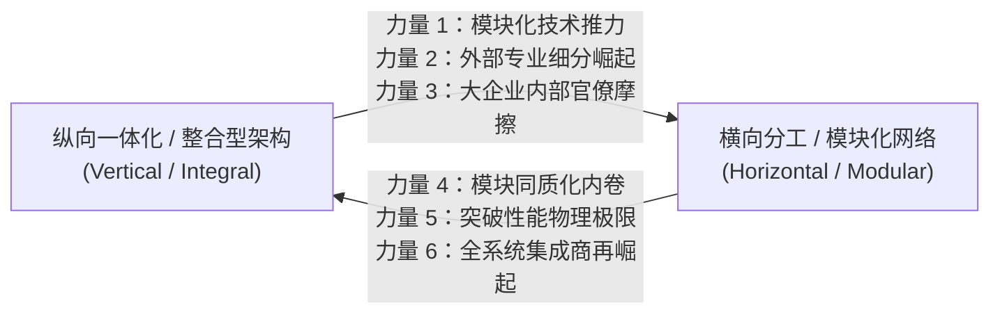

# Lec 4 价值链动力学与双重螺旋模型（Value Chain Dynamics & Double Helix Model）

## TL;DR

- 查尔斯·法恩（Charles Fine）提出钟摆速度（Clockspeed）概念，刻画了产品、工艺与组织进化的速率差异。
- 双重螺旋模型揭示了产业结构在纵向一体化（垂直架构）与横向模块化（水平分工）之间的永恒周期性震荡。
- 价值链控制点的动态漂移要求运营战略管理者必须时刻预判利润池与核心能力的转移轨迹。

## 一、钟摆速度（Clockspeed）：产业演进的脉搏与时钟频率

在麻省理工学院斯隆管理学院教授查尔斯·法恩（Charles Fine）的开创性著作《钟摆速度》（Clockspeed）中，产业演化被赋予了生物进化论的视角。不同的行业由于底层技术驱动力与市场更替周期的差异，展现出截然不同的“钟摆速度”：

- **快速时钟行业（Fast Clockspeed）**：典型代表为消费电子、微处理器、快时尚与互联网服务。产品生命周期以月计算，工艺装备在 2-3 年内发生革命性淘汰，组织架构频繁拆分重组。
- **慢速时钟行业（Slow Clockspeed）**：典型代表为民用客机、重型内燃机、船舶制造与化工采矿。产品生命周期长达数十年，工艺路线高度稳定，核心资产具有极长折旧周期。

::: definition [产业钟摆速度（Clockspeed）]
指特定产业中产品换代、工艺装备革新以及企业组织生态结构演化发生变迁的速率。钟摆速度决定了运营战略决策的有效窗口期与资产投资的折旧回收模型。
:::

企业在不同时钟频率的接口处运营时，会产生显著的系统性张力。例如汽车整车厂（中速钟摆）整合车载智能座舱芯片（极速钟摆）时，往往会遭遇研发周期断层与供应脱节的巨大挑战。

## 二、双重螺旋模型（The Double Helix Model）的演进机理

法恩教授提出的“双重螺旋模型”（Double Helix Model）揭示了产业组织架构纵贯历史的宏观震荡规律。产业架构并非单向迈向模块化，而是在**纵向一体化（Vertical / Integral）**与**横向解耦（Horizontal / Modular）**之间呈现螺旋式交替震荡：

### 1. 从纵向一体化向横向模块化的演进力量
- **标准接口的建立**：当产品各子系统的物理与功能接口被业界完全标准化，子系统之间的跨边界协作成本急剧下降。
- **外部专业化供应商的高效崛起**：专注于单一模块的独立企业通过为多家客户供货实现巨幅规模经济，其研发与制造成本远低于一体化企业内部部门。
- **内部大企业病的腐蚀**：庞大的一体化企业内部协调成本飙升，对前沿颠覆性技术的感知出现迟钝。

### 2. 从横向模块化回归纵向一体化的重组力量
- **模块产品的同质化与利差塌陷**：当标准化模块沦为平庸的走量商品（Commoditization），组装厂的利润池被急剧挤压。
- **逼近物理极限与系统性能瓶颈**：当客户对极限性能、极度轻量化或低功耗提出严苛要求时，标准模块接口的冗余损耗成为瓶颈，必须通过打破模块边界、重新执行底层一体化协同设计（Co-design）方能突破。
- **系统集成者的利润通吃**：具备全局视野的整合巨头重新定义下一代私有系统架构，收拢价值链控制权。

::: example [个人电脑与智能手机产业的双重螺旋轮回]
- **IBM PC 的横向解耦**：20 世纪 80 年代 IBM 开放 PC 架构，迅速被英特尔芯片（Wintel 联盟）与微软操作系统横向切分，整机组装沦为微利组装行业。
- **苹果智能手机的整合重塑**：苹果公司通过自研 A/M 系列芯片、深度优化 iOS 操作系统与精密闭合机身的一体化系统架构，重新实现了在软硬件性能、功耗与能效上的绝对垄断，独揽全球智能手机行业 80% 以上的利润总和。
:::

## 三、价值链控制点（Control Points）的动态狩猎

运营战略的终极课题在于识别并卡位价值链上的控制点。法恩指出，控制点往往依附于**稀缺且不可替代的生产要素**：

- 控制点不是永恒固定的，它随着技术演进在微处理器、操作系统、核心代工产能与专有算法之间持续漂移。
- 聪明的企业通过对非核心模块进行激进的外部寻源与降成本，同时对承载控制点的核心子系统保持近乎偏执的自研掌控（如特斯拉在纯视觉自动驾驶芯片与一体化压铸车身上的自控）。

::: pitfall [外包导致的控制权旁落（The Sourcing Trap）]
许多传统整车厂在向智能化转型过程中，将电池管理系统（BMS）与自动驾驶软件全权打包外包给 Tier 1 供应商。这种看似“敏捷省事”的采购决策，实际上切断了企业自身积累底层数据资产与算法迭代的通道，最终沦为无附加值的代工壳体。
:::

## 我的理解

双重螺旋模型与钟摆速度理论为我们理解当代高科技与智能硬件的产业格局提供了极为清醒的解构视角。

1. **警惕过度模块化的平庸陷阱**：利用公模、标准方案和开源代码可以以最快速度构建一个能跑的原型（MVP），但若要打造出让用户惊艳的划时代产品，必然需要深入到底层硬件元器件与固件调度的一体化调优。
2. **多时钟系统的接口设计哲学**：在设计复杂产品时，必须在快时钟模块与慢时钟模块之间设立高度解耦的缓冲抽象层。例如工业装备的物理机械架构可以保持 10 年稳定，但其上层的控制软件与边缘感知计算模块必须支持像智能手机一样的月度 OTA 演进。
3. **利润池迁移的防线构筑**：企业必须每季度审视自身所处产业链环节的毛利率变动趋势。一旦发现本环节的溢价能力正在被上下游的标准化协议所稀释，就必须果断启动向高门槛专有技术或专有服务生态的一体化跃迁。
