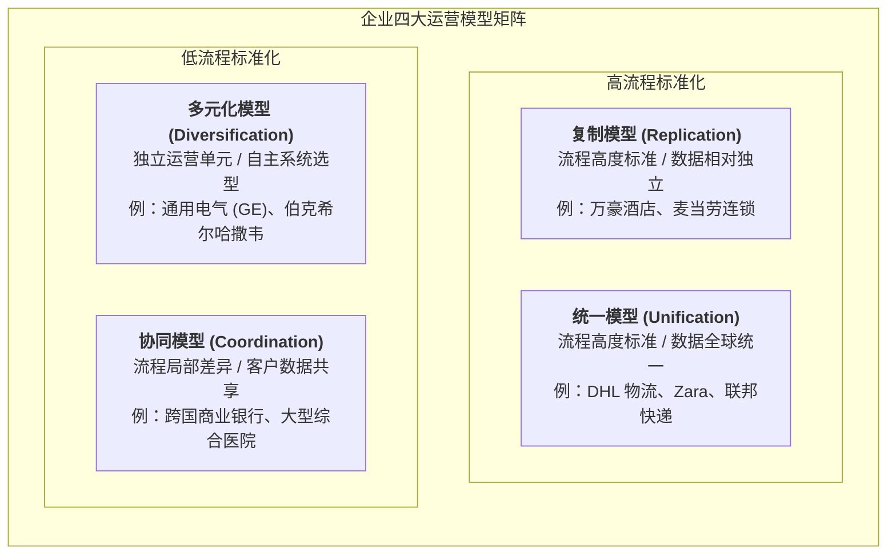

# Lec 6 企业架构与运营战略协同（Enterprise Architecture & Operations Strategy）

## TL;DR

- 企业架构确立了组织业务流程、数据模型与底层信息技术的逻辑结构，是运营战略落地的数字化底座。
- Jeanne Ross 的四种运营模型（协同、统一、多元化、复制）依据业务流程标准化与数据整合度清晰定界。
- 将企业资源规划（ERP）、制造执行系统（MES）与产品生命周期管理（PLM）垂直打通是实现敏捷制造的关键前提。

## 一、企业架构的本质及其与运营战略的战略契合

在数字化浪潮深刻重塑制造业与服务业的当下，企业已无法在缺乏信息系统支撑的前提下孤立探讨实体运营战略。麻省理工学院信息系统研究中心（MIT CISR）的学者指出：**卓越的运营战略必须与清晰的企业架构（Enterprise Architecture, EA）深度协同**。

许多企业在数字化转型中遭遇的沉痛教训是：斥巨资购买了顶级 ERP、CRM 与大数据分析平台，但内部流程依然摩擦不断、数据孤岛林立。其根源在于企业未能预先厘清自身的核心运营模型，导致 IT 系统架构与商业战略发生严重背离。

::: definition [企业架构（Enterprise Architecture）]
企业架构是对企业业务愿景、组织流程、信息资产及支持技术基础设施之间相互关系的结构化蓝图定义。它为规范业务流程的执行逻辑与指导 IT 资本投资提供了跨部门的统一指挥准则。
:::

## 二、Jeanne Ross 经典四大运营模型（Operating Models）

麻省理工学院让·罗斯（Jeanne Ross）等学者在经典著作《企业架构作为战略》（Enterprise Architecture as Strategy）中，根据两个关键决策维度——**业务流程标准化程度（Process Standardization）**与**数据整合共享程度（Data Integration）**，将企业的运营形态归纳为四种基础模型：

### 1. 多元化模型（Diversification：低标准化，低整合度）
- **特征**：企业由若干个业务属性高度无关的自治业务单元（BU）组成。各单元面向不同的客户群体，具有独立的供应链与生产体系。
- **架构重点**：总部仅关注财务指标汇总与合规审查，各业务单元自主选型独立的运营与 IT 架构。

### 2. 协同模型（Coordination：低标准化，高整合度）
- **特征**：业务单元具有独特的操作流程，但面向共同的客户群体或依赖共享的供应链要素。
- **架构重点**：打通跨业务单元的“单一真实客户视图”（Single View of Customer）或全局物料主数据，依托数据中间件实现跨部门协同。

### 3. 复制模型（Replication：高标准化，低整合度）
- **特征**：企业在不同地理区域快速复制高度标准化的业务单元（如连锁快餐、快捷酒店或标准分销中心）。单店之间无需频繁交换实时业务事务。
- **架构重点**：提供经过极致测试的“打包式即插即用运营模板”（Standardized Store-in-a-box）。

### 4. 统一模型（Unification：高标准化，高整合度）
- **特征**：全局核心流程高度统一，且依赖高度集中、实时的全局共享交易数据库。任何节点的库存与订单变动全网可见。
- **架构重点**：部署全球单一实例的企业级 ERP 核心系统，消除所有局部变异与系统分支。

::: pitfall [架构错配陷阱：以统一之名扼杀敏捷创新]
一些高管盲目崇拜“统一模型”，强行要求内部所有的前沿探索型创新团队使用集团僵化的重型 ERP 报销与物料审批流程。这种用成熟业务的刚性标准抹杀初创业务灵活性的做法，不仅无法带来规模协同，反而导致创新项目的全面窒息。
:::

## 三、制造企业数字化技术堆栈的垂直分层打通

在离散与流程制造企业中，现代企业架构的核心战役在于打破 IT（信息技术）与 OT（操作技术）的割裂壁垒。经典的 ISA-95 标准将制造执行体系清晰解构为四大协同层级：

1. **企业计划与商业层（Level 4 / ERP）**：负责财务总账、销售订单管理、主生产计划（MPS）与战略物料采购。
2. **制造运营管理层（Level 3 / MES & MOM）**：负责车间工单调度、在制品跟踪、质量在线检验、批次追溯与设备综合效率（OEE）统计。
3. **监视与产线控制层（Level 2 / SCADA）**：实现生产过程的人机交互监视、工艺配方下发与报警管理。
4. **底层物理传感与执行层（Level 1 & 0 / PLC & Sensor）**：伺服电机、温度压力传感器、工业机器人与机器视觉检测系统。

::: example [智能制造中的数据断层与闭环打通]
若 ERP 预测需求发生变动，系统自动将订单拆解为 BOM 并推送给 MES；MES 根据当前产线机床的实际健康状态与刀具磨损数据，动态优化作业工单序列；产线发生次品拦截时，MES 毫秒级反馈至 SCADA 触发停线报警，并同步更新 ERP 的物料可用承诺（ATP）指标。只有消除层级间的断层，企业才能实现从客户点击下单到工厂无人化排产的端到端敏捷响应。
:::

## 我的理解

企业架构不仅是 IT 架构师画在白板上的技术拓扑，更是高管团队对企业商业运作本质的根本性选择。

1. **先定运营模型，再选技术方案**：在立项任何数字化或信息化重大工程前，管理层必须首先在 Ross 四大模型中明确核心业务单元的定位。如果自身业务本质是各具特色的多元化模型，却花数亿美金强推全球统一 ERP，项目注定会因无休止的定制化需求变更而烂尾。
2. **主数据治理是运营架构的基石**：无论技术栈如何前沿，如果物料编码（SKU）、客户标识符与工时定额在跨部门流转中存在三套截然不同的口径，任何顶层 AI 算法与 BI 看板产出的都只是精心粉饰的数字垃圾。
3. **架构的渐进演进能力**：构建企业架构切忌追求“大爆炸式”（Big Bang）一次性替换。应当采用微服务与事件驱动架构（EDA），通过定义良好的 API 接口逐步将老旧的单体遗留系统进行模块化绞杀与升级，保障日常商业营运零停机。
