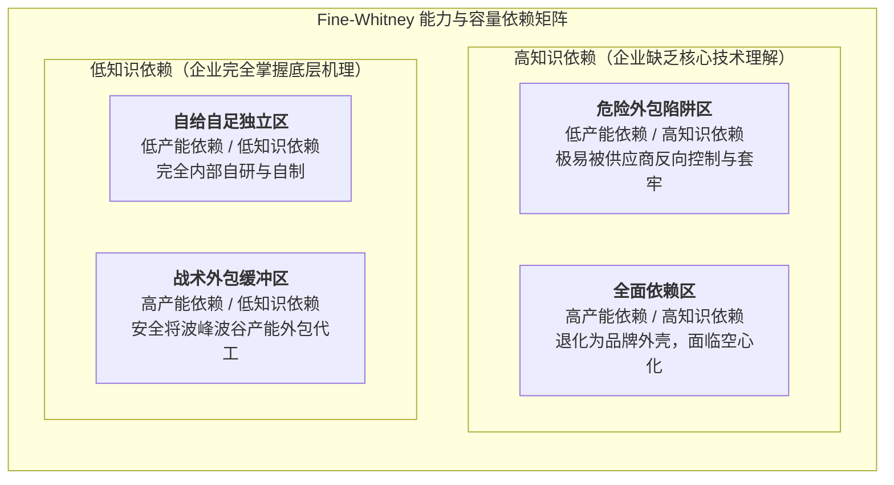

# Lec 7 垂直一体化与外包边界决策（Vertical Integration & Outsourcing）

## TL;DR

- 交易成本经济学（TCE）确立了资产专用性、交易频率与不确定性对企业自制或外购边界的决定性作用。
- 法恩与惠特尼矩阵从能力依赖（知识）与容量依赖（产能）双重视角重塑了外包风险评估模型。
- 外包的隐性风险在于组织制造与工程直觉的逐渐空心化，以及供应商向上游逆向攀升后的套牢威胁。

## 一、交易成本经济学（TCE）与科斯企业边界理论

在微观经济学与企业理论中，企业究竟应当自行制造某一零部件（Make），还是从外部自由市场公开采购（Buy）？诺贝尔经济学奖得主罗纳德·科斯（Ronald Coase）与奥利弗·威廉姆森（Oliver Williamson）提出的交易成本经济学（Transaction Cost Economics, TCE）为此奠定了坚实的理论基石。

科斯指出，利用市场价格机制是有摩擦成本的（包括信息搜寻、价格谈判、合约签订与履约监督等交易成本）。当企业内部组织协调一项活动的边际管理成本**低于**在公开市场上完成该项交易的边际交易成本时，企业边界便会向外扩张，选择垂直一体化；反之则选择市场外包。

::: definition [威廉姆森交易成本三维度]
威廉姆森指出，驱动交易成本急剧上升的三大核心要素为：
1. **资产专用性（Asset Specificity）**：该交易所依赖的物理模具、技术工艺或人力技能是否只能用于单一客户？专用性极高时，沉没资本在第二用途上的价值严重贬损。
2. **环境与行为不确定性（Uncertainty & Complexity）**：未来需求、技术路线是否充满不可预知的突变？合约越难以穷尽未来的各种偶然情形。
3. **交易频率（Frequency）**：该项商业交互是一次性偶发还是长期高频发生？高频交易更有利于分摊一体化管理架构的固定成本。
:::

当**高资产专用性**与**高不确定性**交织在一起时，有限理性（Bounded Rationality）与机会主义倾向（Opportunism）会导致严峻的“套牢问题”（Hold-up Problem）。拥有专用资产的一方或掌握采购话语权的一方极易在合作中途毁约或强行压价，迫使理性企业最终选择将该资产收归内部，实行完全自制。

## 二、法恩-惠特尼（Fine & Whitney）依赖矩阵

麻省理工学院查尔斯·法恩与丹尼尔·惠特尼（Daniel Whitney）提出了超越单纯财务成本核算的战略外包评估工具——依赖度二维矩阵。他们深刻指出：**企业对外部供应商的依赖，必须严格区分“对产能的依赖”与“对知识的依赖”**：

### 1. 战术外包缓冲（Tactical Outsourcing）
企业完全掌握产品的底层工程原理、工艺设计与公差分配（低知识依赖），仅仅因为自身工厂投资上限或为了对冲市场峰值需求，将部分组装代工交给外部代工厂（高产能依赖）。这种外包是高度可控且安全的，因为企业随时具备更换代工厂或收回自制的能力。

### 2. 战略外包陷阱（The Strategic Hollowing Out）
企业不仅让供应商承担制造组装，甚至因内部工程团队裁撤而将详细工程图纸设计、物料选型与测试全权交由外部黑盒（高知识依赖）。随着时间推移，企业彻底丧失了辨别技术优劣与评估真实制造成本的能力，陷入被供应商长期要挟的困境。

::: example [波音 787 梦想客机的过度外包教训]
波音在研发 787 梦想客机时，激进推行了超越以往的全球一级外包战略。波音不仅外包零部件生产，甚至将复合材料机身段的设计所有权、整体测试以及下级供应链管理权全盘甩给一级供应商（Tier 1）。
这种过度外包带来了灾难性后果：不同供应商生产的机身截面在最终组装时由于公差标准不一致无法拼接；电池过热隐患难以溯源；原本宣称缩减成本的项目最终延期三年以上，超支数百亿美元。波音随后不得不斥资数十亿美元将关键机身工厂重新收购回购为自营资产。
:::

## 三、外包中的组织制造直觉空心化（Hollowing Out）

哈佛商学院皮萨诺与西哈（Gary Pisano & Willy Shih）在《制造繁荣》（Producing Prosperity）中提出了强烈的行业预警：**研发与制造并非可以随意割裂的模块。在许多前沿硬科技领域，“制造过程本身就是研发的实验室”**。

当企业为了追逐季度的每股收益（EPS）将物理制造长期外包时，会悄然切断产品设计师与车间工艺之间的反馈闭环：

- 设计师不再直观了解最新数控机床的加工公差与材料应力分布，设计出的图纸往往无法以经济方式制造。
- 下一代具有颠覆性的工艺创新（如纳米级表面处理、特种焊接工艺）往往在代工厂的车间现场孕育。外包使跨国巨头无缘这一创新策源地，将创新的果实拱手相让给成长起来的代工厂。

::: pitfall [外包成本计算中的短视：忽视系统级协同损耗]
财务部门在做自制或外购分析时，往往采用简单的“外部采购报价 vs. 内部直接人工+材料成本”进行比对。这种核算方法系统性遗漏了跨国履约监控、知识产权流失风险、质量争议排查工时以及关键工程人才流失等巨额隐性沉没成本。
:::

## 我的理解

自制与外购的权衡是所有工程技术带头人与管理者必须直面的战略大考。

1. **守住知识内核，外包弹性容量**：永远不要把自身核心产品的工程知识产权与底层设计能力外包给任何第三方。你可以让代工厂替你拧螺丝，但螺丝的扭矩定额、公差配合逻辑与失效模式分析必须牢牢掌握在自己的架构师手里。
2. **警惕外包的不可逆性**：拆除一座工厂、裁撤一支经验丰富的制造工程团队只需一个财季的决议，但若想在五年后重新重建这一生产线的工艺积累与熟练技工团队，往往需要付出十倍于当年的资金与极其漫长的时间。
3. **构建可信的战略双源供应链（Dual-sourcing）**：对于核心战略物料，最稳健的做法是保持“内部自制 30%-50% + 外部采购 50%-70%”的双轨运行机制。内部自制产线不仅能作为压制外部供应商暴利报价的价格标杆，更是企业持续锤炼底层工艺知识与应急保供的特种部队。
