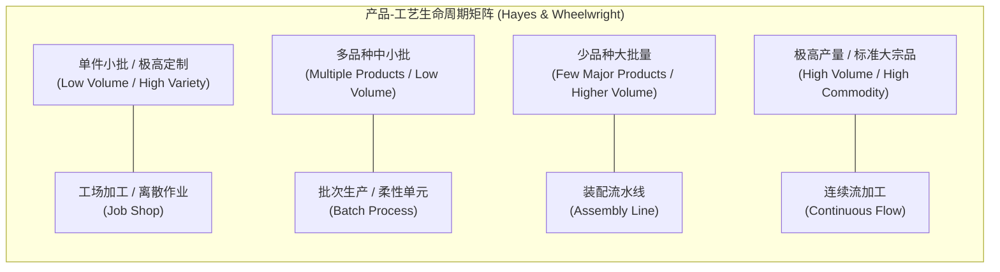

# Lec 9 工艺技术决策与多工厂制造网络（Process Technology Decisions & Multiple Plants）

## TL;DR

- 产品-工艺矩阵（Product-Process Matrix）揭示了产量规模、产品标准化程度与工艺流程结构之间的对角线匹配规律。
- 斯金纳聚焦工厂（Focused Factory）概念指明生产系统必须按产品、工艺或客户细分进行目标聚焦，避免非聚焦工厂的多目标冲突。
- 多工厂制造网络通过领先工厂、贡献工厂与服务工厂的角色分工，实现全球制造网络的知识共享与规模经济协同。

## 一、产品-工艺矩阵（Product-Process Matrix）与对角线对齐

在制造业战略中，工艺技术的选择绝非单纯的机械工程决策，而是决定企业成本结构与柔性边界的战略核心。哈佛商学院罗伯特·海斯（Robert Hayes）与史蒂文·惠尔赖特（Steven Wheelwright）提出了著名的“产品-工艺生命周期矩阵”：

### 1. 对角线匹配原则（Diagonal Alignment）
矩阵的对角线代表了经济学上的效率前沿：
- **左上角（Job Shop）**：适用于产品生命周期初期的定制开发与小批量试制。依靠通用机床与高度熟练的高薪技工，具备极高产品柔性，但单位变动成本高昂。
- **右下角（Continuous Flow）**：适用于石油炼化、基础化工与造纸等重资产大宗品。依靠重型专用连续流装备，单位固定资产折旧极高但边际变动成本趋近于零，系统极度缺乏产品切换柔性。

::: pitfall [偏离对角线的致命惩罚（Out-of-Diagonal Traps）]
- **左下角陷阱（工艺过于刚性）**：为定制化或需求不确定的小批量产品投资了昂贵的刚性流水线，导致设备稼动率极低，巨额固定资产折旧迅速吞噬所有毛利。
- **右上角陷阱（工艺过于原始）**：面对数十万件的标准化大规模订单，依然采用分散工场的单件手工流转，导致人力成本暴涨、交期失控且质量一致性彻底崩溃。
:::

## 二、斯金纳聚焦工厂（Focused Factory）原则

威肯·斯金纳在 1974 年发表的论文《聚焦工厂》指出了传统大型制造企业的通病：管理层试图在一座工厂的屋檐下，同时满足高精度定制样件（追求柔性与极致性能）与数百万件大众消费品（追求极致低成本）的制造需求。

斯金纳指出，这种“全能型非聚焦工厂”必然导致互相冲突的制造任务在车间现场争夺机床和工人工时。最终的结果是：定制件成本过高且交期延误，标准件质量波动且无法发挥规模效应。

::: definition [聚焦工厂（Focused Factory）]
聚焦工厂主张将生产设施的使命收敛为单一、明确且狭窄的竞争目标。工厂在厂房布局、设备选型、薪酬激励、调度算法与工程支持等方面全部围绕该特定任务进行定制。
:::

### 聚焦的四大经典维度
1. **产品聚焦（Product Focus）**：整座工厂仅生产单一产品线或高度相关的系列产品。
2. **工艺聚焦（Process Focus）**：专门承担某类核心工艺（如精密压铸、晶圆制造、表面热处理）。
3. **客户/市场聚焦（Market Focus）**：专门服务特定地理区域或特定行业客户（如航空航天级与汽车级产线物理隔离）。
4. **产量/批量聚焦（Volume Focus）**：设立独立的“厂中厂”（Plant-Within-a-Plant, PWP），将快反样件试制车间与连续量产车间完全物理隔开。

## 三、全球多工厂网络（Multi-Plant Networks）的拓扑协同

现代跨国制造企业通常管理着分布在全球数十个节点的工厂网络。费多斯（Kasra Ferdows）提出了多工厂制造网络中海外工厂的战略角色分工阶梯：

- **离岸工厂（Offshore Plant）**：仅利用当地低廉劳动力或能源要素，生产低成本零部件并全额出口，内部工程技术能力薄弱。
- **服务器工厂（Server Plant）**：主要为克服东道国的关税壁垒、外汇管制或满足本地化法规，专为服务特定区域市场而设立。
- **贡献工厂（Contributor Plant）**：不仅承担量产制造，还建立专门的工艺改良实验室，自主优化产品设计与供应商开发。
- **先导工厂（Lead Plant）**：掌握行业最前沿的核心制造工艺研发能力。作为新产品导入（NPI）的首发基地，负责孵化成熟工艺并向全球其他子工厂分发标准 SOP 与技术骨干。

::: example [全球晶圆代工巨头的先导厂与量产厂联动]
台积电在台湾新竹的大本营工厂（如 Fab 12、Fab 20）扮演着绝对的“先导工厂（Lead Plant）”角色。研发副总与制程科学家在此攻关 2nm/A16 极限制程，将成千上万个工艺配方优化至量产良率门槛后，再以“复制粘贴”（Copy-Exact）机制将成熟机台配置分发至台南 GigaFab 以及美国、日本的海外制造节点，实现全球网络的高效协同。
:::

## 我的理解

工艺技术的选型往往决定了企业未来五到十年的资本回报率底层曲线。

1. **软件工程中的聚焦原则**：斯金纳的聚焦工厂理论不仅适用于物理机床，完全适用于研发微服务架构。当一个单体系统试图同时处理高并发实时事务写入与离线复杂大数据分析时，系统必然崩溃。将高吞吐链路与分析型链路在代码架构与基础设施层物理解耦，正是数字时代的“厂中厂”实践。
2. **警惕过度自动化的虚荣指标**：自动化程度并非越高越好。马斯克在特斯拉 Model 3 经历“生产地狱”后公开承认：“过度自动化是个错误，人类被低估了。”在工序尚未完全稳定、公差控制尚有变异的阶段盲目引入极其复杂的自动化机械臂，只会把工艺隐患放大为昂贵的停机故障。
3. **工艺能力的全球分发机制**：拥有多工厂网络的企业，其核心资产不仅是物理设备，更是跨厂区无损迁移工艺知识的组织能力。建立结构化的数字化工艺参数中台，让先导工厂的调优经验秒级同步至全球工厂，是实现网络级竞争力的必由之路。
