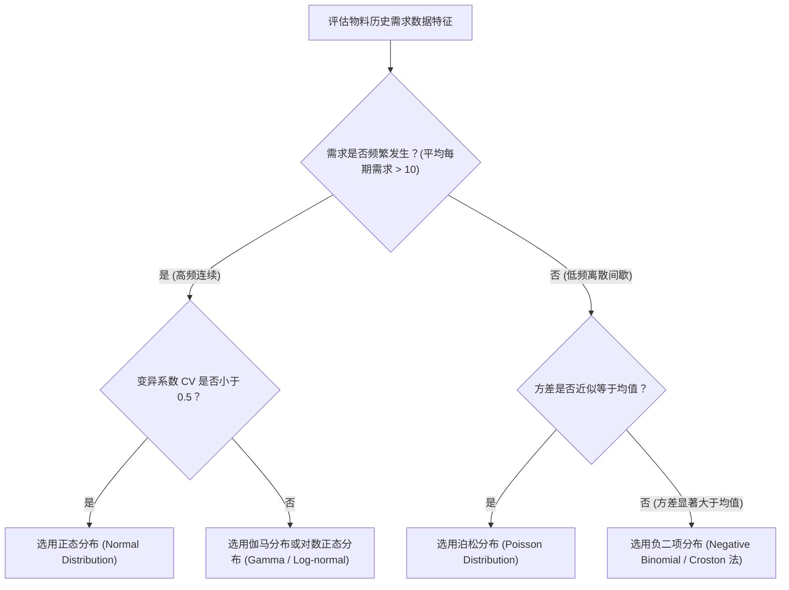

# Lec 10 物流系统概率统计基础与分布拟合（Review of Probability and Statistics for Logistics）

## TL;DR

- 从确定性到随机性：正态分布、泊松分布与负二项分布在物流需求中的适用边界。
- 前置时间需求（Lead Time Demand, LTD）卷积公式与均值方差的合成法则推导。
- 极端长尾风险：高阶矩偏度（Skewness）与峰度（Kurtosis）对安全库存缓冲的冲击。

## 一、物流系统常见随机变量分布与选型准则

在物流系统运营与库存推演中，不确定性不再用单一数字描述，而是由概率密度函数 $f(x)$ 与累积分布函数 $F(x) = P(X \le x)$ 刻画。根据物料周转特征选择契合的概率分布，是避免库存模型失真的第一步：

1. **正态分布（Normal Distribution）**：
   - 适用于高流速、需求相对对称连续的大宗畅销品（$CV = \sigma / \mu < 0.5$）；
   - 根据中心极限定理，大量独立随机微观客户需求的加总自然收敛于正态分布。
2. **泊松分布（Poisson Distribution）**：
   - 适用于低频偶发、长尾且单次需求量离散较小的备品备件（如飞机发动机稀有零件）；
   - 其均值与方差完全相等：$E[X] = Var(X) = \lambda$。
3. **负二项分布（Negative Binomial Distribution）**：
   - 适用于呈现“群聚爆发（Lumpy/Intermittent Demand）”的物料（方差远大于均值：$Var(X) > E[X]$）。

## 二、前置时间需求（Lead Time Demand, LTD）的方差合成

在补货周期中，从发出采购订单到货物完全入库上架经历的时间周期 $L$ 内，累积发生的总需求被称为**前置时间需求（$D_L$）**。

在实际环境中，日需求 $D$ 与前置时间天数 $L$ 往往**同时具备随机波动性**。设日需求均值为 $\mu_D$、方差为 $\sigma_D^2$，订货提前期均值为 $\mu_L$、方差为 $\sigma_L^2$，且二者相互独立。

::: theorem [前置时间需求的期望与方差合成公式]
利用全期望公式与全方差公式推导：
$$E[D_L] = E_L [E[D_L | L]] = E_L [L \cdot \mu_D] = \mu_L \cdot \mu_D$$
$$Var(D_L) = E_L [Var(D_L | L)] + Var_L (E[D_L | L])$$
$$Var(D_L) = E_L [L \cdot \sigma_D^2] + Var_L (L \cdot \mu_D) = \mu_L \cdot \sigma_D^2 + \mu_D^2 \cdot \sigma_L^2$$
因此，前置时间需求的合成标准差为：
$$\sigma_L = \sqrt{\mu_L \sigma_D^2 + \mu_D^2 \sigma_L^2}$$
:::

::: insight
公式中右侧第二项 $\mu_D^2 \cdot \sigma_L^2$ 具有巨大的破坏力！请注意：它是以**日需求均值的平方 $\mu_D^2$** 作为乘数因子的。这意味着：**供应商交期波动（$\sigma_L$）对系统总不确定性的放大效应，远远大于每日日常需求波动（$\sigma_D$）本身**！如果一个畅销爆品每天卖 1000 件，哪怕供应商交期只浮动 2 天，其产生的库存冲击相当于每日需求产生数万件的剧烈晃动。
:::

## 三、中心极限定理在多周期聚合中的边界

经典教科书常假设：“将多个连续周期的日需求累加，其总方差等于每日方差之和”。但这一假设成立的充要条件是：**各周期的需求相互独立且不相关（Uncorrelated）**。

一旦真实需求存在自相关性（如正自相关系数 $\rho > 0$），$L$ 个周期的聚合方差将急剧膨胀：
$$Var\left( \sum_{i=1}^L D_i \right) = L \sigma_D^2 + 2 \sigma_D^2 \sum_{i < j} \rho^{|i - j|} > L \sigma_D^2$$
若忽略需求自相关，传统模型计算出的安全库存将严重不足，导致企业在需求持续走高时遭遇长达数周的系统性断货。

## 我的理解

统计学不是书斋里的抽象推导，而是物流工程师看清混沌现实的透视镜。很多平庸的管理者在遇到缺货时，第一反应是斥责销售部门“预测不准”；但只要代入 LTD 复合方差公式就会瞬间清醒：真正的罪魁祸首往往是物流自身对海外供应商交期控制不力（$\sigma_L$ 过大）。控制供应商交货的确定性与守时率，比单纯在销售端抠预测算法，能够以高出两个数量级的效率削减全网库存。
