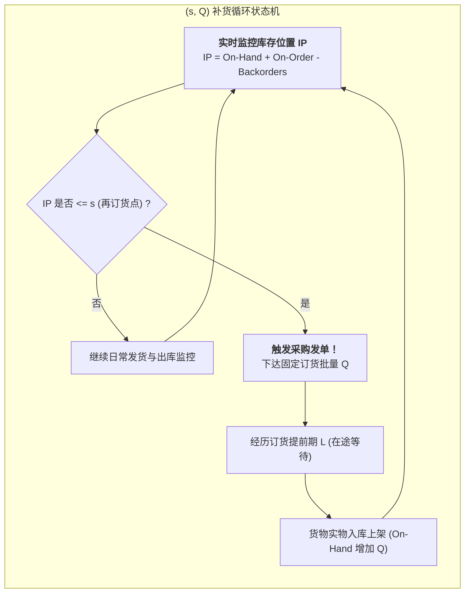

# Lec 11 随机需求与安全库存建模（Inventory Management IV: Probabilistic Demand, Safety Stock）

## TL;DR

- 连续检查补货策略 $(s, Q)$ 运作机制与再订货点（ROP）数学解析结构构建。
- 周期服务水准（Type 1 / CSL）与无缺货填充率（Type 2 / Fill Rate）本质区别。
- 正态损失函数（Normal Loss Function）推导与精确安全系数 $z$ 闭环求解。

## 一、连续检查补货策略 $(s, Q)$ 状态动力学

在随机需求环境下，最通用的库存管控机制是连续检查策略 $(s, Q)$：系统实时监控物料的**库存位置（Inventory Position, IP）**。
$$IP = \text{现有手头物理库存 (On-Hand)} + \text{在途订货 (On-Order)} - \text{客户待交欠单 (Backorders)}$$

当 $IP$ 消耗降至**再订货点（Reorder Point, $s$）**或以下时，系统立即自动触发一张批量为 $Q$ 的补货采购单。
$$s = \text{提前期内平均期望需求 } E[D_L] + \text{安全库存 (Safety Stock, } SS)$$
$$s = \mu_L \mu_D + k \cdot \sigma_L$$
其中 $k$ 为安全系数（Safety Factor），直接由企业设定的服务水准目标决定。

## 二、两大核心服务水准定义与辨析

企业在制定库存政策时，必须极其严谨地区分两类截然不同的服务水准：

::: definition [周期服务水准（Type 1 / Cycle Service Level, CSL）]
在任意一个补货补货周期内，**不发生任何缺货事件的概率**：
$$CSL = P(D_L \le s) = F(s)$$
如果 $D_L \sim N(\mu_L, \sigma_L^2)$，则令标准正态累积分布 $\Phi(k) = CSL$，查表可得安全系数 $k$。
例如：$CSL = 95\% \implies k \approx 1.645$；$CSL = 99\% \implies k \approx 2.326$。
:::

::: definition [订单填充率（Type 2 / Fill Rate, $\beta$）]
能够直接由现有库存即时发货满足的客户需求数量占全期总需求量的百分比：
$$\beta = 1 - \frac{\text{单周期平均缺货期望量 } E[US]}{\text{单次订购批量 } Q}$$
填充率直接反映了物料交付量层面的健康度。即使一个周期发生了缺货事件（导致 $CSL = 0$），但如果只缺了 1 件，而当期总共满足了 999 件，其 $\beta$ 依然高达 99.9%！
:::

## 三、正态损失函数与填充率安全库存闭环推导

单周期内的期望缺货量（Expected Units Short, $E[US]$）等于实际需求超过再订货点 $s$ 的右侧尾部积分：
$$E[US] = \int_{s}^{\infty} (x - s) f(x) dx$$

在需求服从正态分布的假定下，通过变量代换 $z = (x - \mu_L) / \sigma_L$，可将其化为标准形式：
$$E[US] = \sigma_L \cdot G(k)$$
其中 $G(k)$ 称为**标准正态损失函数（Standard Normal Loss Function）**：
$$G(k) = \int_k^\infty (z - k) \phi(z) dz = \phi(k) - k [1 - \Phi(k)]$$

将该式代入填充率定义方程：
$$1 - \beta = \frac{\sigma_L \cdot G(k)}{Q} \implies G(k) = \frac{Q (1 - \beta)}{\sigma_L}$$

::: example [根据目标填充率反算安全库存]
某零件年需求 $D=10000$，每次订购批量 $Q=500$ 件，提前期需求标准差 $\sigma_L = 100$ 件。若管理层要求将订单填充率提升至 $\beta = 98\%$：
$$G(k) = \frac{500 \cdot (1 - 0.98)}{100} = \frac{10}{100} = 0.10$$
查标准正态损失表（或利用数值逼近），当 $G(k) = 0.10$ 时，对应的安全系数为 $k \approx 0.90$。
对比之下，若盲目按照 98% 周期服务率 CSL 计算，所需的安全系数高达 $k = 2.05$。
这意味着：**由于订货批量 $Q$ 自身在周期内提供了一定程度的缓冲容量，按真实的商业填充率核算，安全库存可以大幅精简一半以上！**
:::

## 我的理解

区分 CSL 与 Fill Rate 是初级库管与资深供应链架构师的分水岭。很多企业因为对一线业务粗暴下达“服务率必须达到 99%”而又未精确定义口径，导致计划员按 CSL 硬套公式，采购了天文数字的安全库存。理解标准正态损失函数 $G(k)$ 的数学精髓，让我们能把批量决策 $Q$ 与安全库存 $k$ 联立成一个双变量共振系统，在严苛保障终端交付率的同时，为企业释放宝贵的流动资金。
