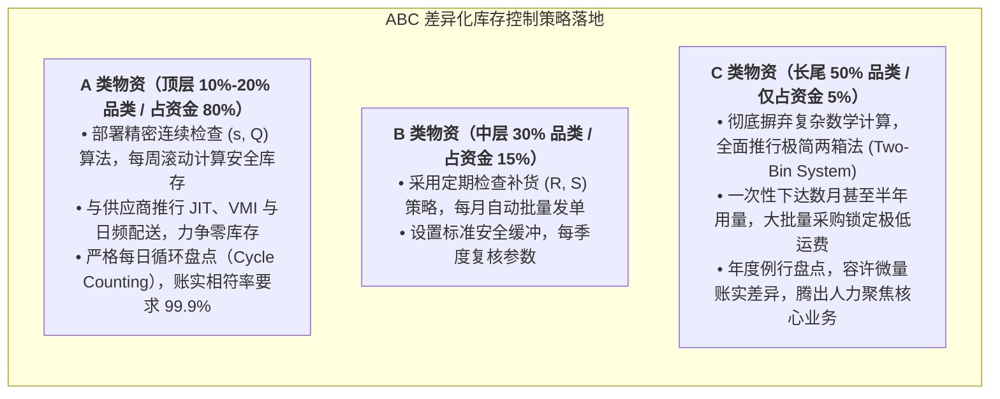

# Lec 12 缺货损失、隐含惩罚与分类管控（Inventory Management V: Backorder Costs, Implied Costs, A and C Items）

## TL;DR

- 定量刻画缺货代价：欠单等待成本、直接销售损失与客户流失长期价值惩罚。
- 反向工程：从企业现行安全库存设定中反算隐含单位缺货成本（Implied Cost）。
- 差异化管控落地：A 类高价值物资的精细算法与 C 类低价值物资的两箱法自动化。

## 一、缺货成本（Shortage Cost）的现实计量困境

在库存优化理论中，我们通常假设单位缺货成本为 $B$（每发生一件缺货惩罚 $B$ 元）。
但在企业现实经营中，很少有财务报表能给出一个精确的“缺货成本单价”：
- 如果客户允许**延期交货（Backorder）**，成本包括额外的催货加急运费、客服沟通工时与违约金补偿；
- 如果客户直接**取消订单转投竞品（Lost Sale）**，成本包含当期的毛利损失；
- 最恶劣的情形是**商誉永久受损（Goodwill Loss）**：不满意的客户在社交网络发布差评，导致该客户未来 5 年的终身价值（LTV）彻底归零。

由于这些隐性损失极难在事前通过会计凭证精确计量，许多企业干脆直接放弃建模，导致库存决策失去指引。

## 二、隐含缺货成本（Implied Shortage Cost）反向工程

MIT 15.770J 提出了一个极具颠覆性的工程视角：**如果我们无法直接测算 $B$，我们可以通过观察企业当前实际执行的库存政策，反推其行为背后所“默认承认”的隐含单位缺货成本（$B_{implied}$）！**

在连续检查延期交货模型中，年总库存相关成本函数为：
$$TC(s, Q) = \frac{D}{Q} S + h \left( \frac{Q}{2} + s - \mu_L \right) + \frac{D}{Q} B \cdot E[US]$$
将 $E[US] = \sigma_L G(k)$ 代入，对安全系数 $k$ 求偏导并令其为 0：
$$\frac{\partial TC}{\partial k} = h \sigma_L + \frac{D}{Q} B \sigma_L \frac{\partial G(k)}{\partial k} = 0$$
由于 $\frac{\partial G(k)}{\partial k} = \Phi(k) - 1$，整理可得最优条件：
$$1 - \Phi(k^*) = \frac{Q \cdot h}{D \cdot B}$$

::: theorem [隐含缺货成本反算公式]
若企业当前实际采用的安全系数为 $k$，订购批量为 $Q$，则其决策行为所隐含的单位缺货损失为：
$$B_{implied} = \frac{Q \cdot h}{D \cdot [1 - \Phi(k)]}$$
:::

::: example [跨品类隐含成本的荒谬倒错]
某装备制造厂分析发现：
- 对于某昂贵核心电机（A 类）：由于资金压力，计划员将其安全系数定为 $k=1.28$（CSL=90%），反算其 $B_{implied} = 85$ 元；
- 对于某普通小垫圈（C 类）：由于库管员怕断货被骂，随手加了一大堆库存，安全系数 $k=3.09$（CSL=99.9%），反算其 $B_{implied} = 12000$ 元！
这意味着企业管理层在潜意识里**认为一个廉价垫圈缺货的后果严重程度是核心电机的 140 倍**！这种全公司资源配置的巨大扭曲，在没有经过量化反向审计之前，完全处于隐蔽黑盒状态。
:::

## 三、A 类与 C 类物资的实战差异化落地

ABC 分类的核心思想是将极其有限的精细化运筹精力聚焦在关键少数上。在现代拥有成千上万个物料编号（SKU）的仓储中心，如果对所有物资实施无差别的精细化数学管控，不仅会导致采购和计划部门的人力成本极度膨胀，更会导致关键高价值物料的断供风险被大量低价值琐碎事务所淹没。

科学的物资分级管理要求建立差异化的管控流程与授权体系。针对不同类别的物料，应当匹配完全不同的补货周期、盘点频次、安全系数与供应商协同机制：

通过建立清晰的 ABC 分级控制矩阵，企业可以释放出超过 70% 的日常例行管理精力。采购员不再需要每天疲于奔命地为几百种螺栓垫圈提报申请审批，而是能够集中精力与 A 类核心战略供应商进行高价值技术谈判与 VMI 协同。

::: definition [经典两箱法（Two-Bin System）运作机制]
仓库物理上设置两个物料箱：
1. 一线工人日常直接从 1 号箱中取料使用；
2. 一旦 1 号箱全部用空，将空箱直接放置在采购通道，此动作自动触发采购补货；
3. 在补货采购提前期内，工人开始消耗 2 号箱中的安全库存；
4. 当新批次物料到货后，先将 2 号箱补满，多余物料装入 1 号箱。全流程无需扫码或录入系统，极度精简高效。
:::

## 我的理解

反向工程隐含缺货成本，是麻省理工学院供应链教学中最具穿透力的思想武器之一。它像一面照妖镜，把企业日常运营中那些自相矛盾的习惯与拍脑袋决策暴露无遗。管理没有免费的午餐，任何安全库存数字的背后都标着企业所承担的真实财务价格。通过将隐性的偏好显性化，再配合 ABC 分类的极简两箱法，我们才能在企业内部建立起一套逻辑自洽、边界清晰的卓越仓储秩序。
