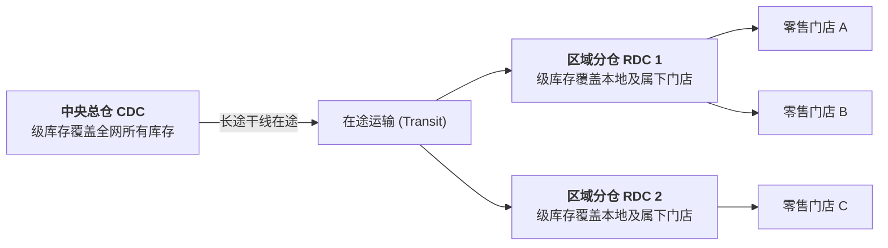

# Lec 13 库存专题实战：多级库存与前置时间波动（Problem Solving: Multi-Echelon & Lead Time Variability）

## TL;DR

- 前置时间波动（Lead Time Variability）对系统总方差的倍增机理深度数学推演。
- 多级供应链串联系统（Serial Systems）中的各级库存位置（Echelon Stock）概念。
- 集中式 vs. 分散式仓网库存汇聚效应（Square Root Law）的量化节约边界。

## 一、提前期方差的复合冲击解构

我们在第 10 讲中给出了前置时间需求方差的合成公式：
$$\sigma_{LTD}^2 = \mu_L \sigma_D^2 + \mu_D^2 \sigma_L^2$$

为了在实战中彻底吃透这一模型，我们通过一个大型汽车零部件分销网络的真实场景进行敏感性对比：

::: example [交期压缩 vs. 需求平滑的收益对决]
某分销商每日零件需求均值 $\mu_D = 200$ 件，标准差 $\sigma_D = 40$ 件。原先采用某传统铁路承运商，交付提前期均值 $\mu_L = 10$ 天，标准差 $\sigma_L = 3$ 天。
计算当前总方差：
$$\sigma_{LTD}^2 = (10)(40^2) + (200^2)(3^2) = 16,000 + 360,000 = 376,000 \implies \sigma_{LTD} \approx 613.2 \text{ 件}$$
注意：**交期波动贡献了整个不确定性总方差的 95.7%（360,000 / 376,000）！**

此时企业面临两个改进方案：
- **方案 A（优化销售预测）**：投资 50 万元引入高精预测软件，将日需求标准差 $\sigma_D$ 砍掉一半（降至 20 件）；
  - 改善后的总方差：$\sigma_{LTD}^2 = (10)(20^2) + 360,000 = 4,000 + 360,000 = 364,000 \implies \sigma_{LTD} \approx 603.3 \text{ 件}$（总标准差仅微降 **1.6%**！）
- **方案 B（更换可靠准时承运商）**：与某具备 GPS 全程监控的高铁货运企业签约，交期均值同样为 10 天，但交期标准差 $\sigma_L$ 压缩至 1 天；
  - 改善后的总方差：$\sigma_{LTD}^2 = 16,000 + (200^2)(1^2) = 16,000 + 40,000 = 56,000 \implies \sigma_{LTD} \approx 236.6 \text{ 件}$（总标准差暴降 **61.4%**！）
:::

这一计算结论具有决定性的实战指导意义：在绝大多数供应链场景中，**缩减物流交付前置时间的方差，其减存降本效果是优化需求预测算法的数十倍**！

## 二、级库存（Echelon Stock）理论

在跨越“中央总仓（CDC）$\to$ 区域分仓（RDC）$\to$ 零售网点”的多级分销系统中，如果仅看每个网点本地的手头库存（Local Stock），往往会产生严重的局部次优误判。

::: definition [级库存（Echelon Stock）]
某个特定节点 $j$ 的级库存（$ES_j$），定义为**该节点当前手头现有物理库存，加上该节点下游所有各级仓库手头库存、在途运输库存的总和，再减去终端客户的累计欠单**：
$$ES_j = \text{Local Stock}_j + \sum_{k \in Downstream(j)} (\text{In-Transit}_k + \text{Local Stock}_k) - Backorders$$
:::

引入级库存概念后，全网补货决策被彻底重塑：上游中央总仓补货并不取决于下游各个分仓是否刚巧把本地货架用空，而是取决于**全系统总级库存是否穿透了全网再订货点**。这一理论有效根除了由于各级库管员各自独立打提前量导致的牛鞭效应。

## 三、网络集中化与风险汇聚（Risk Pooling）平方根法则

将分散在 $N$ 个独立区域小仓的库存集中合并至 1 个大型中央物流中心，全系统所需总安全库存的变化规律服从著名的**平方根法则（Square Root Law）**：

::: theorem [库存开方根汇聚定理]
设各区域市场需求相互独立且具有相同的标准差 $\sigma$，服务水平目标相同：
- $N$ 个分散小仓所需总安全库存为：
  $$SS_{decentralized} = \sum_{i=1}^N k \sigma \sqrt{L} = N \cdot k \sigma \sqrt{L}$$
- 合并为 1 个中央大仓后，总需求方差为各区域方差之和：$\sigma_{central}^2 = N \sigma^2 \implies \sigma_{central} = \sqrt{N} \sigma$；所需总安全库存为：
  $$SS_{central} = k (\sqrt{N} \sigma) \sqrt{L} = \frac{SS_{decentralized}}{\sqrt{N}}$$
:::

若将原本分散在全国 16 个省份的独立小仓（$N=16$）集中合并为 1 个全国总仓，理论上全网总安全库存可以瞬间直降：
$$1 - \frac{1}{\sqrt{16}} = 1 - \frac{1}{4} = 75\%!$$

当然，集中化带来的代价是干线向末端的平均运输里程拉长、末端配送时效变慢。物流网络架构师的终极任务，正是寻找使“仓储安全库存节省额”与“干线末端运费增量”之和达到全系统极小值的最优仓网数量 $N^*$。

## 我的理解

多级库存运筹是空间维度与时间维度的交响乐。它告诉我们，切忌以孤立静止的眼光审视单一仓库的盈亏。通过将视角提升至全网“级库存”维度，我们得以摆脱各部门各自为政的近视症；而开方根法则则赋予了我们向网络冗余开刀的坚定信心——用信息的集中透明代替物理的盲目割裂，才是现代物流网络进化的永恒主线。
