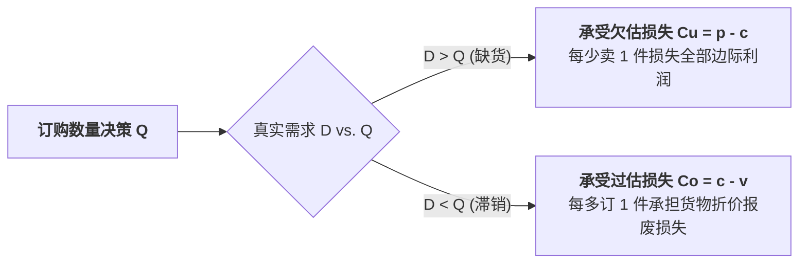

# Lec 14 易腐与时尚品库存：报童模型进阶（Inventory Management VI: Special Products — Fashion, Style, and Perishable Goods）

## TL;DR

- 单周期一次性采购决策：时尚潮品、新鲜果蔬与短生命周期电子产品的核心困境。
- 临界分位数（Critical Fractile）推导：过估滞销损失 $C_o$ 与欠估缺货损失 $C_u$ 的黄金平衡。
- 需求分布非对称与离散场景下的报童模型求解与季末残值清仓闭环管理。

## 一、单周期库存问题的商业本质

与可以跨周跨月连续补货的常备工业品不同，商业世界中有很大一部分商品属于**单周期易腐与时尚品（Single-Period / Perishable Goods）**：
- 巴黎时装周走秀款高定大衣（销售季节仅有短短 6 周，过季即彻底贬值）；
- 当天早晨印制的报纸或出炉的面包（当晚未售出只能按废纸废料报废）；
- 某跨年演唱会的门票或春节生肖文创衍生品。

对于此类商品，由于生产供应链提前期极长（如面料印染与海外缝制需数月），企业在销售旺季到来之前**只有且仅有一次不可追加的下单机会**。

## 二、经典报童模型（Newsvendor Model）推导

设企业决定订购数量为 $Q$，市场真实需求为随机变量 $D$，概率密度为 $f(x)$，累积分布为 $F(x)$。
定义两个核心边际损益参数：
1. **欠估损失（Underage Cost, $C_u$）**：若多订购 1 件且售出所获得的边际利润：
   $$C_u = p - c$$
   （$p$ 为正常零售售价，$c$ 为单位采购成本）
2. **过估损失（Overage Cost, $C_o$）**：若多订购 1 件但未售出所承受的边际净损失：
   $$C_o = c - v$$
   （$v$ 为季末残值回收价或打折变现价，必然有 $v < c$）

### 期望利润函数与极值求解
全期期望利润等于期望总销售收入减去采购成本，再加上未售出存货的期望残值：
$$E[\Pi(Q)] = p E[\min(D, Q)] + v E[\max(0, Q - D)] - c Q$$
根据边际分析法（Marginal Analysis），考虑订购量由 $Q$ 增加微小增量 $dQ$ 时的期望利润边际变化：
$$\frac{d E[\Pi]}{dQ} = C_u \cdot P(D > Q) - C_o \cdot P(D \le Q) = 0$$
代入 $P(D > Q) = 1 - F(Q)$：
$$C_u [1 - F(Q^*)] - C_o F(Q^*) = 0 \implies F(Q^*) (C_u + C_o) = C_u$$

::: theorem [临界分位数准则（Critical Fractile Rule）]
使期望利润最大化的最优订购量 $Q^*$ 必须满足其累积不缺货概率恰好等于临界分位数比率：
$$F(Q^*) = \frac{C_u}{C_u + C_o} = \frac{p - c}{(p - c) + (c - v)} = \frac{p - c}{p - v}$$
若需求服从均值为 $\mu$、标准差为 $\sigma$ 的正态分布，则：
$$Q^* = \mu + z^* \cdot \sigma$$
其中安全系数 $z^* = \Phi^{-1}\left( \frac{C_u}{C_u + C_o} \right)$。
:::

## 三、进阶拓展：高毛利 vs. 低毛利产品的订货倾斜

临界分位数公式深刻揭示了商业直觉与运筹数学的统一：
- **高毛利暴利产品（$p \gg c \implies C_u \gg C_o$）**：
  - 临界分位数趋近于 1（如 $90\% - 98\%$）；
  - 最优决策是**大幅超额订货（$Q^* \gg \mu$）**！宁可季末堆积打折，也绝不能让顾客进门买不到，因为每成交一单的暴利足以弥补数十件滞销品的残值损失。
- **薄利代工品（$p \approx c \implies C_u \ll C_o$）**：
  - 临界分位数远小于 0.5；
  - 最优决策是**保守保守再保守（$Q^* < \mu$）**！即使面对平均期望需求，也宁可损失部分激增订单，也绝不敢多备一件库存。

::: pitfall [直觉均值陷阱]
缺乏运筹学常识的经理人最普遍的错误，就是机械地将订货量定为“平均预测需求 $\mu$”。只有当 $C_u = C_o$（即每多卖一件赚的钱恰好等于多订一件亏的钱）时，$Q^*$ 才恰好等于 $\mu$。在任何其他商业不对称场景下，订购均值 $\mu$ 必然导致系统性次优亏损。
:::

## 我的理解

报童模型是微积分与商业博弈结合的最纯粹杰作。它将复杂的心理焦虑简化为一个优雅的分数比率 $\frac{C_u}{C_u + C_o}$。在面对不确定性时，追求“绝对零滞销”或“绝对零断货”都是极端幼稚的。真正的成熟管理者，懂得拥抱统计学的不完美，利用临界分位数这把尺子，精准地在贪婪与恐惧之间画下最理性的分割线。
