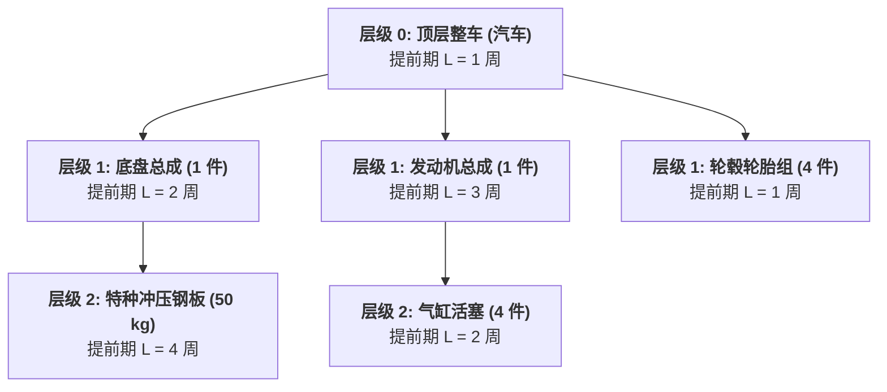

# Lec 15 物料需求计划 MRP 与配送资源计划 DRP（Inventory Management VII: MRP and DRP Systems）

## TL;DR

- 独立需求与相关需求本质区分：物料清单（BOM）多级展开与时间分段排程。
- MRP 运算核心逻辑：毛需求、在途入库、净需求与计划产出下达的矩阵推演。
- 将 MRP 逻辑向分销网络镜像拓展：配送资源计划（DRP）全网多级调拨推演。

## 一、独立需求与相关需求的范式革命

约瑟夫·奥利基（Joseph Orlicky）于 20 世纪 60 年代提出了划时代的理论分水岭：
- **独立需求（Independent Demand）**：来自企业外部最终客户对整机成品的购买需求。其发生具有随机性，只能通过前述时间序列、因果分析或巴斯模型进行统计预测，并应用 EOQ 与安全库存法进行管理；
- **相关需求（Dependent Demand / Derived Demand）**：制造该成品所需的内部所有零配件、外购原材料与包装辅料的需求。一旦顶层成品的生产计划敲定，底层物料的需求量可以通过产品工程结构图**精确无误地数学计算出来**，绝不允许再单独去做所谓的统计预测！

::: definition [物料清单（Bill of Materials, BOM）]
一种用树状层级结构表达的工程技术文件，详尽列明生产一件父项（Parent Item）所需的全部子项（Component Items）物料代码、规格、装配单耗（Quantity per Assembly）及提前期偏置。
:::

## 二、MRP 标准运算递推逻辑

物料需求计划（Material Requirements Planning, MRP）根据主生产计划（MPS）、BOM 展开结构和当前库存状态记录，按时间分段（Time Buckets）逐层推进核心四步运算：

::: theorem [MRP 净需求递推基本方程]
对于任意物料在第 $t$ 期的运算逻辑：
1. **可用期初库存（Beginning Inventory）**：
   $$I_t^{avail} = I_{t-1}^{ending}$$
2. **净需求（Net Requirements, $NR_t$）**：
   $$NR_t = \max\left(0, GR_t - I_t^{avail} - SR_t + SS\right)$$
   （$GR_t$ 为毛需求；$SR_t$ 为确认预定入库量 Scheduled Receipts；$SS$ 为安全库存阈值）
3. **计划产出入库（Planned Order Receipts, $PORec_t$）**：
   根据选定的批量规则（如 Lot-for-Lot、固定批量或 Silver-Meal），将 $NR_t$ 向上调整为合规批量；
4. **计划订单下达（Planned Order Releases, $PORel_{t - L}$）**：
   根据装配或采购提前期 $L$，将计划入库量向前反向时移偏移 $L$ 个周期：
   $$PORel_{t - L} = PORec_t$$
   该物料的下达量 $PORel$ 随即乘上装配用量，转化为其所有下级子项物料的毛需求 $GR$！
:::

## 三、配送资源计划（Distribution Requirements Planning, DRP）

如果说 MRP 是在工厂车间“从产品向原材料”反向倒推装配物料，那么**DRP 则是将完全相同的逻辑镜像复制到物流仓网中**——“从末端零售店向中央大仓反向倒推补货发运”：

DRP 彻底根除了传统分销网络中“各分仓私自打电话向总仓争抢货源”的无序混乱。通过时间分段的调拨推演，总仓能够提前数周清晰洞察何时何地会出现库容短缺，从而实现集装箱运力与跨区域班列的提前锁定。

## 我的理解

MRP 与 DRP 是现代工业文明在复杂计划协同领域的里程碑。它的伟大之处在于**用精准的拓扑逻辑消灭模糊的盲猜**。通过将整机爆炸拆解为毫厘不差的原子物料流，企业告别了“生产线等一颗螺丝停工待料”的尴尬耻辱。而在当代，随着算力的飞跃，MRP 与 DRP 正在与实时物联网（IoT）在途追踪无缝融合成高频动态执行系统，驱动着全球工业巨舰在惊涛骇浪中稳健航行。
