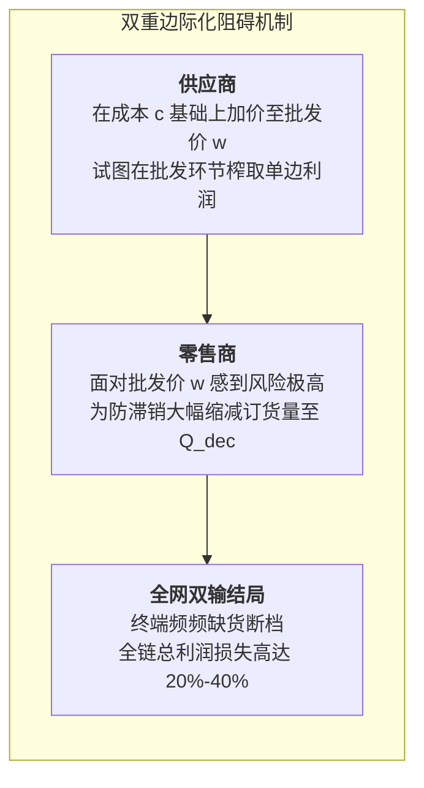

# Lec 18 供应链契约：协同机制、回购与收益共享契约（Supply Chain Contracts）

## TL;DR

- 双重边际化（Double Marginalization）博弈论证明与全网效率损失量化。
- 回购契约（Buyback Contract）参数边界与全网全局协同（Coordination）实现机制。
- 收益共享契约（Revenue Sharing）在音像租赁与现代电商供应链中的商业颠覆。

## 一、双重边际化的数学证明与效率陷阱

考虑一个由单一供应商（以单位边际成本 $c$ 生产）和单一零售商（以零售价 $p$ 面对市场随机需求 $D$）构成的分散式供应链。
供应商以批发价 $w$ 将货物卖给零售商（必然有 $p > w > c$）。

根据第 14 讲报童模型：
1. **一体化全局最优（Centralized System）**：
   若双方属于同一家公司，全系统边际利润为 $p - c$，过估损失为 $c - v$。全网最优订货量 $Q^{cent}$ 满足：
   $$F(Q^{cent}) = \frac{p - c}{p - v}$$
2. **分散批发价契约（Decentralized Wholesale Price Contract）**：
   独立零售商只关心自身利润，其边际利润仅为 $p - w$，过估损失为 $w - v$。零售商的订货量 $Q^{dec}$ 满足：
   $$F(Q^{dec}) = \frac{p - w}{p - v}$$

::: theorem [双重边际化定理（Double Marginalization）]
由于批发价 $w > c$，显而易见有：
$$\frac{p - w}{p - v} < \frac{p - c}{p - v} \implies Q^{dec} < Q^{cent}$$
**分散式决策下的订货量严格低于全供应链整体利润最大化的最优订货量！**
供应商与零售商各自在边际上加价一次（加价两次导致终端价格过高、订货过少），造成全系统无谓损失（Deadweight Loss），全网总利润遭到严重破坏。
:::

## 二、回购契约（Buyback Contract）机制设计

为了消除这一矛盾，必须设计契约机制重构双方的利益分配：

::: definition [回购契约参数架构]
供应商向零售商提供组合报价 $(w, b)$：
- 零售商以批发价 $w$ 进货；
- 销售季结束后，供应商承诺以单位价格 $b$（$b > v$）回购零售商未售出的全部滞销库存。
:::

此时，零售商的过估损失被大幅缓解为 $C_o = w - b$；而欠估收益依然为 $C_u = p - w$。零售商的临界分位数修正为：
$$F(Q) = \frac{p - w}{(p - w) + (w - b)} = \frac{p - w}{p - b}$$

::: theorem [供应链完美协同（Supply Chain Coordination）条件]
为了使零售商自愿选择全网全局最优批量 $Q^* = Q^{cent}$，必须令其临界分位数等于系统全局临界分位数：
$$\frac{p - w}{p - b} = \frac{p - c}{p - v} = \lambda \in (0, 1)$$
此时，供应商可以通过灵活调节参数 $\lambda$：
$$w = p - \lambda(p - v), \quad b = p - \lambda(p - c)$$
实现全网整体利润达到一体化最大值，同时通过调整批发价与回购价的比例，在上下游之间任意按比例分割增量利润（Win-Win Pareto Improvement）。
:::

## 三、收益共享契约（Revenue Sharing Contract）与商业颠覆

与回购契约需要实物逆向回运不同，**收益共享契约（Revenue Sharing）**通过纯资金清算达成协同：
1. 供应商以**极低甚至接近边际成本的超低批发价 $w$（$w \to c$）**向零售商供货；
2. 作为交换，零售商承诺将终端销售收入的比例 $\phi \in (0, 1)$ 无条件返还给供应商，自己仅保留 $(1 - \phi)$。

::: example [百视达（Blockbuster）音像租赁的商业奇迹]
20 世纪 90 年代末，百视达录像带租赁店面临严峻危机：好莱坞制片厂每盘新上映电影录像带向百视达收取 65 美元的高昂批发价。由于成本太高，百视达每个门店只敢采购几盘，导致 80% 的进店顾客被告知“新片已全被租空，请下周再来”，客户体验极差。
百视达随后与制片厂达成了革命性的收益共享契约：
- 制片厂将每盘录像带的批发价从 65 美元直接暴降到 **8 美元**（接近塑料压盘成本）；
- 百视达将顾客支付的租金（每次 3 美元）的 45% 直接分给制片厂。
**结果颠覆了整个行业**：百视达采购量激增 6 倍，打出“热门新片保真有货（Guaranteed in Stock）”的轰动广告；进店客流暴增，制片厂与百视达双方的总利润在一年内双双飙升超过 30%！
:::

## 我的理解

博弈论与契约理论是供应链顶层架构中最具智慧的光芒。它深刻揭示了商业世界的一个残酷真理：**当机制设计错误时，哪怕双方管理者都是极其聪明且尽忠职守的好人，博弈的结果也必然是一场双输的灾难**。回购契约与收益共享契约的魔力在于，它们通过精妙的数学对冲，将上下游从你死我活的零和压价，拉回到了休戚与共的利益共同体。这是用制度理性驯服狭隘自私的最高典范。
