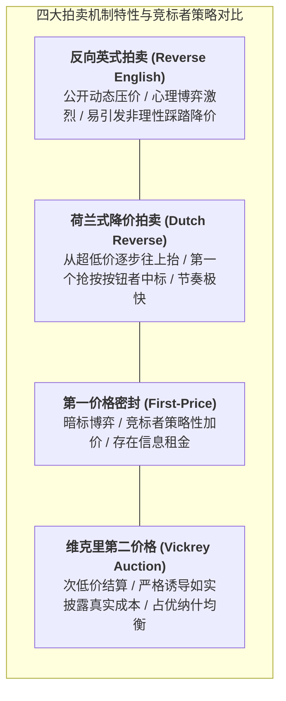

# Lec 19 供应链采购拍卖机制：反向拍卖与组合竞标（Auctions in Supply Chain Management）

## TL;DR

- 采购拍卖博弈机制：英式拍卖、荷兰式拍卖、第一价格与第二价格密封拍卖（Vickrey）。
- 反向电子拍卖（e-Reverse Auction）的降价效率、赢者诅咒（Winner's Curse）防范。
- 多标的组合竞标（Combinatorial Bidding）在物流运力包采购中的网络协同效应。

## 一、采购拍卖的博弈论基石与四大经典拍卖范式

在传统的企业大宗物资与物流运力采购中，一对一的商业谈判往往耗费漫长的周期，且由于买方无法确切知晓各个供应商的真实底层边际成本，容易被供应商结盟抱团维持高价。

拍卖机制设计（Auction Mechanism Design）通过创造公开透明的竞争博弈规则，迫使竞标者根据自身成本函数揭示真实估值：

1. **英式升价拍卖（English Auction）/ 采购反向降价拍卖（Reverse English Auction）**：
   - 采购方公布最高限价，供应商在规定时间窗口内公开互相竞相压价，价格持续单调下降，直至倒计时结束无人继续降价，最低报价者中标。
2. **第一价格密封拍卖（First-Price Sealed-Bid Auction）**：
   - 各供应商在截止日前独立提交密封报价单，彼此互不可见；开标后报价最低者中标，并严格按其所报价格结算。竞标者在“报价过低导致利润微薄”与“报价过高导致错失中标”之间寻找纳什均衡。
3. **第二价格密封拍卖（Second-Price Sealed-Bid / Vickrey 拍卖）**：
   - 威廉·维克里（William Vickrey）证明了诺贝尔经济学奖级别的真理揭示机制：报价最低者中标，**但实际结算价格按所有未中标者中的次低报价（Second-Lowest Price）执行**！
   - **理论特性**：在此机制下，“严格按照自己的真实边际成本如实报价”是每个理性竞标者的**绝对占优策略（Dominant Strategy）**！任何虚报或投机均会导致预期收益受损。

## 二、反向电子拍卖与“赢者诅咒”的系统防范

反向电子拍卖（e-RA）在工业界采购中曾掀起巨大的降本风暴，但如果设计粗糙，极易陷入毁灭性的“赢者诅咒（Winner's Curse）”：

::: definition [赢者诅咒（Winner's Curse）]
在共同价值或存在成本不确定性的竞标中，最终以最低价中标的供应商，往往不是技术最高超、管理最精益的企业，而是**对自身履约难度和材料成本估计最过于乐观、犯下最严重计算失误的企业**。
:::

当此劣币驱逐良币的中标者进入合同执行期后，很快发现自己每一单都在巨额亏损：
- 供应商开始以次充好、偷工减料；
- 遭遇原材料微小涨价即单方面毁约烂尾，导致买方整条生产线断供；
- 甚至引发破产清算，买方不得不承受紧急转单的高昂补救代价。

为防范赢者诅咒，现代物流拍卖必须引入**资格准入预审（Pre-qualification Gate）**、多属性综合评分拍卖（不仅评价格，更将历史准时率、车队车况、ESG 纳入折算系数），并设置**异常低价熔断排除机制**。

## 三、组合竞标（Combinatorial Auctions）在运力网络中的颠覆力量

在干线物流运力招标中，不同航线或公路车道（Lanes）之间存在强烈的**网络经济学网络协同效应（Network Economies & Economies of Scope）**：
- 如果一家车队只中标“北京 $\to$ 上海”的单向重载单程，返程卡车必须空驶（Deadhead），其每公里运价必须包含空载补偿；
- 但如果该车队能同时中标“北京 $\to$ 上海”与“上海 $\to$ 北京”的往返双向闭环，或者“北京 $\to$ 上海 $\to$ 武汉 $\to$ 北京”的三角循环回路，其车辆往返满载率达到 100%，边际运营成本大幅断崖式下降！

传统单线路独立拍卖强制将整体网络割裂拆解，导致承运商无法表达这种协同优势。而**组合拍卖（Combinatorial Auctions）**允许承运商对任意线路子集构成的“服务包（Bundle）”进行联合打包联合报价：
$$\text{例如：报价包 } B = \{\text{Line 1}, \text{Line 2}\} \to \text{打包总价 } 15,000 \text{ 元}$$
买方随后运行**胜者确定问题（Winner Determination Problem, WDP）**的大规模整数规划求解器，寻找使全网总运费最低的全局覆盖最优解。

## 我的理解

拍卖机制是经济学微观博弈论在供应链中最锋利的手术刀。它告诉我们，采购从来不是求爷爷告奶奶的求情，也不是蛮横无理的强盗压榨，而是一场基于信息对称度的精妙棋局。尤其在物流领域，组合拍卖的引入堪称现代运力采购的工业革命——它把承运商原本无法释放的“网络往返闭环潜能”转化为真金白银的降本红利，让博弈双方在全系统效率提升中实现真正的双赢。
