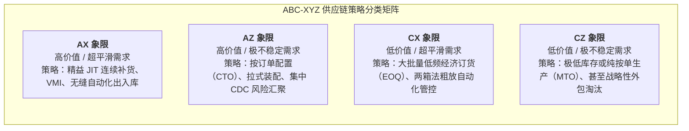
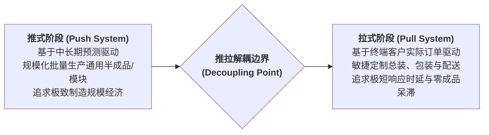

# Lec 2 供应链基本原理与细分分析（Supply Chain Fundamentals and Segmentation Analysis）

## TL;DR

- 客户与产品需求特征的多元化要求供应链从单一无差异网络向精细化细分网络跃迁。
- 基于帕累托 80/20 法则与需求波动性（CV）的多维细分矩阵构建差异化履约策略。
- 推式与拉式供应链的动态边界界定——通过延迟制造（Postponement）锁定系统弹性。

## 一、一刀切供应链（One-Size-Fits-All）的破产

在传统的企业供应链运营中，管理层通常倾向于建立一套统一的标准流程：所有的原材料按照固定的周期向供应商采购，所有的成品存放在统一规格的货架上，所有的客户订单均承诺“48 小时内发货”。

然而，现实商业环境极其严苛复杂。企业可能同时销售高频高流速的基础标准品（如基础螺栓），以及低频、极其昂贵且定制化程度极高的精密传感器。若采用一套完全无差别的运营体系：
- 对于高流速产品，由于过度严苛的审查流程导致补货繁琐、频频断档；
- 对于长尾偶发产品，若按高频产品的标准配置安全库存，则会造成巨量资金被死死套牢，最终因技术迭代变成报废呆滞料。

因此，**供应链细分（Supply Chain Segmentation）**成为现代物流系统工程提升投资回报率（ROIC）的核心利器。

## 二、基于 ABC-XYZ 的双重细分矩阵

科学的细分首先建立在客观的数据统计基础之上。最经典的方法是将销售贡献度（ABC 分析）与需求波动性（XYZ 分析）进行交叉正交分析：

::: definition [变异系数（Coefficient of Variation, CV）]
变异系数衡量需求波动的相对剧烈程度，定义为需求标准差 $\sigma_D$ 与平均需求 $\mu_D$ 之比：
$$CV = \frac{\sigma_D}{\mu_D}$$
- **X 类产品（$CV \le 0.5$）**：需求高度稳定平滑，可精确进行时间序列预测；
- **Y 类产品（$0.5 < CV \le 1.0$）**：需求存在较明显波动或季节性，需设置动态安全库存；
- **Z 类产品（$CV > 1.0$）**：偶发型、间歇性或突发式需求，传统预测工具基本失效。
:::

通过将帕累托金额价值分类（A: 前 20% 品类贡献 80% 营收；B: 中间 30% 贡献 15%；C: 尾部 50% 仅贡献 5%）与 XYZ 波动度交叉，可以得到 9 种清晰的供应链策略象限：

在系统化落地该矩阵时，企业绝不能仅仅依赖单一采购员的主观感觉，而必须由 ERP 与高级计划系统（APS）自动每季度滚动重新计算各 SKU 的 $CV$ 指标与销售权重，动态调整其在各仓网的履约路径与补货参数。

## 三、推拉边界（Push-Pull Boundary）与延迟策略

细分分析的另一大核心输出是确定不同产品的**订单解耦点（Decoupling Point）**，即推式生产与拉式履约的分水岭：

::: theorem [延迟制造原理（Principle of Postponement）]
在产品的物理制造与地理流动过程中，尽可能推迟产品最终形式（形态延迟，Form Postponement）或最终物理位置（空间延迟，Time/Place Postponement）的差异化确定时刻，直到收到真实确凿的下游订单为止。
:::

::: example
惠普（HP）打印机全球供应链是空间形态延迟的教科书级经典。过去惠普在新加坡工厂制造时就直接为欧洲不同国家配置特定的电源插头、本地化说明书与包装盒，导致法国版本滞销而德国版本严重断货。后来惠普改革为：新加坡工厂只生产完全通用的标准裸机并整箱海运至荷兰欧洲配送中心，当收到具体国家经销商采购订单后，再在荷兰当地快速装入对应语言的电源适配器与说明书。这使全欧安全库存降低了 40%，且缺货率下降至历史最低点。
:::

## 我的理解

供应链细分本质上是对企业“认知懒惰”的强力矫正。过去企业追求所谓的“标准化管理”，往往把粗暴的一刀切当成了高效，结果导致明星产品服务不好、长尾产品成本失控。真正的精细化运营，要求我们深刻理解每个 SKU 的基因密码——用极简精益的推式管道处理平稳大批量，用高响应敏捷的拉式网络应对长尾离散波动，在同一种基础设施底座上运行多条差异化的“虚拟供应链”。
