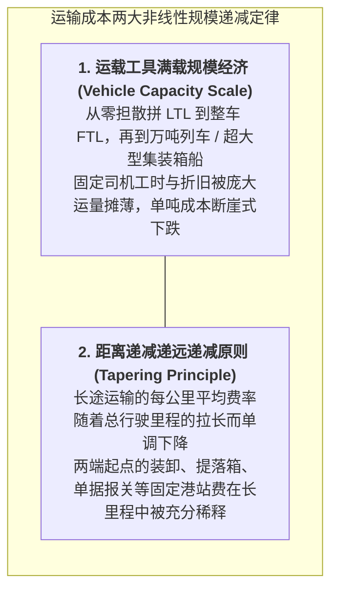

# Lec 20 运输管理 I：运力模式选择、规模经济与战略网络（Transportation I: Fundamental Concepts, Strategic Networks, Connection to Inventory Planning）

## TL;DR

- 五大运输模式（空运、海运、铁路、公路、管道）的技术经济特征与帕累托前沿。
- 货运规模经济的双重维度：运输工具重载规模（Vehicle Capacity）与距离规模（Tapering）。
- 在途库存资本沉没成本与加速运输溢价之间的总成本权衡分析模型推导。

## 一、五大基础运输方式的技术经济矩阵

运输活动是物流系统在物理空间维度上实现商品“地点效用（Place Utility）”的核心手段。不同运输载体的物理特性决定了其迥异的成本结构与服务表现：

| 运输方式 | 固定基础设施成本 | 边际变动运行成本 | 典型速度 | 运输能力/载重 | 路线灵活性 | 典型适运货物 |
| :--- | :--- | :--- | :--- | :--- | :--- | :--- |
| **航空运输 (Air)** | 极高（机队/机位） | 高（燃油/机组） | 极快 (800 km/h) | 低至中等 | 节点固定（机场） | 高货值芯片、鲜花、紧急备件 |
| **公路货运 (Motor/Truck)** | 低（公路公共投资） | 中（司机/燃油/路桥）| 中等 (60-90 km/h)| 中等 (10-30 吨) | **极高（门到门直达）**| 绝大多数工业品与消费品 |
| **铁路货运 (Rail)** | 高（轨道/机车编组） | 低（大宗牵引） | 较慢 (30-60 km/h)| 极高 (数千吨) | 轨道固定、需编组解体 | 煤炭、矿石、大宗化肥、粮食 |
| **水路/海运 (Water/Ocean)** | 极高（港口/集装箱船）| **极低（吨海里成本最低）**| 慢 (20-35 km/h)| **超大 (万箱巨轮)** | 航道固定、受泊位潮汐限制 | 跨国大宗原材料、全球集装箱贸易 |
| **管道运输 (Pipeline)** | 最高（铺设管道与征地）| 极低（电力泵站加压）| 慢且连续恒定 | 巨大且单向专用 | 极低（点对点不可挪动）| 原油、天然气、成品油、化工浆料 |

## 二、运输规模经济的两大几何规律

运输成本的形成并非简单的“每吨公里多少钱”线性累加，而是呈现出极其显著的非线性几何规模特征。物流运筹学将其抽象为两大支配性定律：运载工具容量规模效应与运距递远递减原则。

在承运实践中，货运企业的固定成本（包括车辆折旧、路桥年费、场站调度、司机基础工资等）在发车前就已经沉淀，而随里程增加的燃油与磨损消耗呈现边际平缓趋势。理解这两大非线性规模机制，是设计全网干线集运网络与定价模型的底层前提：

通过将上述两大几何规律与仓储布局相结合，现代物流网络能够实现高度协同的集约化运营。例如，干线重载长途直达（满足递远递减原则并最大化单车重载容量）配合区域枢纽周边的短途高频接驳，构成了现代多式联运货运网络的效率中枢。

::: definition [递减费率原则（Tapering Principle）]
运输费率随运输距离增加而增加，但**增加的速率逐渐递减**（即总运费函数 $C(d)$ 呈现凹函数形态：$C'(d) > 0$ 且 $C''(d) < 0$）。这意味着将长途运输人为切分成多次短途驳运，必然造成两端固定站场费用的重复收取，极度恶化整体经济性。
:::

## 三、运输与在途库存（In-Transit Inventory）的系统权衡

许多采购经理在选择物流渠道时，只看物流公司报出的运费单价：
- 海运报价：每件产品 5 美元，运输耗时 30 天；
- 空运报价：每件产品 25 美元，运输耗时 3 天。
直觉上看，空运每件贵了整整 20 美元，看似“极不划算”。

然而，这完全忽视了**在途库存持有成本（Pipeline Inventory Cost）**与**目的地安全库存缓冲成本**的巨大差异！

::: theorem [运送模式总成本决策方程]
年总物流系统成本（Total Logistics Cost, TLC）包含采购运输费、在途库存持有费与两端安全库存持有费：
$$TLC = D \cdot r + \frac{D \cdot L}{365} \cdot c \cdot i + k \sigma \sqrt{L} \cdot c \cdot i$$
其中：
- $D$ 为年出货总量；
- $r$ 为单位产品运费；
- $L$ 为运输前置时间（天数）；
- $c$ 为产品单位货值；
- $i$ 为年资本持有成本率（如 25%）。
:::

::: example [高货值芯片的运力抉择]
某企业每年从台湾向美国硅谷运送 10 万颗高性能 AI 算力芯片，单颗货值 $c = 2000$ 美元，年资本利率 $i = 25\%$。
- 采用海运（$L = 30$ 天，运费 $r = 5$ 美元/颗）：
  - 年纯运费：$100,000 \times 5 = 50$ 万美元；
  - 年在途库存沉没成本：$\frac{100,000 \times 30}{365} \times 2000 \times 0.25 \approx \mathbf{410.9}$ **万美元**！
  - 合计成本：$50 + 410.9 = 460.9$ 万美元。
- 采用空运（$L = 3$ 天，运费 $r = 30$ 美元/颗）：
  - 年纯运费：$100,000 \times 30 = 300$ 万美元；
  - 年在途库存沉没成本：$\frac{100,000 \times 3}{365} \times 2000 \times 0.25 \approx \mathbf{41.1}$ **万美元**！
  - 合计成本：$300 + 41.1 = 341.1$ 万美元。
**结论颠覆直觉**：选择运费贵了 6 倍的空运，全系统反向净**节省 120 万美元**的真实综合成本！
:::

## 我的理解

运输模式选择是物流系统工程中最具戏剧性的反常识案例。它生动地证明：任何脱离了全局资产负债表与资本成本率的“局部省钱”，都极可能是巨大的“全局自杀”。高货值商品在跨洋慢船上的每一天，都在悄无声息地吞噬着企业的现金流利息和过时贬值风险。优秀供应链架构师的眼中不仅有路上的卡车和集装箱，更有跳动在报表上的流动资金脉搏。
