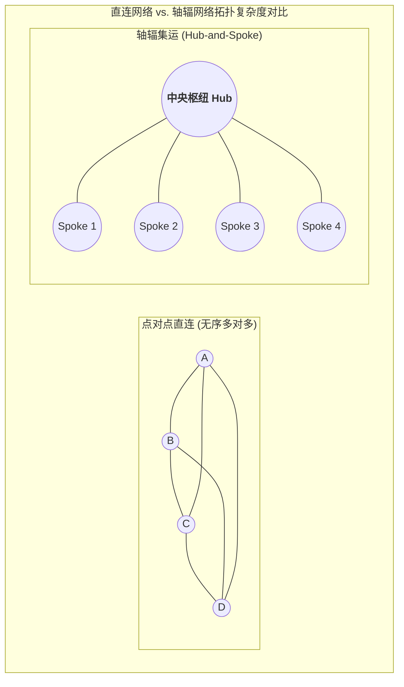
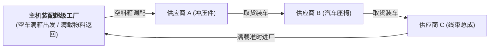

# Lec 21 运输管理 II：集运网络、越库作业与轴辐网络（Transportation II: Operational Network Analysis）

## TL;DR

- 突破点对点直连瓶颈：集运（Consolidation）的时空价值与轴辐网络（Hub-and-Spoke）拓扑优势。
- 零仓储库存中转奇迹：沃尔玛越库作业（Cross-Docking）的场地布局与车次节拍协同。
- 循环取货（Milk-Run）路由规划在汽车制造整车装配厂精益入厂物流中的工程落地。

## 一、点对点直运 vs. 轴辐集运网络拓扑

当物流网络包含 $N$ 个地理节点时，若采取两两点对点直连（Point-to-Point Direct Shipping）：
- 全网需要维持的单向运输线路数量高达 $\frac{N(N-1)}{2}$ 条；
- 在节点数量庞大（如 $N=50$）时，线路数将膨胀至 1225 条；
- 绝大多数小城市之间的货运流速极低，无法凑足整车（FTL），导致车辆严重轻载空跑，运价飞涨。

**轴辐式网络（Hub-and-Spoke Network）**由联邦快递（FedEx）创始人弗雷德·史密斯（Fred Smith）于 20 世纪 70 年代发扬光大，它通过设立一个或几个中央枢纽转运中心（Hub）：
- 线路总数急剧收敛压缩至 $N-1$ 条（即每个外围网点 Spoke 仅需开通一条直达 Hub 的双向干线）；
- 所有的外围零散件在白天发往 Hub，夜间在 Hub 内部利用高节拍自动化分拣机进行高速交叉重组，天亮前装入满载干线大车直飞目的地城市。

## 二、越库作业（Cross-Docking）的极速流转工程

**越库作业（Cross-Docking）**被誉为零售物流史上的最大技术突破之一。在传统仓库中，货物入库后经历：卸车 $\to$ 验货 $\to$ 叉车上高位货架存放数周 $\to$ 生成拣货单 $\to$ 下架拣选 $\to$ 包装复核 $\to$ 装车出库。

而在真正的越库中心，货物在库停留时间**严格控制在 24 至 48 小时以内，甚至实现“不过货架直接过桥”**：

::: definition [越库作业标准流程]
1. 入口卸货侧（Inbound Docks）：来自数百家供应商的集装箱整车到达卸货，托盘或纸箱被直接推送至传送带；
2. 自动化条码扫描与交叉分拣（Sorting Core）：动态地磅称重、光电扫描外箱二维码，系统毫秒级识别该箱物料归属的目标零售门店；
3. 出口装载侧（Outbound Docks）：高速输送机将货物直接滑入停靠在对侧对应门店的待发卡车车厢内，即装即走。
:::

越库作业彻底消除了传统仓储中的“上架暂存与拣选搬运”这两个最耗费人工且毫无增值意义的环节，使企业在享受上游整车采购规模经济的同时，实现了下游门店的按日精益小批量无缝补货。

## 三、精益入厂物流：循环取货（Milk-Run）算法

在丰田汽车与大型先进总装制造工厂中，厂区周边往往聚集着数十家一级零配件配套供应商。
如果每个供应商每天各自派一辆卡车给总装厂送货，不仅厂区门口道路将陷入彻底瘫痪，而且每个车队都极度轻载。

**循环取货（Milk-Run）**借鉴了传统奶农清晨派出一辆奶车沿村庄道路顺次收取各家鲜奶的经典智慧：

::: insight
Milk-Run 成功的关键不是单纯的路线规划，而是**时间窗与标准器具的精密吻合**：
1. **标准化循环器具**：全供应链强制推行通用折叠式料箱，运料车进厂卸下满箱零件的同时，必须原样等量载回相同尺寸的清洗合格空料箱；
2. **严苛的取货时间窗（Time Windows）**：货车到达每家供应商月台的时间精度控制在正负 5 分钟之内，超时未装好直接扣罚绩效。
这种高频穿梭物流让主机厂在车间线边仅需维持 2 到 4 小时的极低工序缓冲，达成惊艳世界的零库存精益制造。
:::

## 我的理解

集运、轴辐与越库是物流空间动力学的极致升华。它们共同向我们揭示了一个深刻哲理：物流绝不是孤立质点的随机游走，而是高度有序的系统脉动。轴辐网络用一次集中转运换来了全网维度的指数级收敛，越库作业用时间的极速压缩消灭了空间的静止浪费，而 Milk-Run 则把外部供应链变成了车间装配流水线的无形延伸。这是人类对效率极限永不停歇的优雅追求。
