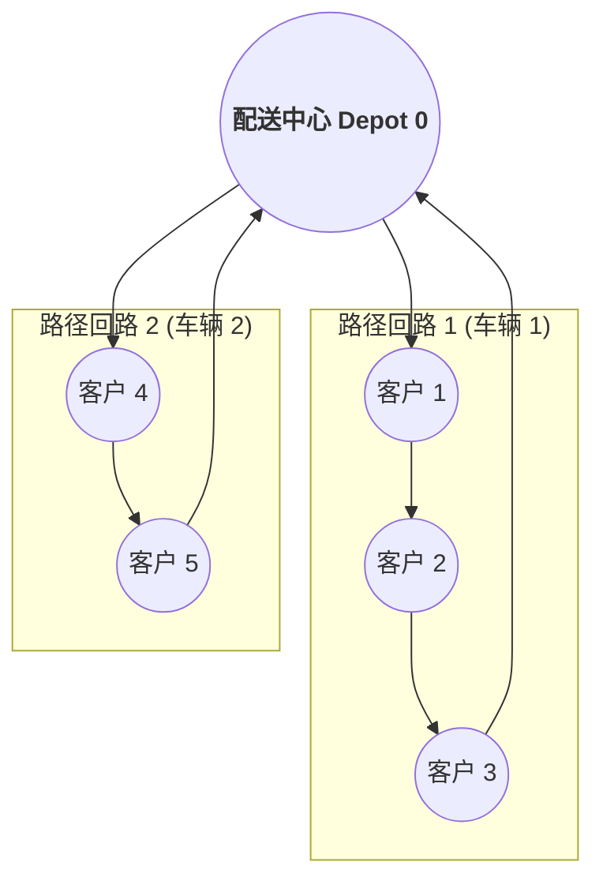

# Lec 22 运输管理 III：车辆路径规划 VRP 与节约启发式算法（Transportation III: Routing and Scheduling Approaches and Algorithms）

## TL;DR

- 最后一公里配送核心难题：旅行商问题（TSP）向有容量约束车辆路径规划（CVRP）的扩展。
- Clarke-Wright 节约算法（Savings Algorithm）的几何推导与贪心合并准则。
- 带时间窗限制（VRPTW）的大规模邻域搜索（ALNS）现代启发式求解架构。

## 一、车辆路径问题（Vehicle Routing Problem, VRP）数学模型

车辆路径问题是整个运筹学中最著名、商业应用最广泛的 NP-hard 组合优化难题之一。
在经典容量约束车辆路径问题（Capacitated VRP, CVRP）中：
- 设有一个唯一的中央物流配送站（Depot, 记为节点 0）；
- 拥有 $K$ 辆同质车队，每辆车的最大额定载重容量为 $C$；
- 需为 $N$ 个空间地理坐标已知、需求量为 $q_i$ 的客户提供配送服务；
- 目标是设计一组闭合的车辆巡游路径（每条路径从 Depot 出发，服务若干客户后返回 Depot），在满足客户需求且不超载的前提下，使**全车队行驶总里程或总行驶时间达到全局极小值**。

由于 VRP 包含了旅行商问题（TSP）作为特例，当客户节点数超过几百个时，精确算法（如分支切割定价法 Branch-Price-and-Cut）往往面临维数灾难，必须依赖精巧的启发式算法。

## 二、Clarke-Wright 节约算法（Savings Algorithm）

克拉克与赖特（Clarke & Wright）于 1964 年提出的节约算法是物流工业界最具实操价值的经典构造启发式算法。

### 1. 节约里程的几何推导
假设初始状态下，系统为每一个客户 $i$ 都单独派出专车进行点对点往返配送：
- 路径 1：$0 \to i \to 0$，行驶里程为 $2 c_{0i}$；
- 路径 2：$0 \to j \to 0$，行驶里程为 $2 c_{0j}$；
- 此时配送这两个客户的基准总行驶里程为：$Total_{init} = 2 c_{0i} + 2 c_{0j}$。

现在考虑将这两个客户合并到同一辆卡车的连续路径中：$0 \to i \to j \to 0$。
- 合并后的总行驶里程变为：$Total_{merged} = c_{0i} + c_{ij} + c_{0j}$。

::: theorem [Clarke-Wright 节约值公式]
将客户 $i$ 与客户 $j$ 合并在同一路径中，所能带来的净行驶里程节约量定义为：
$$s_{ij} = Total_{init} - Total_{merged} = (2 c_{0i} + 2 c_{0j}) - (c_{0i} + c_{ij} + c_{0j})$$
$$s_{ij} = c_{0i} + c_{0j} - c_{ij}$$
几何直觉清晰：**若客户 $i$ 与 $j$ 彼此距离极近（$c_{ij}$ 很小），而它们各自距离配送中心极远（$c_{0i}, c_{0j}$ 很大），则合并二者的节约价值 $s_{ij}$ 将呈现爆发性激增！**
:::

### 2. 算法执行四步曲
1. **构建节约值矩阵**：计算所有可能客户对 $(i, j)$ 之间的节约值 $s_{ij}$；
2. **全局降序排序**：将所有正节约值按照从大到小严格降序排列；
3. **贪心合法性合并**：从最大节约值开始遍历：
   - 检查客户 $i$ 与 $j$ 是否分别位于各自当前路径的末端边界（即能够直接相连且不产生回路分支）；
   - 检查合并后新路径的总载重是否满足车辆载重约束：$\sum q \le C$；
   - 若全部满足，则执行合并，用单条弧 $(i, j)$ 取代原先的两条回程弧；
4. **终止判决**：重复上述步骤直到所有候选节约弧遍历完毕，输出完整路径方案。

## 三、现实复杂约束：自适应大规模邻域搜索（ALNS）

在实际外卖即时送、快递同城派送与冷链配送中，还会面临严苛的**硬时间窗约束（Time Windows, VRPTW）**：客户要求必须在 $[e_i, l_i]$ 时间区间内送达，早到必须等待，迟到直接罚款。

现代求解器普遍采用**自适应大规模邻域搜索（Adaptive Large Neighborhood Search, ALNS）**元启发式框架：
- **破坏算子（Ruin / Destroy Operators）**：自适应随机或基于空间关联性从当前解中剔除 15% - 30% 的客户节点（如 Shaw 移除算子、最昂贵弧移除算子）；
- **修复算子（Recreate / Repair Operators）**：利用贪心插入、后悔度优先插入（Regret-k Heuristic）将未分配客户重新智能回填至各条路径中；
- **模拟退火准则（Simulated Annealing）**：以一定概率接受恶化解以跳出局部极值陷阱。

## 我的理解

路径规划算法是现代智慧物流体系的神经中枢。每一张外卖订单的高效送达、每一个顺丰包裹的准时入柜，背后都在数毫秒内经受着数以百万次的 VRP 运筹迭代。Clarke-Wright 算法展示了数学家如何用最质朴的几何洞察（“两条线不如一条折线”），在复杂的组合汪洋中开辟出一条优雅高效的捷径。懂得算法的边界与启发式的精髓，是让物流系统摆脱手工作坊、迈向自动化调度的核心蜕变。
