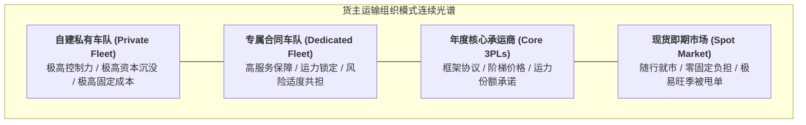

# Lec 23 运输管理 IV：货主视角与自营车队/第三方承运决策（Transportation IV: Shipper Perspective — Strategies and Approaches for Design and Management）

## TL;DR

- 制造与零售货主的战略抉择：自建重资产私有车队（Private Fleet）vs. 外部承运人。
- 核心资产专用性、服务可控度与沉没固定投资的交易成本经济学（TCE）剖析。",
- 第三方物流（3PL）与第四方物流（4PL）集成商的服务水平协议（SLA）绩效考核。

## 一、货主企业的核心关切与制造外包分歧

对于制造企业和大型零售品牌（如宜家、苹果、沃尔玛），运输不是企业的核心产品，而是支撑主营业务现金流运转的履约动脉。
在搭建运输网络时，货主企业（Shipper）面临根本性的**自做还是外购（Make-or-Buy）决策**：
- **自营车队（Private Fleet）**：由企业全资购置卡车车队、自聘专职司机，并自主开发调度车管系统；
- **专用合同承运（Dedicated Contract Carriage）**：与大型物流承运商签订 3 至 5 年独家排他合同，对方提供喷涂本企业 Logo 的专属车队；
- **公共承运人 / 货运网络平台（Common Carrier / Freight Brokerage）**：根据日常发运需求，按批次在零担或整车市场上竞价发标，按单结算。

## 二、交易成本经济学（TCE）下的决策框架

诺贝尔经济学奖得主奥利弗·威廉姆森（Oliver Williamson）的交易成本理论为这一决策提供了严密的解释框架：

::: definition [资产专用性（Asset Specificity）与自营边界]
1. **物理资产专用性**：如果运输需要极其特殊的非标装备（如零下 70 度超低温液氮冷链罐车、超限超重风电叶片专用承运拖车），通用市场上几乎没有现成可用车队，外部交易风险极高，此时企业倾向于**自建自营**；
2. **场地与时间专用性**：如果配送具有极强的时效紧迫性，一旦延误半小时即导致整条汽车焊装生产线全面瘫痪停工，外部第三方违约的外部性代价毁灭性巨大，必须保留**自营底线运力**；
3. **品牌心智专用性**：对于高端奢侈品或精密仪器，送货司机是企业与终端客户接触的唯一肉身界面，司机的礼仪培训与服务态度直接代表品牌形象，不可轻易转交外部粗放卡车司机。
:::

::: insight
最卓越的货主策略往往采取**“核心底线自营 + 峰值需求外包”的混合双轨制（Hybrid Fleet Strategy）**：
- 测算全年的基础底线运量（Base Volume），配置自营私有车队，保证这部分自有资产全年保持 100% 的极高利用率与极致满载；
- 面对节假日促销、双十一等季节性峰值需求激增（Spike Volume），则通过公开招标调动外部 3PL 与即期市场运力进行柔性吸收，避免自建车队在淡季大批闲置折旧。
:::

## 三、3PL 承运商全生命周期考核与 SLA 机制

当货主选择与第三方物流（3PL）合作时，必须通过严谨的**服务水平协议（Service Level Agreement, SLA）**与平衡计分卡防止服务失控：

| 考核核心维度 | 关键量化 KPI | 行业优秀基准 | 奖惩挂钩机制 |
| :--- | :--- | :--- | :--- |
| **时效履约率** | 准时交付率（On-Time Delivery, OTD） | $\ge 98.5\%$ | 延误超过 2 小时按比例扣减当单运费；月度低于 95% 扣罚保证金 |
| **货损货差控制** | 破损货损率（Damaged in Transit） | $\le 0.05\%$ | 照价全额赔偿，并承担下游客户由此产生的停工延误索赔 |
| **系统数据对接** | 轨迹状态节点回传及时率（EDI/API Tracking）| $\ge 99.0\%$ | 每日自动对账，未按时上传 GPS 轨迹者限制下一轮发货配额 |
| **旺季保供弹性** | 旺季额外运力响应满足率 | $\ge 95.0\%$ | 旺季保障奖励阶梯运费浮动分红；擅自甩单者永久踢出供应商池 |

## 我的理解

货主视角的运输管理，核心绝不仅仅是找几辆车拉货，而是**企业商业模式与外部生态关系的博弈平衡**。盲目追求 100% 自营是沉迷于控制欲的重资产毒药；而完全甩手依赖外部即期市场则是缺乏定力的自掘坟墓。高明的物流掌舵者深谙资本效率与履约弹性的中庸之道，用清晰的 SLA 规则与数据接口武装外部伙伴，在控制风险的同时最大化放大企业的资本运营杠杆。
