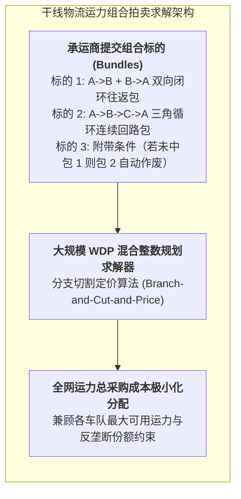

# Lec 24 运输管理 V：干线货运组合拍卖与承运商竞价（Transportation V: Procurement and Use of Combinatorial Auctions）

## TL;DR

- 大型跨国货主年度数十亿运力招标的痛点：传统单线寻源导致网络往返协同割裂。
- 组合拍卖胜者确定问题（WDP）的数学整数规划模型构建与分支定价求解。
- 引入承运商偏好与容量上限的非价格软约束运力优化分配落地方案。

## 一、传统干线货运招标的系统性失灵

在大型跨国制造和分销企业（如家得宝 Home Depot、宝洁 P&G）中，每年需要在全国或全球采购成百上千条公路货运车道（Lanes）的运力服务，涉及数以亿美元计的庞大预算。

在过去采用的传统单线路招标中：
- 货主将每一条独立的起讫点线路（如广州 $\to$ 武汉、武汉 $\to$ 北京）单独挂出来要求承运商报单价；
- 承运商在竞标时面临极其痛苦的**暴露风险（Exposure Problem）**：车队老板心里非常清楚，如果能同时拿到广州到武汉和武汉回广州的往返双向线路，他可以报出极低的地板价（如每公里 4 元）；但如果只中标了去程而空驶返回，每公里低于 7 元就会巨额亏本！
- 在无法打包竞标的恐惧下，承运商为了规避单边空驶风险，被迫在所有独立单线上都按照单程空驶的高价进行保守报价，最终导致货主支付了极为昂贵的总采购溢价。

## 二、组合拍卖胜者确定问题（WDP）数学模型

通过采用组合拍卖，承运商被允许自由提交条件报价包（Conditional Bundles）。

### 胜者确定问题（WDP）标准 0-1 整数规划
设企业需要采购的车道集合为 $L$。
共收到来自各承运商提交的投标包集合 $B$。
- 每个投标包 $j \in B$ 包含一个车道子集 $S_j \subseteq L$；
- 投标包 $j$ 的报价为 $p_j$；
- 参数 $a_{ij} = 1$ 若车道 $i \in S_j$，否则为 0；
- 决策变量 $x_j \in \{0, 1\}$ 表示是否接受第 $j$ 个投标包（$x_j = 1$ 表示中标）。

目标函数为最小化全网总采购支出：
$$\min \sum_{j \in B} p_j x_j$$
$$\text{s.t.} \quad \sum_{j \in B} a_{ij} x_j \ge 1, \quad \forall i \in L \quad (\text{每条车道必须至少被一个中标包完全覆盖})$$
$$x_j \in \{0, 1\}, \quad \forall j \in B$$

## 三、现实商业约束与运筹优化落地

如果纯粹按照上述简化的标准集合覆盖模型求解，求出的结果可能会在商业执行中遭遇灾难：
1. **单一承运商过度垄断集中风险**：算法可能为了省几十万元，将全网 70% 的核心运力分配给同一家超低价车队。一旦该车队资金链断裂或遭遇司机罢工，货主全国物流瞬间瘫痪；
2. **承运商数量上限约束**：与过多的零散个体车队对接会导致货主合同管理、对账和 IT 接口对接成本指数级飙升。

因此，现代组合采购系统必须嵌入深度的**商业规则约束（Business Constraints）**：
- **最大集中度红线**：任何单一承运商获得的业务总份额不得超过全网总预算的 25%；
- **承运商总数限制**：全网最终入选的中标承运商总数必须严格控制在 $K_{min}$ 到 $K_{max}$ 之间；
- **老供应商转换惩罚（Switching Costs）**：若将现有老供应商替换为新承运商，模型自动在目标函数中计入一笔固定切换成本（用于考核培训与初期磨合风险）。

::: example [跨国零售巨头的组合采购实战红利]
在麻省理工学院供应链前沿合作项目中，某大型跨国零售企业对全美 2500 条干线车道实施了组合运力拍卖。系统收集了 120 家物流企业提交的超过 40,000 个组合标的。通过运行商用 MILP 求解器，在严格满足“每条干线至少保留 2 家主备承运商”的业务约束下，最终比传统单线分散报价**净降低了 13.8% 的年度运力采购总支出，绝对金额节省超过 4500 万美元**！
:::

## 我的理解

干线运力组合拍卖是现代运筹学赋能战略采购的最高境界。它彻底打破了传统招投标中“买卖双方互相隐瞒、零和博弈”的死局。通过允许承运商用数学集合的形式表达自身运力网络的闭环互补性，系统巧妙地将外部庞杂的运力物理网络与货主自身的发运流向无缝咬合在了一起。这是算法创造真金白银商业价值的最生动注解。
