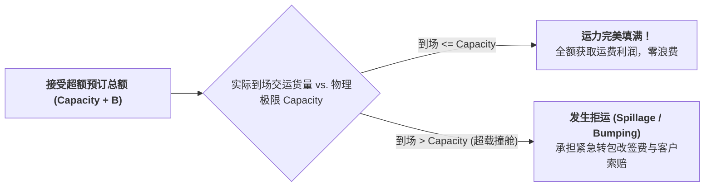

# Lec 25 运输管理 VI：承运商运营优化与运价收益管理（Transportation VI: Carrier Operations and Yield Management）

## TL;DR

- 承运商视角经营哲学：易腐运力资产、固定运力约束与边际变动成本结构。
- 收益管理（Yield Management）核心机制：超额预订（Overbooking）与多等级舱位分配。
- Littlewood 两舱位法则到 EMSRb 多舱位启发式动态运价控制推导。

## 一、承运商运营的核心经济学特征

在前面各讲中，我们大多站在制造和零售“货主（Shipper）”的视角审视物流；本讲我们将视角 180 度翻转，站在**承运商（Carrier）**——集装箱班轮公司（马士基、中远海运）、货运航空公司或干线重卡车队老板的角度，探讨如何通过运筹优化实现资产收益最大化。

承运商资产运营具有极其严苛的四个物理与经济特征：
1. **产能的极度易腐性（Perishability）**：一架货机一旦滑出跑道起飞，舱内没装满的任何一立方米空置容积，或者一列集装箱班列未挂满的空车皮，其潜在商业价值在轮子转动的瞬间**永久归零**，绝不可能存入仓库留到下周再卖；
2. **短期产能的绝对刚性（Fixed Capacity）**：在航次或班期敲定后，无法在几小时内随意拉长货轮或给机身焊装额外空间；
3. **巨大的固定成本与极微薄的边际成本**：开行一趟航班或班轮的燃油、折旧与机组成本极其高昂且相对固定，而多搭载一箱包裹的边际变动成本几乎微不足道；
4. **客户支付意愿（Willingness to Pay）的高度异质性**：计划周密的普通散货货主愿意提前两周订舱以换取低廉运费，而遭遇突发断供的高科技芯片客户则愿意支付 5 倍溢价要求当天立即锁舱插队。

## 二、超额预订（Overbooking）的风险中和模型

在货运实务中，客户预订舱位后因工厂生产延误、单证不全等原因导致最后时刻取消订舱或“爽约未到（No-Show）”的现象极其普遍（空运货运常见 15% - 25% 的 No-Show 率）。
承运商若按 100% 舱位老实接单，起飞时往往发现有两成舱位被白白浪费。

因此，承运商必须实施**超额预订（Overbooking）**：

设物理舱位上限为 $C$，超额接受订舱量为 $x$。
- 若第 $x+1$ 个货主最终爽约（概率为 $P(No-show)$），承运商多赚取净运费收入 $R$；
- 若第 $x+1$ 个货主如期到场导致物理爆舱（概率为 $1 - P(No-show)$），承运商必须支付高额的转运改签惩罚与商誉赔偿 $D$。
最优超额预订门槛恰好再次回归报童临界分位数准则：
$$P(\text{实际到货量} \le C) = \frac{D}{D + R}$$

## 三、舱位分配与收益管理法则（Littlewood Rule & EMSR）

假设一架全货机拥有固定载重容量 $C$。市场存在两类客户细分：
- **低价折扣舱（Class 2）**：运价为 $R_2$，提前数周早早到达，需求量巨大；
- **高价全价舱（Class 1）**：运价为 $R_1$（$R_1 > R_2$），多为紧急加急订单，在起飞前一两天才会临时出现，其需求为随机变量 $D_1$。

承运商面临两难：如果在早期把舱位全部低价卖给 Class 2，后期出现的高利润 Class 1 将无舱可用；但如果保留过多舱位等待 Class 1，一旦后期高端需求落空，飞机将带着空位升空。

::: theorem [利特尔伍德法则（Littlewood's Rule）]
应该保留给高价客户专用、拒绝向低价客户出售的保护舱位数（Protection Level, $y_1^*$）必须满足：
向低价客户多卖一个舱位的确切收益 $R_2$，恰好等于将其留给高价客户所能获得的期望边际收益：
$$R_2 = R_1 \cdot P(D_1 > y_1^*) \implies P(D_1 > y_1^*) = \frac{R_2}{R_1}$$
即：
$$F_1(y_1^*) = 1 - \frac{R_2}{R_1}$$
允许向低价客户开放销售的最大可用配额（Booking Limit）为：
$$BL_2 = C - y_1^*$$
:::

在面对多于两级舱位的复杂商业环境（如航空快递划分为 5 至 8 个优先等级），贝尔实验室的皮特·贝洛巴巴（Peter Belobaba）将其拓展为著名的**期望边际席位收益启发式算法（Expected Marginal Seat Revenue, EMSRb）**，通过将所有高等级舱位聚合为一个加权均值等效随机变量，实现多舱位保护水平的动态迭代刷新。

## 我的理解

收益管理被誉为“20 世纪现代商业运输领域最重要的微观经济学发明”。它完美诠释了数据与算法如何将一种物理上完全无差异的运力空间，重构成充满商业弹性的多维产品。通过概率统计与动态调价，承运商不再被动接受运价周期的残酷屠戮，而是在每一趟航班、每一个航次中把消费者的剩余价值榨取到极致。这是运筹学在市场经济中最耀眼的价值变现。
