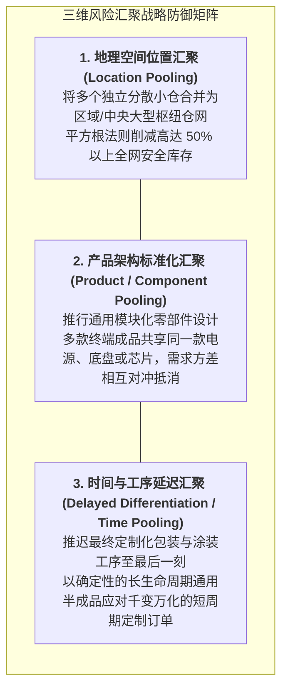

# Lec 26 风险汇聚策略、端到端集成与物流实践闭环（Risk Pooling Strategies and Approaches: Putting It All Together）

## TL;DR

- 全课程大总结：位置汇聚、产品汇聚与时间延迟汇聚的三维风险对冲框架。
- 全球化供应链的脆弱性与黑天鹅事件：从极致精益向战略弹性韧性的范式迁徙。
- 数字化控制塔（Supply Chain Control Tower）与端到端物流运筹实践终极闭环。

## 一、风险汇聚（Risk Pooling）的三维大一统理论

纵观麻省理工学院 15.770J 物流系统工程的全部知识大厦，对抗不可避免的随机波动与不确定性，其最强大的数学底座正是**风险汇聚理论（Risk Pooling Principle）**。

当多个随机变量之间不存在完全正相关（相关系数 $\rho < 1$）时，将它们的方差聚合，全系统综合变异系数必然显著收敛。在物流实践中，这一理论沿着三个维度全面铺开：

::: theorem [多元风险汇聚方差收敛通式]
设全网聚合了 $n$ 个独立且方差同为 $\sigma^2$ 的需求节点，若各节点间相关系数为 $\rho$，则总方差为：
$$\sigma_{total}^2 = n \sigma^2 + n(n-1)\rho \sigma^2$$
当且仅当 $\rho < 1$ 时，系统平均单节点的波动率 $\sigma_{total} / n$ 严格小于分散状态下的单一波动率 $\sigma$。若各区域呈负相关（$\rho < 0$），对冲减存效果更为惊人。
:::

## 二、从“极致精益”走向“抗逆韧性（Resilience）”

在过去三十年中，全球工业界曾对“零库存（Zero Inventory）”与“极致精益 JIT”顶礼膜拜。然而，随着近年来地缘政治冲突、苏伊士运河堵船、关键半导体晶圆断供等一系列全球黑天鹅事件爆发，过度追求薄弱单点成本的脆弱供应链遭遇了毁灭性打击。

现代物流系统架构正在发生深刻的范式迁徙：

| 评估维度 | 传统超精益供应链（Hyper-Lean） | 现代韧性鲁棒供应链（Resilient & Robust） |
| :--- | :--- | :--- |
| **首要目标** | 消除一切库存缓冲，极致压缩单件成本 | 保障全天候不间断业务连续性（BCP） |
| **寻源战略** | 全球单一低成本国家单源采购（Single Sourcing）| 关键物料双源 / 多源近岸混合布局（China + 1 / Near-shoring） |
| **库存定位** | 视为罪恶与浪费，力争消灭至零 | 视为战略期权，在咽喉节点配置精准缓冲 |
| **运力冗余** | 严格按平时运量配置，拒绝任何富余 | 预先储备弹性应急运力期权与替代路线方案 |
| **信息可见度**| 仅看直接一级供应商出厂数据 | 端到端全景穿透至三级/四级原材料源头 |

## 三、数字化物流控制塔（Control Tower）与系统闭环

所有前述的预测算法、库存模型、网络拓扑与路径调度，最终必须汇聚于现代企业的**数字化供应链控制塔（Supply Chain Control Tower）**：

1. **实时在途感知（Real-time Visibility）**：通过 IoT 传感器、海运 AIS 船舶定位与公路车机 GPS，实时追踪全球数以万计集装箱的实时经纬度与温湿度状态；
2. **数字孪生仿真推演（Digital Twin Simulation）**：当某港口发生罢工时，系统在数分钟内自动完成 MILP 重排仿真，评估受波及的订单货值，并向调度员推荐备选绕行港口；
3. **自主闭环调度（Autonomous Execution）**：常规的补货发单、VRP 派车与组合拍卖由算法自动与承运商 API 直连交互完成，人类专家仅聚焦于处理极度异常的战略危机事件。

## 我的理解

回顾 MIT 15.770J 的全景征程，物流系统工程是一门将数学的冷峻美感与现实商业血肉完美融合的艺术。我们从最基础的供需不确定性起步，穿越了时间序列与巴斯扩散的预测迷宫，推导了 EOQ、报童模型与 MEIO 的深刻权衡，构建了 MILP 设施选址与 VRP 路径规划的庞大网络，最终在契约博弈与风险汇聚的终局中完成了商业闭环。

物流世界从不承认永恒的静态平衡，每一秒都有新的包裹在流动，每一天都有新的意外在发生。真正的物流大师，心中有一张清晰的全网拓扑，手中有严密的概率运筹算法，眼中更有对人性与商业生态的深刻敬畏。在这张庞大而精密的全球网络中，用理性战胜混沌，用协同消除摩擦，正是这门学科赋予我们最崇高的智慧力量。
