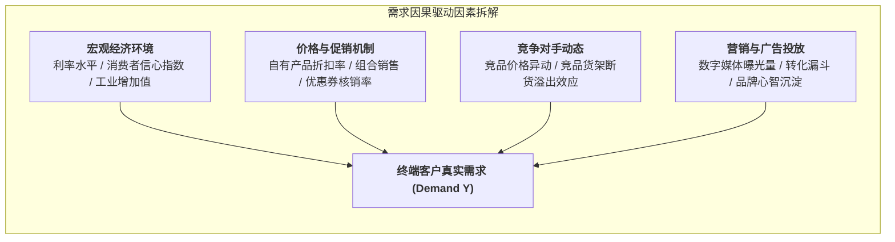

# Lec 4 需求预测 II：因果分析与多元回归（Demand Forecasting II: Causal Analysis）

## TL;DR

- 跳出历史自变量闭环：识别驱动终端消费的核心宏观与微观经济学因果解释变量。
- 多元线性回归模型构建：普通最小二乘法（OLS）参数估计与多重共线性（VIF）检验。
- 促销弹性、交叉价格弹性与广告投放滞后效应的非线性因果关系建模。

## 一、时间序列预测的局限与因果建模的跃迁

时间序列方法假定未来的模式完全是过去历史模式的惯性延续。然而，在现实商业环境中，需求往往受到外部环境与主动营销策略的剧烈扰动：
- 某品类下周开展降价 20% 限时大促，销量必定成倍激增；
- 竞争对手突然推出革命性新品，导致本品牌常规型号需求骤降；
- 宏观经济指标（如利率、房地产新开工面积、居民可支配收入）对大型家电或卡车运力需求的长期牵引。

在上述情境下，仅看历史销量的时间序列模型完全“失明”。必须采用**因果预测模型（Causal Models）**，将需求 $Y$ 建模为一组驱动变量 $X_1, X_2, \dots, X_k$ 的函数。

## 二、多元线性回归与参数估计

经典多元线性回归方程表述为：
$$Y_i = \beta_0 + \beta_1 X_{1i} + \beta_2 X_{2i} + \dots + \beta_k X_{ki} + \epsilon_i$$
其中 $\beta_j$ 代表在其他所有解释变量保持不变的条件下，第 $j$ 个变量变动一个单位对需求带来的边际影响。

普通最小二乘法（Ordinary Least Squares, OLS）通过最小化残差平方和（Sum of Squared Errors, SSE）求解最佳系数向量 $\hat{\boldsymbol{\beta}}$：
$$\min_{\boldsymbol{\beta}} \sum_{i=1}^n (Y_i - \hat{Y}_i)^2 \implies \hat{\boldsymbol{\beta}} = (\mathbf{X}^T \mathbf{X})^{-1} \mathbf{X}^T \mathbf{Y}$$

## 三、模型诊断与计量经济学检验

构建因果回归模型绝非简单地把尽可能多的变量塞入统计软件，必须经过严谨的统计学检验：

::: definition [判定系数（Coefficient of Determination, $R^2$）与调整 $R^2$]
$$R^2 = 1 - \frac{\sum (Y_i - \hat{Y}_i)^2}{\sum (Y_i - \bar{Y})^2} = 1 - \frac{SSE}{SST}$$
调整后的判定系数惩罚了无脑增加多余变量的行为：
$$R_{adj}^2 = 1 - \left( \frac{SSE / (n - k - 1)}{SST / (n - 1)} \right)$$
:::

::: pitfall [多重共线性（Multicollinearity）陷阱]
当两个或多个解释变量之间存在高度线性相关（例如同时将“总广告费”和“电视广告费”作为自变量）时，$(\mathbf{X}^T \mathbf{X})$ 矩阵将趋近于奇异矩阵，导致求逆极其不稳定，计算出的回归系数方差奇大，甚至出现系数正负号与经济学常识截然相反的荒谬结果。
必须通过**方差膨胀因子（Variance Inflation Factor, VIF）**进行诊断：
$$VIF_j = \frac{1}{1 - R_j^2}$$
通常若 $VIF_j > 5$ 或 $10$，表明存在严重共线性，必须剔除冗余变量或采用主成分回归（PCA）降维！
:::

## 四、非线性弹性与分布滞后模型

需求对价格的响应往往具有乘数非线性特征，即恒定价格弹性（Constant Elasticity）：
$$Q = A \cdot P^\eta \implies \ln Q = \ln A + \eta \cdot \ln P$$
在双对数变换模型中，回归系数 $\eta$ 直接等于经济学中的需求价格弹性：价格每变动 1%，销量变动 $\eta\%$。

此外，营销投放通常存在**滞后衰减效应（Adstock Decay Effect）**：
$$X_{t}^{effective} = X_t + \lambda X_{t-1} + \lambda^2 X_{t-2} + \dots$$
参数 $\lambda \in [0, 1)$ 反映了品牌广告在消费者记忆中存留的半衰期。将有效转化暴露量代入因果回归，才能真实反映营销战役对中长期物流出货节奏的脉冲驱动。

## 我的理解

因果预测之所以比单纯的时间序列平滑更具战略价值，是因为它赋予了运营管理者“主动推演”的能力。在商业博弈中，我们不仅想知道“下周需求大概是多少”，更需要知道“如果我们将价格上调 5%，全网物流中心会积压多少库存”或者“当对手发起补贴战时，我们需要准备多少应急转运运力”。因果回归将抽象的经济学逻辑量化为物流系统调度的硬核参数，是高阶供应链系统不可或缺的推演中枢。
