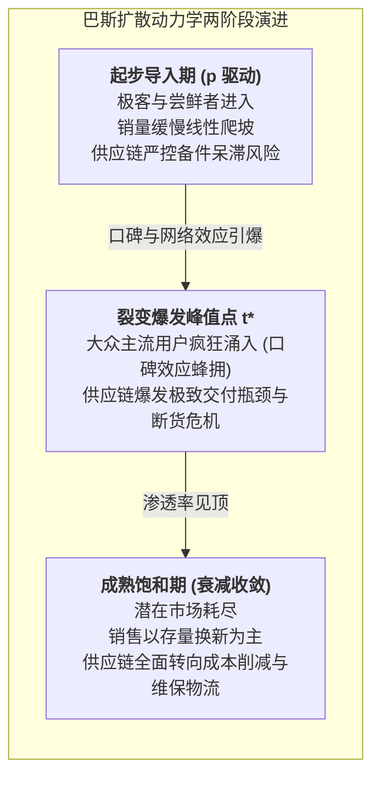

# Lec 5 需求预测 III：新产品预测与巴斯扩散模型（Demand Forecasting III: New Product Forecasting）

## TL;DR

- 零历史数据场景下的破局之道：德尔菲法、类比分析法与巴斯创新扩散数学模型。
- 创新者系数 $p$ 与模仿者系数 $q$ 的参数标定，推导 S 型普及曲线与销量峰值拐点。",
- 跨越鸿沟理论在早期高科技物流网络产能爬坡与断货风险控制中的实战运用。

## 一、新产品上市（NPI）预测的零数据困境

对于全新进入市场颠覆性产品（如初代 iPhone、商用人形机器人、新型电动汽车），企业在上市前面临残酷的“数据虚无”状态——没有过往的销售记录，没有客户复购率统计，甚至没有直接的同类竞品可供参考。

然而，物流与供应链体系却必须在新产品发布前数月甚至一年做出沉重的不可逆资本决策：
- 必须向芯片晶圆代工厂预定数以百万计的产能配额；
- 必须租赁多少万平米的温控分拣仓储空间；
- 必须在全国各级网点铺设多少第一批展机与样机库存。

如果仅凭直觉乐观预测，一旦上市遇冷，巨量专用半成品将化为乌有；如果过于悲观保守，产品上市即被抢光断货，白白错失黄金窗口期，将市场拱手让给快速跟进的竞品。

## 二、巴斯创新扩散模型（Bass Diffusion Model）的数理推导

弗兰克·巴斯（Frank Bass）于 1969 年提出的扩散模型，是高科技产品生命周期预测的经典殿堂级工具。该模型将潜在市场采纳者划分为两类核心人群：
1. **创新者（Innovators）**：独立做出购买决策，不受群体已有购买行为影响，受创新系数 $p$（Coefficient of Innovation）驱动；
2. **模仿者（Imitation / Followers）**：通过口碑（Word of Mouth）、社交证明与同行示范效应做出购买决策，受模仿系数 $q$（Coefficient of Imitation）驱动。

::: theorem [巴斯扩散微分方程]
设潜在市场总容量为 $m$，截至时间 $t$ 时的累计采纳人数为 $N(t)$，尚未采纳的潜在客户数为 $m - N(t)$。在时间 $t$ 的瞬间采纳率 $f(t) / [1 - F(t)]$ 满足：
$$\frac{dN(t)}{dt} = n(t) = \left[ p + \frac{q}{m} N(t) \right] [m - N(t)]$$
其中：
- $n(t)$ 为 $t$ 时刻的当期新销售量；
- $N(t) = \int_0^t n(u) du$ 为累计销售总量。
:::

对该一阶常微分方程求解，可得著名的 S 型累计采纳曲线与倒 U 型当期销量曲线解析解：
$$N(t) = m \cdot \frac{1 - e^{-(p+q)t}}{1 + \frac{q}{p} e^{-(p+q)t}}$$
$$n(t) = m \cdot \frac{p(p+q)^2 e^{-(p+q)t}}{[p + q e^{-(p+q)t}]^2}$$

### 销量峰值时刻与峰值销量推导
通过令 $\frac{dn(t)}{dt} = 0$，可以精确求得销量达到最高峰值（Peak Sales）的关键时刻 $t^*$ 以及峰值销量 $n^*$：
$$t^* = \frac{1}{p+q} \ln\left( \frac{q}{p} \right)$$
$$n^* = n(t^*) = m \cdot \frac{(p+q)^2}{4q}$$
当 $q > p$ 时，峰值时刻 $t^* > 0$，市场必然出现爆发性激增高峰。通常在高科技消费品中，$p$ 的均值约为 0.03，而 $q$ 的均值分布在 0.3 到 0.5 之间。

## 三、跨越鸿沟与产能阶梯式爬坡策略

杰弗里·摩尔（Geoffrey Moore）在《跨越鸿沟》中指出，创新者与实用主义大众客户之间存在一条致命的断层深渊。反映在物流供应链上，很多初创产品在 $p$ 驱动的极客期表现良好，但产能爬坡刚刚耗尽资金，订单却在鸿沟期突然停滞断流。

::: insight
对于新产品上市的供应链配置，严禁在第一天就按照峰值销量 $n^*$ 建设庞大的重资产自有工厂和仓网。明智的战略是：
1. **前期（导入期）**：高溢价租用 EMS 代工厂柔性产线与第三方物流（3PL）共享云仓，保留高响应度与敏捷叫停权；
2. **中期（突破鸿沟迎来 $t^*$ 时）**：果断启动第二备用源，锁定关键长交期元器件（Long Lead Time Parts），实施整车空运优先保供抢占市场；
3. **成熟期**：全面切换至低成本海运集运与自有中央分发网络，摊薄固定运营成本。
:::

## 我的理解

巴斯模型的美妙之处在于它用极简的数学形式揭示了人类社会行为的传播本质。它告诉我们，新产品爆发从不是线性发生的，而是由先锋引领向群体羊群效应突变的非线性跃迁过程。对于物流规划者，理解 $t^*$ 峰值时刻何时到来，比盲目追求单月的预测数字重要得多。它让企业在风暴来临前精准锁死供应商的长周期产能，避免在黎明前夕因供应链断裂而抱憾出局。
