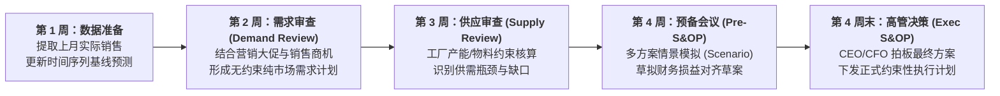

# Lec 6 需求预测 IV：S&OP 产销协同计划与协同预测（Demand Forecasting IV: Connections to Planning and Management）

## TL;DR

- 从孤立预测到组织协同：产销协同计划（S&OP）五步闭环治理流程详解。
- 消除组织间利益冲突：销售乐观冲指标与生产悲观控成本的系统博弈化解。",
- 跨企业协同计划、预测与补货（CPFR）机制在端到端供应链中的落地实践。

## 一、孤岛式计划（Silo Planning）的灾难

在缺乏成熟产销协同机制的企业中，各部门往往运行在各自的“独立平行宇宙”中：
- **销售部（Sales）**：为了确保年末拿到绩效奖金，倾向于向供应链提报极度夸大的预测数字（以便工厂生产足够多的货，防止客户要货时断货）；或者在季度初隐瞒真实商机、季度末集中暴量下单冲刺；
- **制造工厂（Manufacturing）**：深刻了解销售预测水分巨大，于是私下打个七折安排排产，并且只愿意以最经济的超大批量连续换模生产，完全不顾实际库存品类结构；
- **财务部（Finance）**：只关心期末现金流和存货资产负债表，在季度末突然强行叫停所有采购付款，导致生产线缺料停产；
- **物流部门（Logistics）**：天天被迫处理突如其来的紧急加急调拨，运输预算严重超支，同时仓库被滞销大宗货塞得水泄不通。

这种部门割裂导致的结果是：客户投诉率居高不下，库存总金额创历史新高，企业利润被巨额内耗彻底吞噬。

## 二、标准 S&OP 月度五步闭环治理体系

**销售与运营规划（Sales and Operations Planning, S&OP）**是一个由企业最高管理层牵头、跨部门月度循环执行的战术决策流程，其核心目标是达成全公司唯一的“一套数字（One Set of Numbers）”：

::: definition [无约束需求计划 vs. 约束性供应计划]
- **无约束需求（Unconstrained Demand）**：销售团队不考虑任何原材料短缺或产能限制，纯粹从真实市场容量角度评估能够卖出的商品总量；
- **约束性计划（Constrained Plan）**：将无约束需求输入线性规划排产求解器，加入工厂工时上限、外协供应商物料产能、关键干线运输配额等现实约束后，计算出的全系统实际可行产销承诺。
:::

## 三、跨企业协同：CPFR 框架落地

当协同机制从企业内部扩展到上下游战略伙伴（如沃尔玛与宝洁、苹果与富士康）之间时，便演变为**协同计划、预测与补货（Collaborative Planning, Forecasting, and Replenishment, CPFR）**：

1. **确立前端协议（Front-End Agreement）**：明确双方共享的数据范围（POS 机扫描数据、在途库存透明度）、目标服务水准、KPI 考核与保密违约条款；
2. **联合商业计划（Joint Business Plan）**：对齐未来一年双方的品类大促档期、新店开业扩张节奏与联合减排目标；
3. **异常例外管理（Exception Management）**：设定自动监控阈值（如当零售商的实际订单与供应商系统预测偏差超过 15% 时触发报警），双方计划员在 24 小时内召开联合会商排除异常。

::: example
宝洁与沃尔玛早期实施 CPFR 试点时，双方打通了 EDI 专线。沃尔玛门店每扫描卖出一瓶海飞丝洗发水，数据实时直达宝洁工厂的排产系统。宝洁依据实时消费速率直接接管沃尔玛配送中心的补货决策（供应商管理库存 VMI）。结果使沃尔玛的宝洁产品库存天数缩短了 30% 以上，断货率降低近一半，而宝洁自身的产线换模稳定度提升了 40%。
:::

## 我的理解

S&OP 本质上不是一个数学算法，而是一套**组织博弈治理机制**。在现代复杂商业组织中，各部门天然存在局部利益最大化的私心。S&OP 的伟大之处在于用制度化的仪式感与跨部门穿透的数据流，把销售、供应链和财务绑在同一张损益表（P&L）前。它迫使所有人不再互相甩锅推诿，而是在有限的资源边界下共同做出对企业整体股东价值最有利的权衡取舍。
